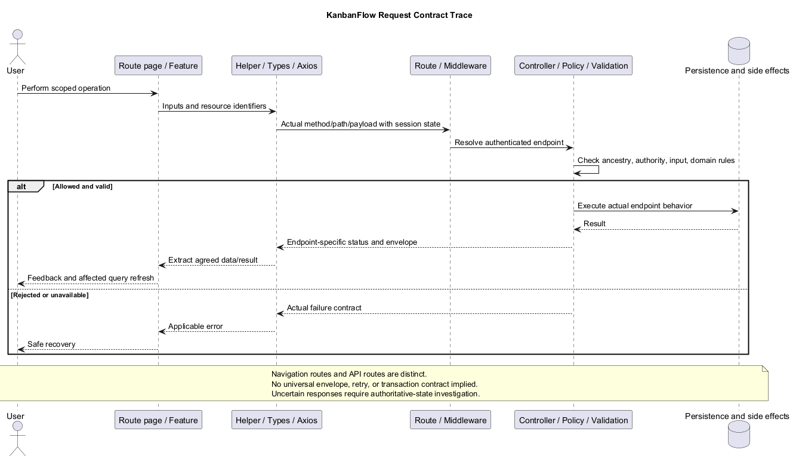
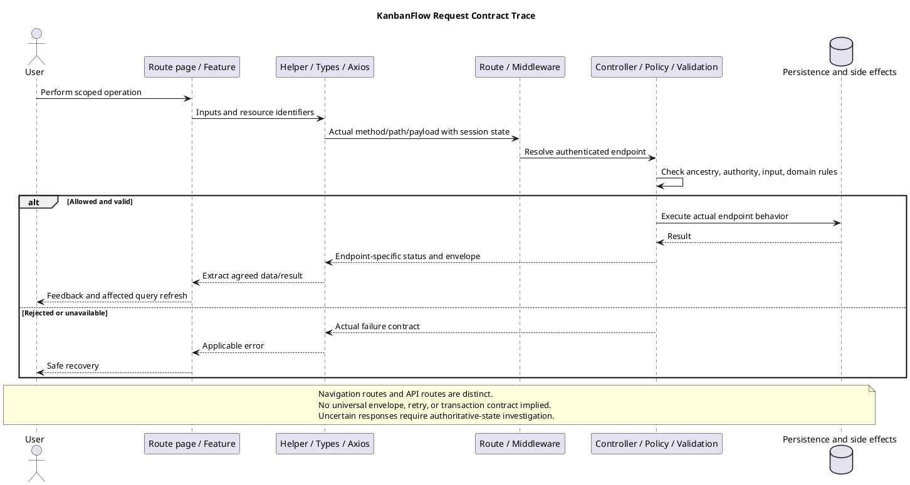

# KanbanFlow Route and Request Contracts

> **Policy amendment (2026-10-10):** Membership mutations are now owner-only; DEC-003/PB-001's bypass is fixed. Current guidance below reflects this rule; historical records retain their original scope. See [QA corrections](../06-testing/qa-corrections-2026-10-10.md) for the selected rule and regression evidence.

## Scope and design

Frontend navigation routes are declared in `frontend/src/App.tsx`. Backend auth routes are in `backend/routes/web.php`; API routes in `backend/routes/api.php` expose nested workspace/project/board/column/task/comment resources and relevant move endpoints.

For a contract, record method, path, actor, ancestry, accepted fields, validation, response shape, failure behavior, and side effects. Derive these from route/controller/client code. A route declaration alone does not establish response details or authorization correctness.

The configured client expects JSON and uses credentials/XSRF state. Verify identifier mismatches, invalid input, unauthenticated/unauthorized calls, and compatibility after a contract change. New password, file, PDF, or public-sharing contracts remain proposals.

## Route layers and transport

Frontend navigation and HTTP API paths are different interfaces. `App.tsx` defines home, login/register, dashboard, and workspace/project/board pages. Feature helpers build server requests independently; there is no implied task detail page merely because a task API route exists.

`frontend/src/api/client.ts` requires `VITE_API_URL` and uses JSON headers, credentials, and the XSRF cookie/header pair. Auth helpers request `/sanctum/csrf-cookie` before login/register/logout. The base URL must agree with the helper paths and deployed origin configuration; do not append an extra `/api` to a base already used with `/api/...` helpers without checking the resulting URL.

The current browser flow is session-based. Route registration and TypeScript types alone do not establish actual request success, response compatibility, or deployed middleware behavior.

## Authentication and health contracts

| Method/path | Boundary | Response observed in source |
| --- | --- | --- |
| GET `/sanctum/csrf-cookie` | Framework session/CSRF initialization used by client | Client awaits cookie initialization; does not read a resource envelope |
| POST `/register` | Guest route; name/email/confirmed password validation | Message and user, 201 on accepted registration |
| POST `/login` | Guest route and `throttle:login`; email/password/remember | Message and user on accepted login; invalid credentials use validation failure |
| POST `/logout` | Authenticated web route | Message; server invalidates session/regenerates token |
| GET `/api/user` | `auth:sanctum` | User directly, not `{ data: user }` |
| GET `/api/health` | Outside authenticated API group | Status and configured application name, not dependency diagnostics |

No password-change/recovery, attachment, PDF, download, or public-share endpoint is established in the inspected route set. Their design documents remain proposals.

## Nested resource catalog

Use the following path prefixes with actual identifiers:

```text
W = /api/workspaces/{workspace}
P = W/projects/{project}
B = P/boards/{board}
C = B/columns/{column}
T = C/tasks/{task}
Comment = T/comments/{comment}
```

| Collection | Item prefix | Declared resource operations |
| --- | --- | --- |
| `/api/workspaces` | W | GET list, POST create; GET item, PUT/PATCH update, DELETE item |
| `W/projects` | P | Same API-resource pattern |
| `P/boards` | B | Same API-resource pattern |
| `B/columns` | C | Same API-resource pattern |
| `C/tasks` | T | Same API-resource pattern |
| `T/comments` | Comment | Same API-resource pattern |

These describe backend `apiResource` declarations, not a claim that every operation has a corresponding client helper or page. Current workspace update helper uses PUT; task/comment/column update helpers inspected here use PATCH. Validate omitted versus null field behavior against the actual controller, irrespective of verb.

Parent identifiers must describe the same resource chain. Board/task/column movement also requires reviewing destination ancestry; individually valid IDs do not establish access. Refer to the [authorization flow](authorization-decision-flow.md) for operation-specific rules rather than assigning a blanket manager permission to all resources.

## Movement and secondary endpoints

| Method/path | Contract focus |
| --- | --- |
| PATCH `B/move` | Separate board movement request; inspect destination/position fields and project authority |
| PATCH `C/move` | Separate column movement request and position validation |
| PATCH `T/move` | Client uses source column in path and payload `{ column_id, position }` for destination/order |
| GET `W/members` | Workspace-scoped membership response |
| POST `W/members` | Add-member input; owner-only `manageMembers` boundary |
| PATCH `W/members/{user}` | Direct role update; owner-only authority |
| DELETE `W/members/{user}` | Owner-only removal; owner/current membership protections apply |
| GET `W/analytics`, `W/activities` | Helpers send filter parameters; inspect actual filter validation, scope, and response |
| GET `/api/notifications` | Helper sends optional limit/unread_only filters and returns full list response |
| GET `/api/notifications/unread-count` | Helper reads `data.unread_count` |
| PATCH `/api/notifications/read-all` | Mark all read; helper discards message response |
| PATCH `/api/notifications/{notification}/read` | Returns notification inside data envelope |
| DELETE `/api/notifications/{notification}` | Actual recipient-scoped delete contract; client returns void |

Normal board/column/task updates prohibit position input in inspected controllers; use the move endpoint. Do not infer shared pagination, maximum limits, recipient authority, or aggregate visibility solely from a query type. Membership additions, removals, and role changes are owner-only under DEC-003/PB-001; the 2026-10-10 correction closes the manager remove/re-add bypass.

## Request and response ownership

| Contract element | Authoritative evidence |
| --- | --- |
| Method/path and middleware | Backend route plus selected client helper |
| Resource binding/ancestry | Controller checks and actual binding configuration |
| Actor/visibility/operation | Invoked policies, model scope, and controller conditions |
| Accepted fields/nullability | Request validation and domain helper path, not model fillable alone |
| Response envelope/relations | Controller JSON and client extraction/types |
| Side effects/transaction | Actual persistence, logger/notification invocation, and lock boundaries |
| Feedback/cache freshness | Feature mutation/query handlers and guard behavior |

Inspected task/workspace list helpers read `{ data: [...] }`; resource helpers commonly unwrap `response.data.data` from item envelopes with an optional message. Auth/current-user and notification list/count patterns differ. Do not introduce a universal envelope or claim delete responses are 204: several controllers return JSON messages while helpers discard them.

TypeScript interfaces do not perform runtime validation by themselves. Document actual field casts, optional values, dates, relation loading, and IDs needed by consumers when changing an endpoint. Keep secrets and internal configuration out of serialized output.

## Failures and consistency

Record actual endpoint codes and payloads. Inspect unauthenticated, unauthorized, ancestry mismatch, invalid input, domain rejection, throttle, server failure, and no-response cases separately. Task update/delete include a locked stale-column check with 409; that does not establish version/conflict detection for all updates.

For denied or invalid mutations, verify final state rather than trusting feedback. For a lost response, establish authoritative outcome before retrying; mutation retries disabled in client defaults do not make manual repetition idempotent. A success response followed by a failed query refresh is distinct from a rejected server write.

Route guards improve navigation but API checks enforce access. Lists, analytics, activities, and notifications need their own scope verification to prevent disclosure through secondary responses. See [error handling](error-handling-design.md) for user recovery and evidence boundaries.

## Contract record template

```text
Requirement and candidate commit:
Client helper/types/component and backend route/controller:
Method, actual URL/base origin, and middleware:
Actor, operation, resource chain, and destination scope:
Accepted fields, omission/null semantics, filters, and constraints:
Success status/body/envelope/relations consumed:
Failure statuses/body and actual frontend recovery:
Persistence, side effects, transaction, and retry implications:
Query invalidations and derived views affected:
Compatibility/migration consequences:
Positive/negative checks, environment, results, and gaps:
```

## Acceptance and maintenance

Verify actual URL/method/payload, success extraction, omitted/null/invalid fields, allowed/denied actors, mismatched ancestry/destination, session/CSRF behavior, response serialization, side effects, and derived query refresh. Include movement/WIP/stale-task and relevant MySQL contention scenarios when those contracts change.

Use isolated data and [verification records](../../Releases/verification-template.md). Record candidate/environment and observed request/response/persisted results, redacting credentials and private content. This document adds source-based guidance, not a fresh runtime contract test or a deployed API specification.

Update route declarations, helpers/types, consuming components, relevant tests, and documentation together for a contract change. Cross-check [update sequence](resume-update-sequence-diagram.md), [deletion sequence](resume-deletion-sequence-diagram.md), [components](component-diagram.md), [authentication](authentication-and-authorization.md), and [schema](schema-reference.md). Keep unsupported capability routes explicitly proposed.

## Review and evidence

Record the candidate commit, actor, environment, affected source paths, proposed change, observed checks, and remaining questions. Link implementation and acceptance evidence; keep untested behavior explicit. This document adds no application feature or newly executed security/behavior test.

## Related guidance

- [Design catalog](README.md)
- [Requirements](../02-requirements/README.md)
- [Analysis](../03-analysis/README.md)
- [Decision register](../../Project-Management/decision-register.md)
- [Verification record](../../Releases/verification-template.md)
- [Diagram guide](../../diagram-guide.md)

## PlantUML diagram



[Editable PlantUML source](diagrams/route-and-request-contracts.puml)


