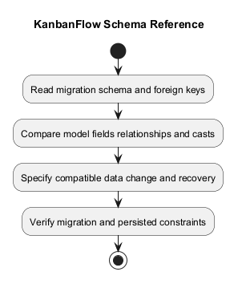
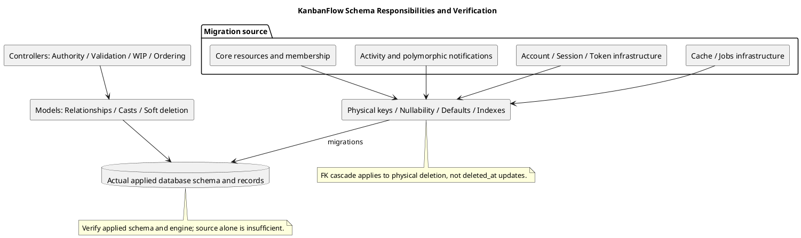

# KanbanFlow Schema Reference

> **Policy amendment (2026-10-10):** Membership mutations are now owner-only; DEC-003/PB-001's bypass is fixed. Current guidance below reflects this rule; historical records retain their original scope. See [QA corrections](../06-testing/qa-corrections-2026-10-10.md) for the selected rule and regression evidence.

## Scope and design

Migrations under `backend/database/migrations` are the source for physical schema. Core tables include users, workspaces, workspace_user, projects, boards, columns, tasks, task_comments, activity_logs, and notifications; framework migrations also provide cache/jobs/token infrastructure.

Task model fields include column_id, created_by, assigned_to, title, description, priority, position, due_date, and completed_at. The model casts dates and positions and uses SoftDeletes. Model fillable fields do not constitute the full schema or a permission contract.

For changes, record exact column types/defaults, keys/indexes, nullability, existing-row handling, forward migration, and recovery evidence. Distinguish schema rollback from restored data. Inspect the actual database environment when testing concurrency or constraints.

## Source and notation

This reference summarizes `backend/database/migrations` at the inspected candidate. It is not a dump of an actual deployed database. Verify applied migrations and effective engine/schema before claiming runtime parity.

`string` means the migration's string declaration (default framework length unless specified); `id` and `foreignId` describe Laravel declarations rather than a universal cross-engine SQL type. `?` below marks nullable fields. `timestamps` adds created_at/updated_at; `softDeletes` adds nullable deleted_at. Engine-specific SQL, collation, timezone, index behavior, and foreign-key enforcement require environment evidence.

## Domain column catalog

| Table | Keys and data columns | Defaults / lifecycle |
| --- | --- | --- |
| `workspaces` | id; owner_id FK users; name/slug strings; description text?; logo_path string?; visibility string | visibility private; timestamps; softDeletes |
| `workspace_user` | id; workspace_id/user_id FKs; role string | role member; timestamps; no softDeletes |
| `projects` | id; workspace_id/created_by FKs; name/slug/status strings; description text?; start_date/due_date date? | status active; timestamps; softDeletes |
| `boards` | id; project_id/created_by FKs; name/slug/visibility strings; description text?; position unsignedInteger | visibility workspace; position 0; timestamps; softDeletes |
| `columns` | id; board_id FK; name string; position unsignedInteger; wip_limit unsignedInteger? | position 0; timestamps; softDeletes |
| `tasks` | id; column_id/created_by FKs; assigned_to nullable FK; title/priority strings; description text?; position unsignedInteger; due_date date?; completed_at timestamp? | priority medium; position 0; timestamps; softDeletes |
| `task_comments` | id; task_id/user_id FKs; body text | timestamps; softDeletes |
| `activity_logs` | id; workspace_id FK; user_id nullable FK; action/subject_type string(100); subject_id unsignedBigInteger?; subject_name string; properties JSON? | timestamps; no softDeletes |
| `notifications` | UUID id PK; type string; notifiable polymorphic pair; data text; read_at timestamp? | timestamps; no softDeletes |

Required foreign keys above are non-null unless explicitly marked. `created_by` and `assigned_to` reference users. Activity subject_id is metadata, not a declared subject foreign key. Notifications use a polymorphic recipient pair, not a declared users foreign key.

## Unique constraints and explicit indexes

| Table | Unique constraint | Explicit nonunique indexes in source |
| --- | --- | --- |
| workspaces | slug | owner_id; visibility |
| workspace_user | workspace_id + user_id | role |
| projects | workspace_id + slug | workspace_id + status |
| boards | project_id + slug | project_id + position |
| columns | None beyond primary key | board_id + position |
| tasks | None beyond primary key | column_id + position; assigned_to + due_date |
| task_comments | None beyond primary key | task_id + created_at |
| activity_logs | None beyond primary key | workspace_id + created_at; subject_type + subject_id |
| notifications | UUID primary key | Polymorphic pair index generated by morphs |

Foreign keys and framework macros may produce additional engine/framework indexes; this table lists explicit application declarations and noted macro behavior, not a full inspected SQL index listing. Parent/position indexes are not unique position constraints. Soft deletion leaves physically present rows subject to existing unique constraints.

## Physical foreign-key delete actions

| Relationship | Declared action |
| --- | --- |
| users → workspaces through owner_id | Cascade |
| workspace/user → workspace_user | Cascade for both keys |
| workspace → projects; users → projects through created_by | Cascade |
| project → boards; users → boards through created_by | Cascade |
| board → columns | Cascade |
| column → tasks; users → tasks through created_by | Cascade |
| users → tasks through assigned_to | Set null |
| task/user → task_comments | Cascade |
| workspace → activity_logs | Cascade |
| users → activity_logs through user_id | Set null |

These actions apply to physical deletion under effective database constraints. Updating deleted_at does not trigger them. A row with a set-null relationship can still disappear through a different cascade path. Review user-deletion blast radius before introducing account deletion; creator/owner references can cascade beyond attribution.

No physical FK is declared for activity subject_id, notification recipient morphs, or session user_id in the inspected migrations. Do not infer automatic cleanup or enforced ownership for these references.

## Account and infrastructure schema

| Table | Selected definitions and constraints | Capability limit |
| --- | --- | --- |
| users | id; name/email/password strings; unique email; email_verified_at timestamp?; rememberToken; timestamps | Verification timestamp does not prove an email-verification workflow |
| password_reset_tokens | email string PK; token string; created_at timestamp? | Table presence does not establish a recovery endpoint/delivery |
| sessions | string id PK; user_id nullable indexed foreignId without constrained FK; ip_address string(45)?; user_agent text?; payload longText; last_activity integer indexed | Runtime session driver/settings must be checked separately |
| personal_access_tokens | id; tokenable morphs; name text; unique token string(64); abilities text?; last_used_at timestamp?; expires_at timestamp? indexed; timestamps | Does not establish an exposed token issuance workflow |
| cache | string key PK; value mediumText; expiration bigInteger indexed | Presence does not prove selected cache driver |
| cache_locks | string key PK; owner string; expiration bigInteger indexed | Not evidence of domain row locking semantics |
| jobs | id; queue string indexed; payload longText; attempts unsignedSmallInteger; reserved_at unsignedInteger?; available_at/created_at unsignedInteger | Does not establish a PDF/export/cleanup pipeline |
| job_batches | string id PK/name; total/pending/failed counts integer; failed_job_ids longText; options mediumText?; cancelled_at/finished_at integer?; created_at integer | Actual batching behavior requires implementation evidence |
| failed_jobs | id; unique uuid string; connection/queue strings; payload/exception longText; failed_at timestamp useCurrent | Explicit index connection + queue + failed_at; diagnostic content may be sensitive |

Infrastructure tables contain sensitive credential/session/diagnostic material. Do not include row payloads, hashes, or tokens in documentation examples or shared check evidence.

## Schema versus application invariants

Role/status/priority/visibility columns are strings with defaults, not declared database enum/CHECK constraints in these migrations. Allowed endpoint values and transitions depend on validation and policy/controller behavior. A valid user FK does not ensure a task assignee is a workspace member.

WIP limit nullability/type does not implement active-task counting. Position indexes do not ensure contiguous ordering. Date columns do not enforce the project's date-order rule. A logo_path string does not implement uploads, and notification storage does not establish email/SMS or streaming.

Model casts, fillable fields, JSON serialization, and endpoint accepted fields have different responsibilities. Cross-check the model and selected API contract instead of equating schema availability with client authority. Membership additions, removals, and role changes are owner-only under DEC-003/PB-001; the 2026-10-10 correction closes the manager remove/re-add bypass.

## Migration change and verification record

For a change, record candidate commit, actual engine/version/configuration, applied migration state, affected tables/rows, old/new definition, backfill plan, uniqueness/nullability conflicts, API compatibility, and recovery procedure. Review existing data before adding restrictive keys or changing cascades.

| Scenario | Evidence required |
| --- | --- |
| Schema baseline | Applied migrations and actual table/key/index definitions in the selected environment |
| Unique/null/foreign-key constraints | Isolated accepted/rejected rows and final state |
| Soft versus physical deletion | Selected and descendant rows/relationships checked separately |
| Set-null/polymorphic references | Actual nulling and application cleanup/access behavior |
| Forward migration with existing data | Before/after schema and records, conflicts/backfill, and compatibility |
| Migration failure/recovery | Actual final schema/data and verified recovery, not assumed atomic DDL |
| Ordering/WIP/concurrency | Application path plus relevant MySQL final-state evidence |
| API serialization | Fields/casts/relations consumed without exposing secrets |

Several down methods drop tables; this reverses schema creation but does not restore dropped data. Source rollback and database restoration are separate. Do not run destructive validation on production records. SQLite-only tests do not establish MySQL DDL, foreign-key, collation, or contention equivalence.

This document reports source inspection and proposed verification criteria, not a newly executed database migration or audit. Use [verification records](../../Releases/verification-template.md) and retain actual limitations.

## Related views and maintenance

Use [data model/ERD](data-model-and-erd.md) for key relationships, [request contracts](route-and-request-contracts.md) for exposed fields, [data lifecycle](../03-analysis/data-classification-and-lifecycle.md) for privacy/deletion, and [update](resume-update-sequence-diagram.md)/[deletion](resume-deletion-sequence-diagram.md) sequences for operation behavior.

Update this reference after migration changes and preserve the distinction between migration source and applied runtime state. The diagram is a schema-responsibility map, not a complete SQL schema dump.

## Review and evidence

Record the candidate commit, actor, environment, affected source paths, proposed change, observed checks, and remaining questions. Link implementation and acceptance evidence; keep untested behavior explicit. This document adds no application feature or newly executed security/behavior test.

## Related guidance

- [Design catalog](README.md)
- [Requirements](../02-requirements/README.md)
- [Analysis](../03-analysis/README.md)
- [Decision register](../../Project-Management/decision-register.md)
- [Verification record](../../Releases/verification-template.md)
- [Diagram guide](../../diagram-guide.md)

## PlantUML diagram

[Editable PlantUML source](diagrams/schema-reference.puml)

