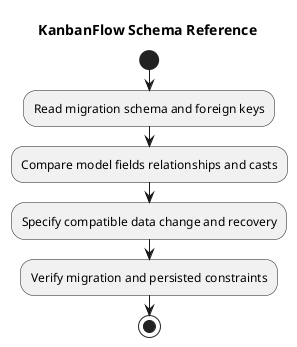

# KanbanFlow Schema Reference

## Scope and design

Migrations under `backend/database/migrations` are the source for physical schema. Core tables include users, workspaces, workspace_user, projects, boards, columns, tasks, task_comments, activity_logs, and notifications; framework migrations also provide cache/jobs/token infrastructure.

Task model fields include column_id, created_by, assigned_to, title, description, priority, position, due_date, and completed_at. The model casts dates and positions and uses SoftDeletes. Model fillable fields do not constitute the full schema or a permission contract.

For changes, record exact column types/defaults, keys/indexes, nullability, existing-row handling, forward migration, and recovery evidence. Distinguish schema rollback from restored data. Inspect the actual database environment when testing concurrency or constraints.

## Review and evidence

Record the candidate commit, actor, environment, affected source paths, proposed change, observed checks, and remaining questions. Link implementation and acceptance evidence; keep untested behavior explicit. This document adds no application feature or newly executed security/behavior test.

## Related guidance

- [Design catalog](README.md)
- [Requirements](../02-requirements/README.md)
- [Analysis](../03-analysis/README.md)
- [Decision register](../../Project-Management/decision-register.md)
- [Verification record](../../Releases/verification-template.md)
- [Diagram guide](../../diagram-guide.md)

## PlantUML diagram

[Editable PlantUML source](diagrams/schema-reference.puml)

