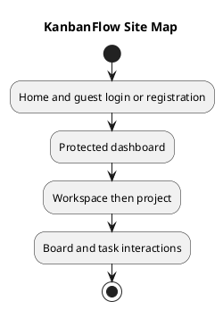

# KanbanFlow Site Map

## Scope and design

The application has home `/`, guest `/login` and `/register`, protected `/dashboard`, workspace `/workspaces/:workspaceId`, project `/workspaces/:workspaceId/projects/:projectId`, and board `/workspaces/:workspaceId/projects/:projectId/boards/:boardId` routes. A catch-all shows the not-found page.

Workspace/project/board pages provide the resource hierarchy; task interactions are not evidence of a dedicated task URL. ProtectedRoute and GuestRoute govern frontend navigation, while backend checks enforce resource access.

Review direct navigation, invalid identifiers, session expiry, back links, breadcrumbs, loading, and not-found behavior. Public share, profile/password, résumé, and export pages are not established in the inspected route set.

## Review and evidence

Record the candidate commit, actor, environment, affected source paths, proposed change, observed checks, and remaining questions. Link implementation and acceptance evidence; keep untested behavior explicit. This document adds no application feature or newly executed security/behavior test.

## Related guidance

- [Design catalog](README.md)
- [Requirements](../02-requirements/README.md)
- [Analysis](../03-analysis/README.md)
- [Decision register](../../Project-Management/decision-register.md)
- [Verification record](../../Releases/verification-template.md)
- [Diagram guide](../../diagram-guide.md)

## PlantUML diagram

[Editable PlantUML source](diagrams/site-map.puml)

