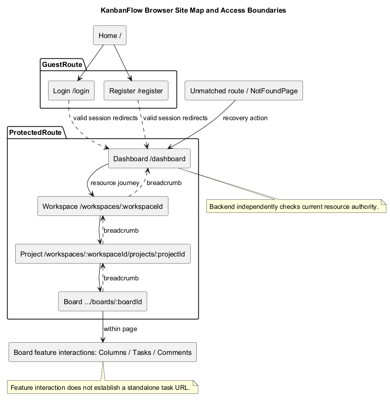
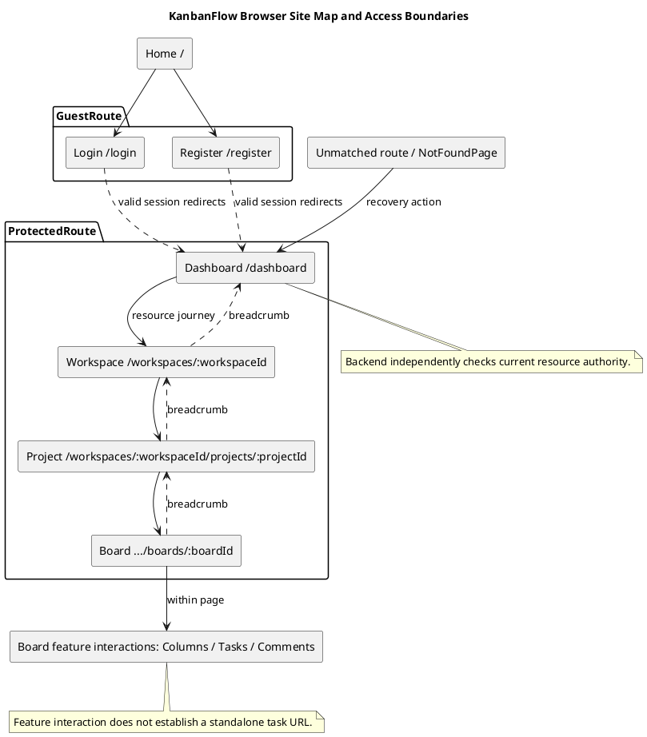

# KanbanFlow Site Map

## Scope and design

The application has home `/`, guest `/login` and `/register`, protected `/dashboard`, workspace `/workspaces/:workspaceId`, project `/workspaces/:workspaceId/projects/:projectId`, and board `/workspaces/:workspaceId/projects/:projectId/boards/:boardId` routes. A catch-all shows the not-found page.

Workspace/project/board pages provide the resource hierarchy; task interactions are not evidence of a dedicated task URL. ProtectedRoute and GuestRoute govern frontend navigation, while backend checks enforce resource access.

Review direct navigation, invalid identifiers, session expiry, back links, breadcrumbs, loading, and not-found behavior. Public share, profile/password, résumé, and export pages are not established in the inspected route set.

## Route inventory

`frontend/src/App.tsx` is the route source; `main.tsx` composes BrowserRouter and providers. Paths below are browser navigation paths, not backend API endpoints.

| Path | Page/component | Access/navigation boundary |
| --- | --- | --- |
| `/` | HomePage | Public entry; shell shows sign-in/get-started navigation |
| `/login` | LoginPage | GuestRoute resolves session before showing guest form |
| `/register` | RegisterPage | GuestRoute resolves session before showing guest form |
| `/dashboard` | DashboardPage | ProtectedRoute; workspace overview/entry |
| `/workspaces/:workspaceId` | WorkspacePage | ProtectedRoute; workspace context and project journey |
| `/workspaces/:workspaceId/projects/:projectId` | ProjectPage | ProtectedRoute; project context and board journey |
| `/workspaces/:workspaceId/projects/:projectId/boards/:boardId` | BoardPage | ProtectedRoute; board, columns, and task interactions |
| `*` | NotFoundPage | Unmatched browser route; action links to dashboard |

Tasks, comments, membership, analytics, and notifications have feature/API interactions without necessarily having standalone pages. No task/comment/profile/password/download/PDF/share/resume URL is established by this route set.

## Navigation hierarchy and shared shell

The main resource journey follows dashboard → workspace → project → board. The shell offers Workspaces navigation on non-public paths and a brand link to dashboard; on home/login/register it offers sign-in/get-started and a brand link to home.

`AppShell.tsx` derives workspace/project breadcrumb context from path segments and numeric identifier checks. Breadcrumbs link back to dashboard, workspace, and project where applicable and mark current context. These labels are generic resource labels, not proof that the selected resource exists or access is permitted.

The shell sets document titles from route context, includes a skip-to-content link, and provides Light/Dark/System selection. Page content is composed under the shell with lazy-route Suspense and the error boundary. Review actual page back links separately; browser history, breadcrumbs, and page actions have different destinations.

## Session and resource states

| Situation | Current source behavior / review requirement |
| --- | --- |
| Protected page session pending | ProtectedRoute shows loading before rendering its Outlet |
| Protected session query fails | Redirects to login for any query error, including possible connection/server failure |
| Guest page with valid session | GuestRoute redirects to dashboard |
| Guest session lookup returns Axios 401 | GuestRoute renders login/register content |
| Other guest lookup failure | Connection error state with retry; not silently assumed logged out |
| Page data unavailable or denied | Review actual page/feature query behavior; frontend route match is not proof of a valid resource |
| Unmatched frontend path | NotFoundPage; distinct from a backend resource 404/403 |
| Lazy page or rendering failure | Suspense/error boundary behavior; no unsaved-work preservation implied |

Resource API authorization remains independent of session navigation. Current workspace membership, private-board visibility, operation authority, and matching nested identifiers must be evaluated server-side. A well-formed URL or visible breadcrumb cannot grant access.

## Direct navigation and deployment assumptions

Verify copying/opening a resource URL, refreshing a nested page, and using browser back/forward. BrowserRouter navigation needs an appropriate server fallback for frontend paths in the actual hosting configuration; source route declarations do not prove that deployed refresh works.

Distinguish frontend origin/path configuration from `VITE_API_URL`. Opening a page must not accidentally serve the backend API or duplicate its prefix. Invalid, nonnumeric, mismatched, deleted, and unauthorized resource identifiers need actual page/API evidence; AppShell's numeric checks only affect shell context.

No return-to-original-page-after-login contract is established here. Inspect actual login navigation before promising it. No public board access is implied by board visibility workspace or workspace visibility metadata.

## Interaction and accessibility review

Check landmarks, skip-link destination/focus, main navigation, breadcrumb names/current-page indication, page headings/titles, and keyboard operation. Review focus after navigation, pending/error announcements, and meaningful recovery links rather than assuming shared markup proves full accessibility.

Inspect representative home/auth/dashboard/resource pages in light/dark/system modes and narrow layouts. Read-only metadata should remain distinguishable from editable controls. Theme persistence and tab synchronization do not establish cross-device account preferences.

When adding a route, define its audience, source page, nested identifiers, navigation/back links, loading/empty/error states, and server authority. Update shell titles/breadcrumbs and request contracts as affected; do not infer a new capability from adding a site-map node.

## Acceptance matrix

| Scenario | Evidence required |
| --- | --- |
| Guest home/login/register journey | Actual entry links, session lookup outcomes, and destination behavior |
| Authenticated visitor to guest pages | Dashboard redirect and usable resource navigation |
| Direct protected URL without session | Actual loading/redirect and API denial; no private data leakage |
| Direct authorized resource URL | Correct resource/parent context, page data, breadcrumbs, and back destinations |
| Removed member/private board | Resource-specific safe denial/recovery despite route match |
| Invalid/mismatched/deleted identifiers | Actual page/API outcomes and no unrelated resource disclosure |
| Nested refresh/back/forward | Actual hosting fallback, route resolution, and correct restored context |
| Backend unavailable | ProtectedRoute and GuestRoute behavior recorded separately |
| Unknown browser URL | NotFoundPage and its dashboard action, with resulting session behavior |
| Lazy/render failure | Loading/fallback readability and actual recovery consequences |
| Keyboard/themes/narrow layout | Skip-link focus, links, breadcrumbs, headings, theme control, and feedback |
| New route, if added | Navigation, title, identifiers, API authority, and relevant documentation agree |

Use isolated accounts/resources and [verification records](../../Releases/verification-template.md). Record candidate commit, browser/frontend/backend origins, actor/session state, starting path, steps, visible result, API observations, and remaining gaps. This guide documents source and criteria, not newly executed browser or deployment checks.

## Maintenance and related views

Update the map after routes, session guards, shell context, resource hierarchy, or navigation actions change. Keep unsupported future sharing, account, and artifact pages marked proposed until actually implemented and verified.

Cross-check [public access](public-access-sequence-diagram.md), [authentication](authentication-and-authorization.md), [authorization flow](authorization-decision-flow.md), [request contracts](route-and-request-contracts.md), [UI/accessibility](ui-and-accessibility-design.md), and [error handling](error-handling-design.md).

## Review and evidence

Record the candidate commit, actor, environment, affected source paths, proposed change, observed checks, and remaining questions. Link implementation and acceptance evidence; keep untested behavior explicit. This document adds no application feature or newly executed security/behavior test.

## Related guidance

- [Design catalog](README.md)
- [Requirements](../02-requirements/README.md)
- [Analysis](../03-analysis/README.md)
- [Decision register](../../Project-Management/decision-register.md)
- [Verification record](../../Releases/verification-template.md)
- [Diagram guide](../../diagram-guide.md)

## PlantUML diagram

[Editable PlantUML source](diagrams/site-map.puml)

