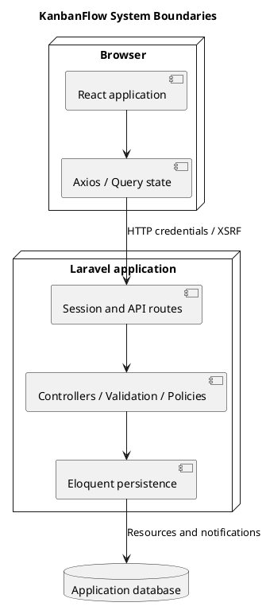

# KanbanFlow System Architecture Diagram

## Scope and design

KanbanFlow uses a React/TypeScript frontend with Vite, shared theme/layout/UI components, API helpers, and query state. A Laravel backend handles session authentication, API controllers, policies, validation, Eloquent persistence, and database notifications.

The browser crosses a configured HTTP session/API boundary; Laravel crosses the database boundary. MySQL is the relevant production-style contention target in existing project guidance. Local SQLite checks do not prove MySQL locking behavior. Database notifications do not establish email delivery or real-time streaming.

Document concrete deployment origins, runtime versions, cookie/security settings, backups, and recovery separately. Repository components are not evidence that those operational arrangements have been deployed or verified.

## Review and evidence

Record the candidate commit, actor, environment, affected source paths, proposed change, observed checks, and remaining questions. Link implementation and acceptance evidence; keep untested behavior explicit. This document adds no application feature or newly executed security/behavior test.

## Related guidance

- [Design catalog](README.md)
- [Requirements](../02-requirements/README.md)
- [Analysis](../03-analysis/README.md)
- [Decision register](../../Project-Management/decision-register.md)
- [Verification record](../../Releases/verification-template.md)
- [Diagram guide](../../diagram-guide.md)

## PlantUML diagram

[Editable PlantUML source](diagrams/system-architecture-diagram.puml)

