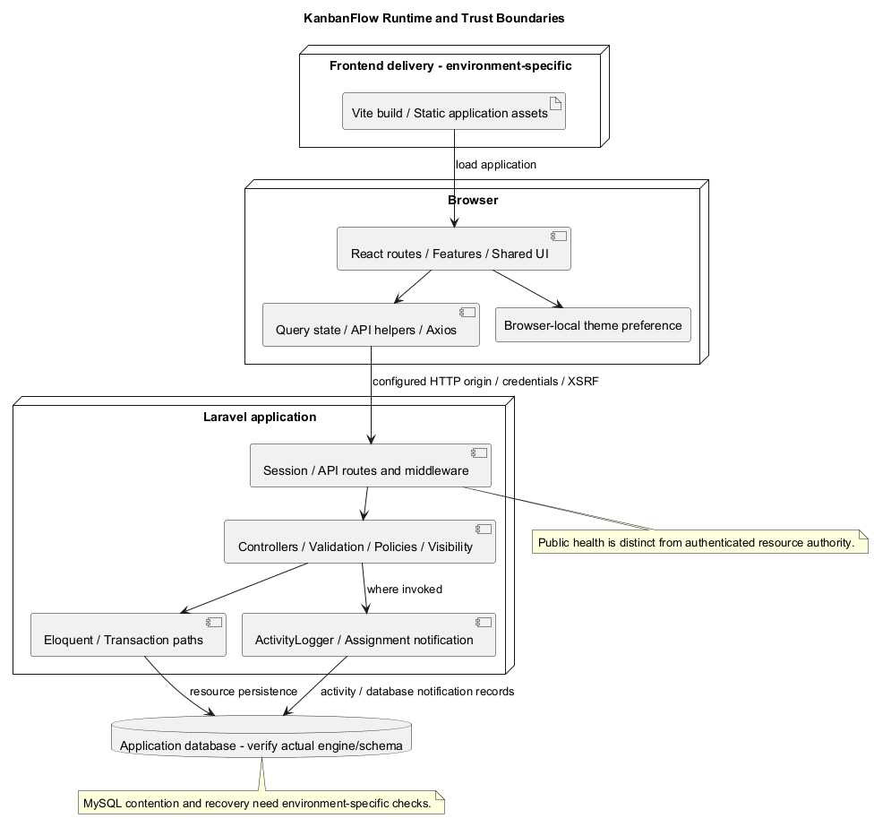
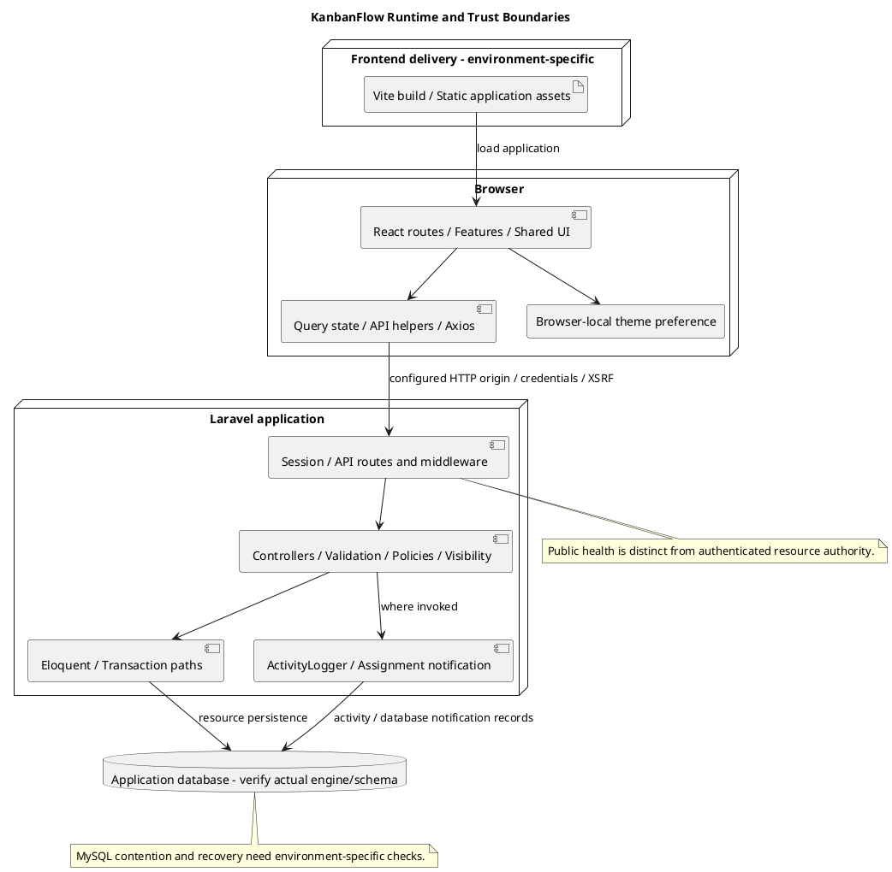

# KanbanFlow System Architecture Diagram

## Scope and design

KanbanFlow uses a React/TypeScript frontend with Vite, shared theme/layout/UI components, API helpers, and query state. A Laravel backend handles session authentication, API controllers, policies, validation, Eloquent persistence, and database notifications.

The browser crosses a configured HTTP session/API boundary; Laravel crosses the database boundary. MySQL is the relevant production-style contention target in existing project guidance. Local SQLite checks do not prove MySQL locking behavior. Database notifications do not establish email delivery or real-time streaming.

Document concrete deployment origins, runtime versions, cookie/security settings, backups, and recovery separately. Repository components are not evidence that those operational arrangements have been deployed or verified.

## Runtime responsibilities

| Boundary | Current responsibility | Evidence / limit |
| --- | --- | --- |
| Browser application | React pages/features, routing, query state, theme, forms and task interactions | `frontend/src/main.tsx`, `App.tsx`, components/features; browser state is not persisted authority |
| Frontend build/static delivery | TypeScript/Vite produces the application bundle | Frontend scripts/configuration; hosting origin, SPA fallback, and production server are environment-specific |
| HTTP session/API | Axios requests JSON with credentials/XSRF; Laravel exposes auth and resource endpoints | Client helpers and backend routes; no client bearer-token issuance workflow established |
| Server behavior | Identity, ancestry, policies/visibility, validation, domain rules, transaction paths, response serialization | Selected controllers/models/policies; declarations alone do not prove every path is correct |
| Persistence | Resource hierarchy, membership, activity and notification records | Migrations/models; actual database engine and applied schema require runtime evidence |
| Side effects | ActivityLogger and assignment database notifications where invoked | Concrete service/helper/channel source; no universal event bus, email, or streaming contract implied |

These boundaries describe the existing frontend plus Laravel application, not independently deployed microservices. `docker/` presence, job/cache tables, storage configuration, and development commands do not establish deployed container, worker, cloud-storage, or export services.

## Representative request and state flow

1. The browser loads the frontend and composes router, query, and theme providers.
2. Session lookup/auth helpers use the configured backend origin; auth mutations initialize CSRF state and the server establishes or invalidates a session.
3. A feature operation sends the actual nested resource path/payload. Authentication is followed by endpoint-specific ancestry, visibility/authority, input, and domain checks.
4. Models/controller transaction paths persist the accepted result. Logging/notification side effects occur where actually invoked.
5. JSON returns to the helper/component; affected queries are invalidated/refetched according to that interaction's code.
6. Verification compares visible results with authoritative persisted state, including denied and uncertain outcomes.

The core persisted hierarchy is workspace → project → board → column → task → comment, with separate membership/actor relationships. Query cache and browser-local theme preference are different state types: theme synchronization between tabs does not establish account-wide preferences, while query refresh does not establish real-time synchronization.

## Trust and authorization boundaries

Do not trust client role values, resource identifiers, cached content, or hidden buttons as permission. The server must evaluate current actor and the selected endpoint's actual authority and ancestry. Private visibility must cover secondary lists, aggregates, activity, and notification responses as applicable.

Board mutations are not all authorized through the same policy invocation: board update/delete controllers use project authority, while task/column paths use board authority. Trace actual endpoints instead of inferring a universal board rule from a component diagram. DEC-003/PB-001 membership remove/re-add authority remains unresolved.

Configuration and serialization are also boundaries. Keep credentials, sessions, tokens, private data, and operational diagnostics out of public responses and shared evidence. The public health endpoint reports status/application name; it is not a complete dependency-health or readiness probe.

## Environment and deployment record

| Concern | Required actual evidence |
| --- | --- |
| Candidate | Delivered commit/tag, installed dependencies, and relevant check results |
| Frontend origin | Served bundle, base path, nested-route fallback, API URL, and browser connectivity |
| Backend runtime | Effective PHP/framework/runtime configuration and web/API entry handling |
| Session/origin | Stateful origin/middleware, cookie domain/security/SameSite/lifetime, and CSRF behavior |
| Database | Engine/version, connection, applied migrations, constraints, and relevant contention behavior |
| Cache/session/job stores | Effective driver/configuration; tables alone do not prove active use |
| Storage | Effective disks/access/paths; no current attachment delivery contract inferred |
| Recovery | Consistent backups, actual restore result, migration handling, and rollback limits |

Manifests/lockfiles and CI describe source constraints/resolved inputs/check environments, not a universal support matrix. The inspected CI uses PHP 8.4 with SQLite support and Node 24; its configured checks are backend tests plus frontend lint/build. A CI declaration is not proof of its latest result, production deployment, MySQL contention, or browser usability.

No external service, deployment, or dependency change is selected by this document. Record material hosting/runtime changes through the decision and release process.

## Integrity, failures, and recovery

| Failure boundary | Architecture review focus |
| --- | --- |
| Frontend rendering/loading | Actual fallback and navigation, unsaved-input consequences, and readable keyboard/theme behavior |
| Session lookup/backend unavailable | Distinguish current protected/guest guard recovery; connection failure is not necessarily credential expiry |
| Authorization/input rejection | Safe feedback, absence of protected/invalid mutation, and relevant persisted state |
| Transaction/concurrency | Actual locks/stale-parent/WIP/ordering rules and final database state |
| Response lost after write | Establish authoritative outcome before retry; no universal exactly-once guarantee |
| Derived-state refresh fails | Separate accepted persistence from stale/error query views |
| Activity/notification failure | Actual call timing and transactional consequences; no blanket cross-store atomicity claim |
| Migration/delete/recovery | Soft versus physical behavior, cascade/null actions, and data restoration evidence |

Source rollback does not restore deleted rows or revoke already copied data. Soft deletion does not trigger physical cascades or establish retention/erasure policy. Any new external delivery/storage boundary needs explicit partial-failure and cleanup design.

## Architecture verification matrix

| Scenario | Evidence to record |
| --- | --- |
| Frontend/backend connectivity | Actual origins, configured URL, request paths, session/CSRF, and browser results |
| Resource journey | Authorized dashboard/workspace/project/board/task interactions and persisted results |
| Direct denial/private data | Unauthenticated, unrelated/removed actors, mismatched ancestry, and secondary response scope |
| Mutation integrity | Actual input/WIP/order/assignment/completion cases with database final state |
| Relevant MySQL contention | Competing operations, rejection/rollback, locks, and final invariants; SQLite alone insufficient |
| Activity/notifications | Actual invocation, recipient/read scope, serialized content, and client freshness |
| Nested navigation/reload | Effective hosting fallback, routing, guards, and error recovery |
| Migration/backup restore | Applied schema/data, verified recovery, and explicit irreversible consequences |
| Shared UI | Representative themes, keyboard/focus, narrow layout, and failure feedback |

Use isolated records and [verification evidence](../../Releases/verification-template.md). Record candidate/environment and checks actually performed; this document supplies source-based architecture guidance and criteria, not new application tests or deployment confirmation.

## Extension boundaries and maintenance

PDF rendering, file attachments/downloads, public resource sharing, password change/recovery, saved drafts/offline editing, and streaming updates are not established capabilities. Their design proposals require concrete scope, contracts, authority, lifecycle, and actual implementation evidence.

Update this architecture after material route, permission, data, runtime, origin, or service changes. Cross-check [components](component-diagram.md), [repository layout](repository-layout.md), [request contracts](route-and-request-contracts.md), [authentication](authentication-and-authorization.md), [data model](data-model-and-erd.md), and [tradeoffs](design-decisions-and-tradeoffs.md). Preserve current behavior versus proposal and historical release evidence.

## Review and evidence

Record the candidate commit, actor, environment, affected source paths, proposed change, observed checks, and remaining questions. Link implementation and acceptance evidence; keep untested behavior explicit. This document adds no application feature or newly executed security/behavior test.

## Related guidance

- [Design catalog](README.md)
- [Requirements](../02-requirements/README.md)
- [Analysis](../03-analysis/README.md)
- [Decision register](../../Project-Management/decision-register.md)
- [Verification record](../../Releases/verification-template.md)
- [Diagram guide](../../diagram-guide.md)

## PlantUML diagram

[Editable PlantUML source](diagrams/system-architecture-diagram.puml)

