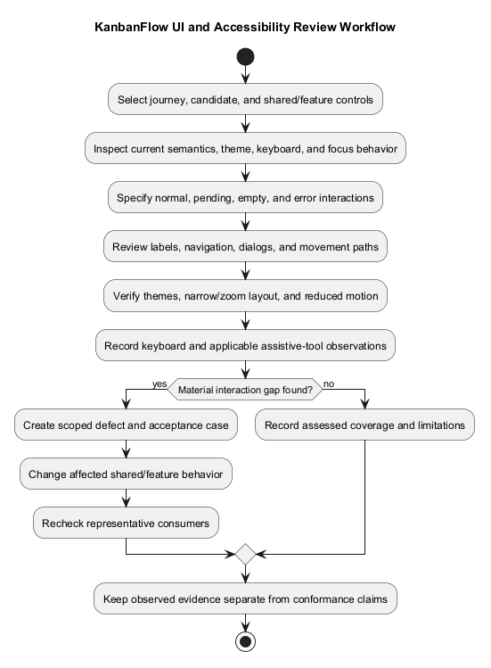
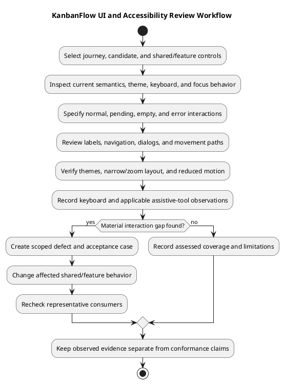

# KanbanFlow UI and Accessibility Design

## Scope and design

Use shared layout, UI components, and theme behavior to keep pages consistent. Light and dark themes must preserve readable text, visible controls, and discernible status. Read-only metadata should appear as information rather than editable text boxes.

For each journey, specify labels, keyboard reachability, visible focus, loading/empty/error states, pending actions, and focus recovery after dialogs or failures. Drag interactions need a usable keyboard path where provided; do not assume pointer success proves accessibility.

Verify representative pages in both themes and at narrow widths, plus keyboard operation and applicable assistive announcements. Lint/build success is not usability or accessibility certification. Record actual manual evidence and unresolved gaps.

## Current shared behavior and evidence limits

| Source relative to frontend/src | Source-observed behavior | Review limit |
| --- | --- | --- |
| `components/layout/AppShell.tsx` | Skip-to-content link, navigation/breadcrumb labels, route titles, theme selector, main-content target | Markup does not prove focus/navigation works in every browser or consuming page |
| `components/theme/ThemeProvider.tsx` | Light/Dark/System resolution, browser-local preference, system-media listener, storage-event tab synchronization, storage failure handling | No account-wide cross-device preference or measured contrast guarantee |
| `components/ui/Modal.tsx` | Native dialog, accessible title label, first-input focus, Tab wrapping over selected visible controls, connected opener focus restore, body scroll handling | Verify forms without inputs, changing/disabled controls, opener removal, and actual focus behavior |
| Modal cancellation | Escape cancellation is prevented by handler; onClose runs only when not busy | Does not establish that every close button or in-flight request follows the same policy |
| `components/ui/PasswordField.tsx` | Button has show/hide name and aria-pressed; changes input type | Consuming input still needs its own label/autocomplete/error contract |
| `index.css` | Focus-visible outline, visible-on-focus skip link, reduced-motion media styles | Review actual contrast, clipping, layout, and coverage rather than claiming certification |
| `features/columns/components/ColumnList.tsx` | KeyboardSensor with sortableKeyboardCoordinates and labelled column move handle | Does not prove all drag/task/move paths work by keyboard or announce outcomes correctly |
| Error/session feedback components | Selected status/alert roles and recovery controls | Inspect each journey; a role declaration is not a full assistive-technology result |

This is source inspection, not newly executed accessibility testing. Keep intended requirements separate from observed implementation and actual browser evidence.

## Information hierarchy and control semantics

Use clear page headings, resource context, actionable labels, and predictable navigation. Separate descriptive metadata from editable fields: created-by/created dates and project dates in summaries should read as information rather than text boxes when no editing is available.

Use links for navigation and buttons for actions. Specify accessible names for icon-only controls, current breadcrumb state, and visible feedback for unavailable operations. Hiding a control or disabling it in the browser does not enforce API permission.

Status, priority, and errors should remain understandable beyond color alone. Verify visible text and applicable semantic cues. Do not infer that every badge or theme token already satisfies the requirement.

## Themes, layout, and motion

Review Light, Dark, and System modes across home/auth/dashboard/workspace/project/board journeys, forms, dialogs, notifications, errors, and empty states. Include system appearance changes, stored preference, tab synchronization, and storage-unavailable behavior where affected.

Measure text/control/focus contrast under the chosen accessibility target and actual rendered colors before claiming conformance; no numerical compliance result is established here. Inspect disabled/hover/selected states as well as normal text.

Test narrow viewports, zoom/text enlargement, long resource names, multiline descriptions, dense boards, and overflow. Horizontal board movement and controls must remain understandable and reachable. Reduced-motion styles exist, but actual drag/scroll/animation behavior needs verification in the candidate.

## Keyboard and focus contract

Define logical tab order, visible focus, Enter/Space activation, Escape cancellation where appropriate, and focus after opening/closing/saving/failing an interaction. Navigation should leave a usable context; do not assume route changes automatically focus the heading.

For dialogs, verify initial focus, forward/backward containment, accessible title, background interaction, scroll restoration, busy behavior, and return focus. If the opener is removed, specify an alternative focus destination rather than relying on a disconnected element. The current component restores only a connected opener.

For column/task movement, record the actual keyboard path, handles, keys, destination/order feedback, cancellation, and persisted result. The presence of a keyboard sensor is not proof that all custom movement paths support it. Dragging by pointer alone cannot establish keyboard equivalence.

## Forms, errors, and changing state

| State | Design expectation to verify |
| --- | --- |
| Form entry | Persistent labels, field purpose, expected format, and operation-specific constraints |
| Invalid input | Actionable feedback, applicable field association, retained input, and useful focus |
| Pending | Discernible progress, actual disabled/repeated-action behavior, and safe cancellation contract |
| Accepted mutation | Visible result and correct state refresh; focus remains usable after editor closure |
| Permission/session failure | Safe feedback and available recovery without implying access or successful save |
| Empty/unavailable data | Explain the condition and any applicable next action |
| Dynamic move/notification | Result understandable to keyboard/assistive users; inspect actual announcements |
| Unexpected render failure | Readable fallback and operable recovery; unsaved/persisted consequences clear |

Existing project/task handlers may present the first server validation message rather than full field mapping. Review this limitation before claiming accessible comprehensive errors. Password visibility controls do not establish password-change support.

## Verification matrix

| Journey or scenario | Evidence to capture |
| --- | --- |
| Public/auth pages | Labels, keyboard navigation, show/hide state, pending/error feedback, and session recovery |
| Dashboard/resource navigation | Heading/title, breadcrumbs, skip link, direct route behavior, back links, and focus |
| Create/edit/cancel | Field labels, validation/retention, save/pending/close behavior, and final persisted values |
| Shared dialog | Initial focus, Tab/Shift-Tab, Escape/busy, connected/removed opener, background and scrolling |
| Column/task movement | Actual keyboard and pointer operations, announcements/recovery, and persisted order/destination |
| Theme changes | Light/Dark/System, media change, tabs/storage failure, normal/error/disabled/focus states |
| Narrow/zoom/long content | Reachable controls, readable layout, clipping/overflow, and usable board navigation |
| Reduced motion | Actual animation/scroll/drag response with preference enabled |
| Screen reader where assessed | Names, roles, headings, landmarks, dialogs, validation and dynamic changes with named browser/tool |
| Permission/error states | Safe output, available recovery, focus, and absence of false save/access claims |

Record candidate commit, browser, viewport/zoom, theme, input method, assistive tool when used, scenario, observed result, and remaining gaps in [verification records](../../Releases/verification-template.md). Automated checks can support manual review but do not replace keyboard, screen-reader, visual, or domain-state evidence. Build/lint success is not usability/accessibility certification.

## Defect handoff and maintenance

For an issue, record the affected journey/control, actual behavior, expected interaction, environment, and a scoped acceptance case. Link shared component and consuming-page effects; do not fix one form while assuming every consumer behaves identically.

Changes to theme tokens, shell, dialog, password controls, keyboard sensors, forms, or error handling need representative consumer checks. Preserve actual results separately from proposed standards or targets; no conformance audit is claimed by completing this document.

Cross-check [site map](site-map.md), [editor interactions](editor-interaction-flow.md), [error handling](error-handling-design.md), [components](component-diagram.md), [authentication](authentication-and-authorization.md), and [non-functional requirements](../02-requirements/non-functional-requirements.md).

## Review and evidence

Record the candidate commit, actor, environment, affected source paths, proposed change, observed checks, and remaining questions. Link implementation and acceptance evidence; keep untested behavior explicit. This document adds no application feature or newly executed security/behavior test.

## Related guidance

- [Design catalog](README.md)
- [Requirements](../02-requirements/README.md)
- [Analysis](../03-analysis/README.md)
- [Decision register](../../Project-Management/decision-register.md)
- [Verification record](../../Releases/verification-template.md)
- [Diagram guide](../../diagram-guide.md)

## PlantUML diagram

[Editable PlantUML source](diagrams/ui-and-accessibility-design.puml)

