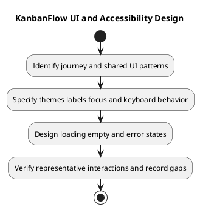

# KanbanFlow UI and Accessibility Design

## Scope and design

Use shared layout, UI components, and theme behavior to keep pages consistent. Light and dark themes must preserve readable text, visible controls, and discernible status. Read-only metadata should appear as information rather than editable text boxes.

For each journey, specify labels, keyboard reachability, visible focus, loading/empty/error states, pending actions, and focus recovery after dialogs or failures. Drag interactions need a usable keyboard path where provided; do not assume pointer success proves accessibility.

Verify representative pages in both themes and at narrow widths, plus keyboard operation and applicable assistive announcements. Lint/build success is not usability or accessibility certification. Record actual manual evidence and unresolved gaps.

## Review and evidence

Record the candidate commit, actor, environment, affected source paths, proposed change, observed checks, and remaining questions. Link implementation and acceptance evidence; keep untested behavior explicit. This document adds no application feature or newly executed security/behavior test.

## Related guidance

- [Design catalog](README.md)
- [Requirements](../02-requirements/README.md)
- [Analysis](../03-analysis/README.md)
- [Decision register](../../Project-Management/decision-register.md)
- [Verification record](../../Releases/verification-template.md)
- [Diagram guide](../../diagram-guide.md)

## PlantUML diagram

[Editable PlantUML source](diagrams/ui-and-accessibility-design.puml)

