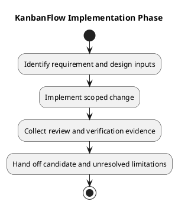

# KanbanFlow Implementation

## Purpose

This phase turns agreed requirements and design decisions into reviewable application changes. Implementation is complete for a particular change only when its acceptance cases and proportionate checks have evidence. The existence of this documentation does not certify every feature or production deployment.

## Document catalog

| Document | Responsibility |
| --- | --- |
| [Implementation](implementation.md) | Code boundaries, server authority, and change requirements. |
| [Development workflow](development-workflow.md) | Local preparation, scoped development, and verification. |
| [Dependency baseline](dependency-baseline.md) | Manifests, lockfiles, runtime alignment, and dependency changes. |
| [Implementation status](implementation-status.md) | Source-backed capabilities, open issues, and evidence limits. |
| [Change delivery](change-delivery.md) | Review, commit, synchronization, and release handoff. |

## Inputs and outputs

Inputs are an agreed problem, acceptance cases, affected design contracts, and an inspected repository state. Outputs are a focused change, relevant regression coverage, updated documentation, and a record of actual checks, limitations, and delivery identity. Unresolved policy questions return to analysis rather than becoming accidental implementation decisions.

## Phase exit

- Behavior meets the stated acceptance cases, including denial and failure paths where relevant.
- Server authorization, resource ancestry, data integrity, and unrelated work are preserved.
- Relevant checks have recorded results for the candidate; failures remain visible.
- Dependencies, migrations, operational changes, and rollback implications are explained.
- Review and delivery evidence link to the resulting commit. A push is not a deployment.

## Related guidance

See [SDLC index](../README.md), [design catalog](../04-design/README.md), [requirements](../02-requirements/README.md), [traceability](../../Project-Management/traceability.md), and [testing phase](../06-testing/README.md).

## PlantUML diagram

[Editable PlantUML source](diagrams/workflow.puml)

