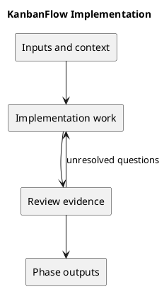

# Implementation

## Purpose and activities

Implement small, scoped changes. Preserve unrelated work and server-side authorization. Update documentation and meaningful regression coverage for behavior changes. Keep secrets and local environment values out of commits.

## Completion evidence

A reviewed change with traceable requirements, proportionate passing checks, and updated documentation. Commit/push actions follow explicit authorization.

## Related guidance

- [Supporting documentation](../../Project-Management/traceability.md)
- [SDLC index](../README.md)

## PlantUML workflow

[Editable source](diagrams/workflow.puml)

