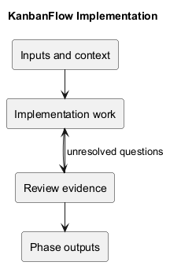
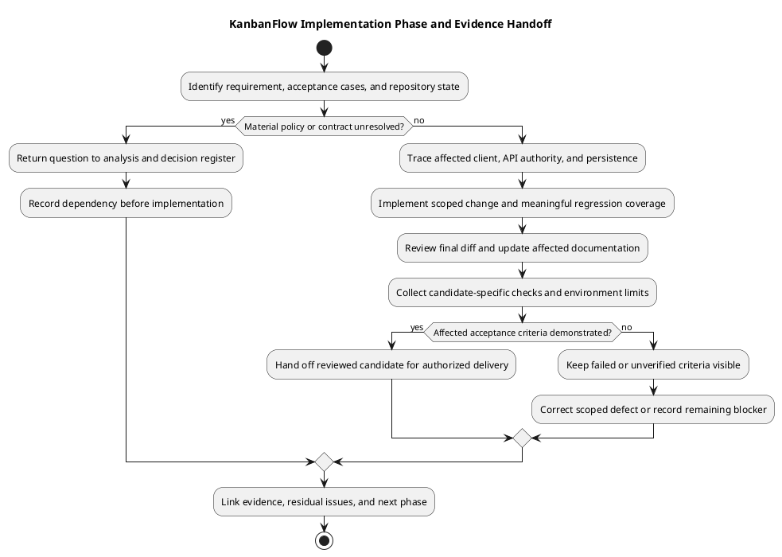

# KanbanFlow Implementation

> **Policy amendment (2026-10-10):** Membership mutations are now owner-only; DEC-003/PB-001's bypass is fixed. Earlier open-policy text and diagrams below describe the preceding state. See [QA corrections](../06-testing/qa-corrections-2026-10-10.md) for the selected rule and regression evidence.

## Purpose

This phase turns agreed requirements and design decisions into reviewable application changes. Implementation is complete for a particular change only when its acceptance cases and proportionate checks have evidence. The existence of this documentation does not certify every feature or production deployment.

## Document catalog

| Document | Responsibility |
| --- | --- |
| [Implementation](implementation.md) | Code boundaries, server authority, and change requirements. |
| [Development workflow](development-workflow.md) | Local preparation, scoped development, and verification. |
| [Dependency baseline](dependency-baseline.md) | Manifests, lockfiles, runtime alignment, and dependency changes. |
| [Implementation status](implementation-status.md) | Source-backed capabilities, open issues, and evidence limits. |
| [Change delivery](change-delivery.md) | Review, commit, synchronization, and release handoff. |

## Inputs and outputs

Inputs are an agreed problem, acceptance cases, affected design contracts, and an inspected repository state. Outputs are a focused change, relevant regression coverage, updated documentation, and a record of actual checks, limitations, and delivery identity. Unresolved policy questions return to analysis rather than becoming accidental implementation decisions.

## How to use this section

Start with [implementation status](implementation-status.md) to distinguish existing capabilities, known issues, and proposed functionality. Use [implementation guidance](implementation.md) to identify the actual code and authority boundaries, then [development workflow](development-workflow.md) for local preparation and checks. Consult [dependency baseline](dependency-baseline.md) when runtime or packages are affected. Finish with [change delivery](change-delivery.md) and a candidate-specific verification record.

This index coordinates those guides; it is not a substitute for route/controller evidence, acceptance criteria, or environment-specific deployment procedures.

## Entry checklist

- Identify the problem or backlog item, intended actor, observable outcome, and exclusions.
- Confirm acceptance criteria and relevant design/request/data contracts.
- Inspect branch, remote, working-tree changes, instructions, and affected consumers.
- Identify policy questions, dependency/runtime changes, migration needs, and recovery implications.
- Choose meaningful verification layers and isolated fixtures before editing.

If the intended permission policy is unresolved, return the question to [analysis decisions](../03-analysis/analysis-decisions-and-open-questions.md) and the [decision register](../../Project-Management/decision-register.md). DEC-003, the manager remove/re-add role bypass, remains open; this phase index neither selects its remedy nor closes it.

## Responsibilities and handoffs

| Responsibility | Required contribution |
| --- | --- |
| Scope and policy | State the accepted behavior and resolve material authority questions. |
| Implementation | Trace affected callers, controllers/policies, and persistence; preserve unrelated work. |
| Review | Assess contracts, authorization, integrity, maintainability, and the final diff. |
| Verification | Record actual checks for the candidate and environment, including failures and gaps. |
| Delivery | Identify published commits and any separately authorized release/deployment operation. |

These are responsibilities rather than an assigned staffing roster. One person may perform multiple activities; do not invent reviewers, approvals, or dates.

## Change categories and verification

| Change category | Implementation attention | Relevant evidence |
| --- | --- | --- |
| API or authority | Nested ancestry, invoked policies, validation, response contracts, indirect operations. | Relevant backend assertions and denied-path cases. |
| Ordering or WIP | Dedicated movement contracts, transactions/locks, stale data, accepted persistence. | Backend regressions, browser recovery, and isolated MySQL contention checks when affected. |
| UI or shared controls | Pending/empty/error states, representative consumers, themes, keyboard/focus. | Frontend lint/build plus affected browser observations. |
| Dependencies or schema | Lockfiles, runtime compatibility, existing records, migration/recovery consequences. | Installation and affected behavior checks in the relevant environment. |
| Documentation | Source accuracy, local links, diagrams, and evidence boundaries. | Link checks, embedded/source consistency, rendered previews, and patch formatting. |

Backend tests use in-memory SQLite; they do not prove MySQL locking behavior. Frontend lint/build do not prove usability or accessibility. Configured CI jobs and historical release results are not fresh passing evidence. See [verification layers](../06-testing/verification-layers.md).

## Minimum change evidence

Connect the requirement or backlog item to the design decision, changed paths, exact candidate, acceptance cases, observed results, and residual issues. Record a before/after example when it makes the behavior clearer. Use [testing verification records](../06-testing/verification-record-template.md) and [documentation traceability](../../Project-Management/documentation-traceability.md); retain failure evidence rather than replacing it with an unsupported success statement.

## Boundaries after implementation

An implemented change may still await verification, review, release, or runtime rollout. Proposed attachment, PDF/export, public-sharing, and password-change design material does not establish implemented endpoints. Soft deletion does not establish physical erasure, descendant restoration, or a restore UI.

Hand verified candidates to [testing](../06-testing/README.md) and [release guidance](../../Releases/README.md) as appropriate. Runtime changes use [deployment](../07-deployment/README.md); defects and follow-up work return through [maintenance](../08-maintenance/README.md). Preserve historical records when current status changes.

## Phase exit

- Behavior meets the stated acceptance cases, including denial and failure paths where relevant.
- Server authorization, resource ancestry, data integrity, and unrelated work are preserved.
- Relevant checks have recorded results for the candidate; failures remain visible.
- Dependencies, migrations, operational changes, and rollback implications are explained.
- Review and delivery evidence link to the resulting commit. A push is not a deployment.

## Related guidance

See [SDLC index](../README.md), [design catalog](../04-design/README.md), [requirements](../02-requirements/README.md), [traceability](../../Project-Management/traceability.md), and [testing phase](../06-testing/README.md).

## PlantUML diagram

[Editable PlantUML source](diagrams/workflow.puml)

