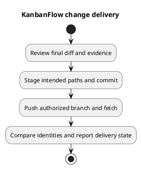

# KanbanFlow Change Delivery

## Delivery objective

Deliver a focused, reviewable change whose behavior and validation can be traced to a commit. Source publication, a version tag, and application deployment are separate events. Do not report one as evidence of another.

## Before committing

Inspect the final diff and working tree. Stage only the intended paths, preserve unrelated work, and check staged formatting. Review contracts, secrets, generated assets, migration implications, and relevant acceptance results. Update affected documentation; for PlantUML edits keep embedded source, editable `.puml`, and rendered preview consistent and validate their links.

Write a commit message describing the resulting change. Include actual validation and unresolved limitations in the review/delivery record. Documentation-only changes need document/link/diagram checks; they do not require claiming a newly passed application suite.

## Publish and synchronize

Use the authorized branch and remote. Fetch before integration when remote changes may exist, inspect divergence, and integrate without discarding local work. Push the intended commit without a force push; if rejected, fetch and resolve the actual divergence before retrying. A network failure is not proof that the remote was updated.

After pushing, fetch and compare local and intended remote commit identities. Report the branch, resulting commit, push outcome, and remaining working-tree changes. Clean and synchronized means both checks are satisfied; unrelated uncommitted files may remain even after a successful push.

## Automation and review

The [CI workflow](../../../.github/workflows/ci.yml) runs backend tests and frontend lint/build for main pushes and pull requests. Check the actual run for the candidate when reporting CI results. If it fails, retain the failure evidence, investigate the affected change/environment, and verify the corrected candidate. A successful local check does not substitute for an unobserved CI run.

## Release handoff

When a release is requested, apply [versioning strategy](../../Project-Management/versioning-strategy.md), [release checklist](../../Releases/release-checklist.md), and [release pipeline](../../Project-Management/release-pipeline.md). Record included commits, changes, verification, known issues, compatibility, and upgrade/rollback instructions. Do not create a patch tag for every documentation commit or invent release approval from source synchronization.

## Operational boundary

Deployment needs an identified target, configuration, dependency/build artifacts, migration plan, and post-deployment verification. Use [upgrade and rollback](../../Releases/upgrade-and-rollback.md); rolling code back does not restore deleted data or automatically reverse database migrations. Keep credentials and operational secrets outside public commit/release records.

## PlantUML diagram

[Editable PlantUML source](diagrams/change-delivery.puml)

