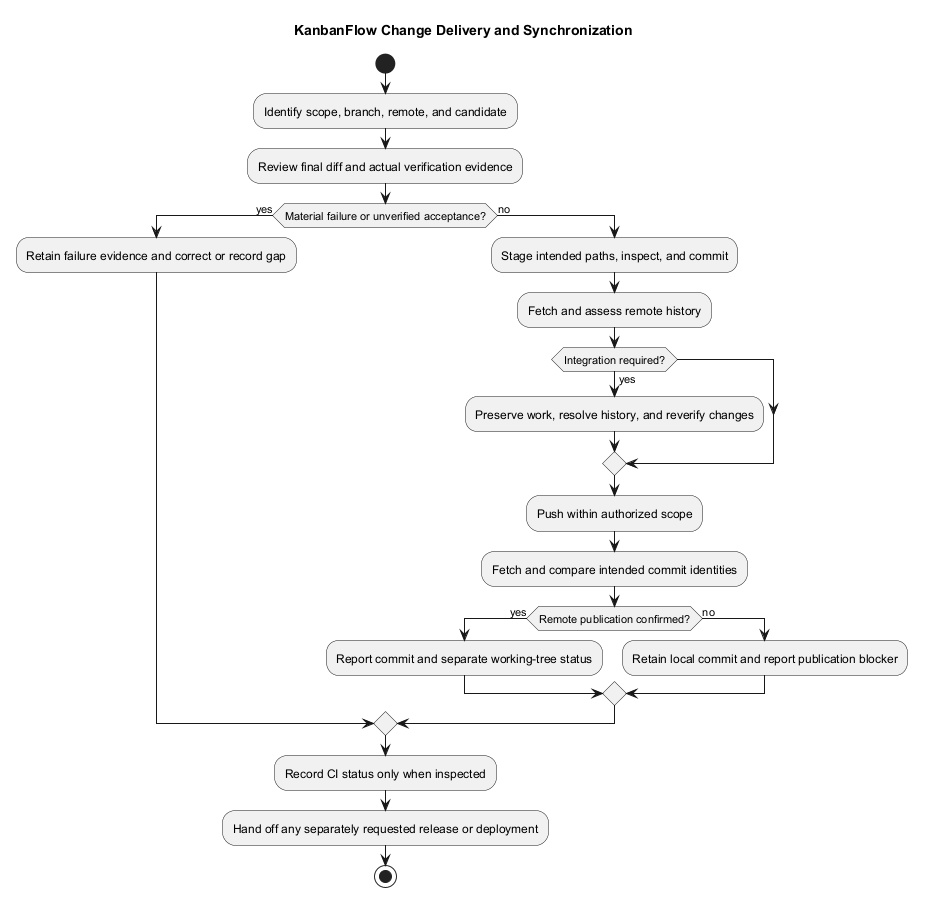
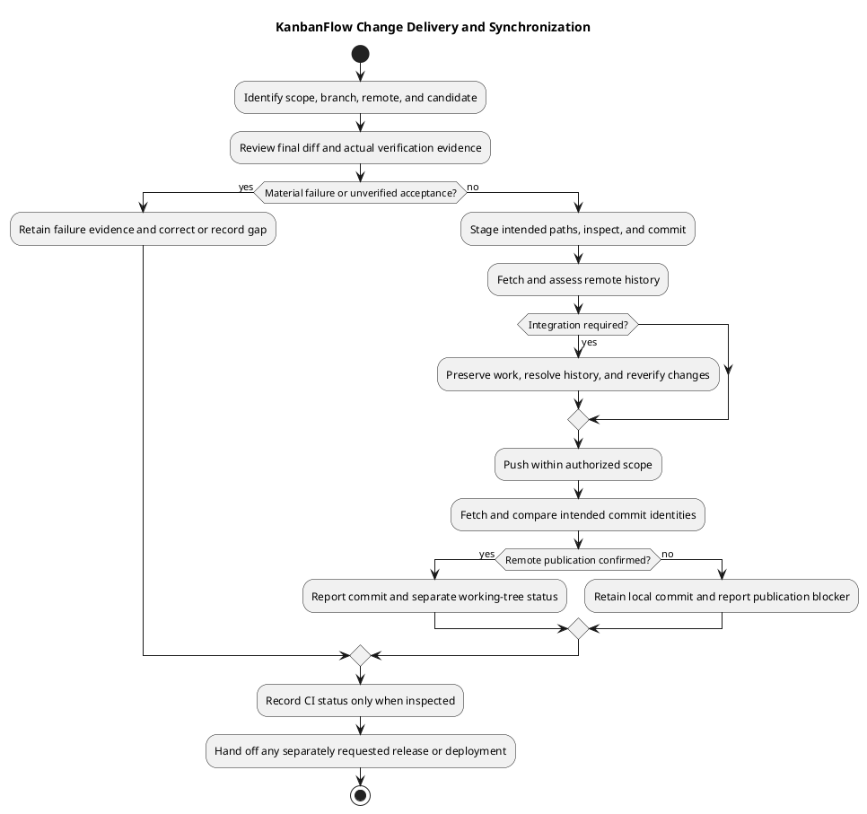

# KanbanFlow Change Delivery

> **Policy amendment (2026-10-10):** Membership mutations are now owner-only; DEC-003/PB-001's bypass is fixed. Current guidance below reflects this rule; historical records retain their original scope. See [QA corrections](../06-testing/qa-corrections-2026-10-10.md) for the selected rule and regression evidence.

## Delivery objective

Deliver a focused, reviewable change whose behavior and validation can be traced to a commit. Source publication, a version tag, and application deployment are separate events. Do not report one as evidence of another.

## Before committing

Inspect the final diff and working tree. Stage only the intended paths, preserve unrelated work, and check staged formatting. Review contracts, secrets, generated assets, migration implications, and relevant acceptance results. Update affected documentation; for PlantUML edits keep embedded source, editable `.puml`, and rendered preview consistent and validate their links.

Write a commit message describing the resulting change. Include actual validation and unresolved limitations in the review/delivery record. Documentation-only changes need document/link/diagram checks; they do not require claiming a newly passed application suite.

## Publish and synchronize

Use the authorized branch and remote. Fetch before integration when remote changes may exist, inspect divergence, and integrate without discarding local work. Push the intended commit without a force push; if rejected, fetch and resolve the actual divergence before retrying. A network failure is not proof that the remote was updated.

After pushing, fetch and compare local and intended remote commit identities. Report the branch, resulting commit, push outcome, and remaining working-tree changes. Clean and synchronized means both checks are satisfied; unrelated uncommitted files may remain even after a successful push.

## Entry conditions and delivery identity

Identify the requested outcome, acceptance criteria, intended branch/remote, baseline, candidate changes, and authorized delivery scope. Inspect existing staged and unstaged work before selecting files. A previous release or successful build does not establish the current candidate's readiness.

Use the exact source identity in the delivery record. If checks were performed before committing, record the checked working-tree state and ensure no substantive edits occurred afterward. New edits or conflict resolutions require the affected checks again; do not carry results across changed behavior silently.

## Review checklist

| Area | Review question |
| --- | --- |
| Scope | Does the final diff implement the stated outcome and preserve unrelated changes? |
| Authority and contracts | Are ancestry, invoked policies, validation, and response expectations preserved? |
| Data and dependencies | Are lockfile/runtime changes, migrations, ordering/WIP effects, and compatibility explained? |
| Client behavior | Are pending, error, failed optimistic update, theme, and keyboard/focus paths checked when affected? |
| Evidence | Are actual results tied to the candidate, with failures and unverified limits retained? |
| Publication contents | Are secrets, dumps, dependencies, and environment-specific generated files excluded? |
| Documentation | Do source references, local links, embedded PlantUML, editable source, and previews agree? |

Use [verification layers](../06-testing/verification-layers.md) to select evidence proportional to the change. Backend SQLite tests do not demonstrate MySQL contention; frontend lint/build do not demonstrate browser acceptance. Keep the selected owner-only DEC-003 rule and affected regression evidence visible in the [decision register](../../Project-Management/decision-register.md).

## Commit and review description

Stage the intended paths, inspect the staged diff, and run the relevant formatting check before committing. Existing staged work may belong to another task; do not include it automatically or unstage it without understanding its ownership. Describe the concrete resulting behavior in the commit message and any review description.

For a behavior change, include the trigger and before/after result, validation performed, and material risks. For documentation work, describe the documents and diagrams changed and the actual document checks. Do not write a passing CI claim before inspecting its run or claim a reviewer approval that has not been recorded.

## Synchronization decision table

| Observed state after fetch | Required handling |
| --- | --- |
| Local and intended remote identities match | Report synchronized for that branch; inspect working-tree state separately. |
| Local ahead only | Review the outgoing commits and push within authorized scope. |
| Local behind only | Preserve work and integrate the intended remote history through the agreed workflow. |
| Histories diverged | Inspect both sides and resolve integration deliberately; no destructive reset or force push as a shortcut. |
| Push response ambiguous or failed | Inspect remote identity after fetch before retrying or reporting success. |
| Remote unavailable | Record the failure and retain the local commit; synchronization remains unverified. |

If conflicts occur, preserve both intended behaviors, review the resolved diff, and rerun affected verification. Equal branch names or package versions do not establish equal source histories. A clean working tree does not prove that commits have been pushed.

## Failure handling and corrected candidates

Keep the original failure evidence and identify its candidate. Diagnose permission, network, remote divergence, CI, or application failures separately. Do not repeatedly push an unchanged candidate to fix a failing application check. A corrected commit needs its own relevant verification and actual CI result when assessed.

Avoid rewriting published history to conceal failed delivery. Choose the repository's intended review/integration workflow; neither protected-branch settings nor mandatory pull-request approval is assumed by this guide. When publication is blocked, report the committed local state and the specific remaining action.

## Delivery record

Capture these fields using the [verification template](../06-testing/verification-record-template.md) where appropriate:

- Requirement/backlog reference and final changed behavior or document scope.
- Baseline and full resulting commit identity; branch and intended remote.
- Actual checks, environment, results, and residual issues.
- Commit/push outcome and fetched local/remote identity comparison.
- Remaining working-tree changes and any unverified CI status.
- Separate release/tag or runtime operation identity only when actually performed.

A concise user-facing report should state what changed, what was checked, the resulting commit, publication outcome, and limitations. Use [documentation traceability](../../Project-Management/documentation-traceability.md) to connect supporting records without duplicating conflicting evidence.

## Automation and review

The [CI workflow](../../../.github/workflows/ci.yml) runs backend tests and frontend lint/build for main pushes and pull requests. Check the actual run for the candidate when reporting CI results. If it fails, retain the failure evidence, investigate the affected change/environment, and verify the corrected candidate. A successful local check does not substitute for an unobserved CI run.

## Release handoff

When a release is requested, apply [versioning strategy](../../Project-Management/versioning-strategy.md), [release checklist](../../Releases/release-checklist.md), and [release pipeline](../../Project-Management/release-pipeline.md). Record included commits, changes, verification, known issues, compatibility, and upgrade/rollback instructions. Do not create a patch tag for every documentation commit or invent release approval from source synchronization.

## Operational boundary

Deployment needs an identified target, configuration, dependency/build artifacts, migration plan, and post-deployment verification. Use [upgrade and rollback](../../Releases/upgrade-and-rollback.md); rolling code back does not restore deleted data or automatically reverse database migrations. Keep credentials and operational secrets outside public commit/release records.

## PlantUML diagram

[Editable PlantUML source](diagrams/change-delivery.puml)

