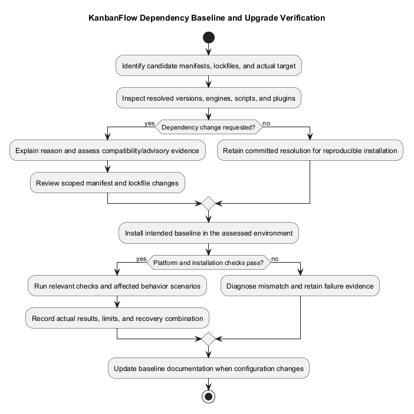
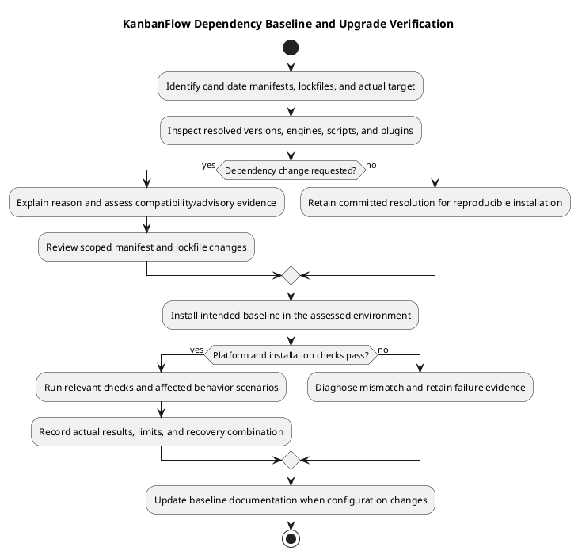

# KanbanFlow Dependency Baseline

## Authoritative records

The committed manifests describe permitted versions; lockfiles describe resolved installations. This baseline records repository configuration and makes no claim about the latest available releases or current vulnerability status.

| Area | Baseline evidence | Current declared configuration |
| --- | --- | --- |
| Backend | [Composer manifest](../../../backend/composer.json), [lockfile](../../../backend/composer.lock) | PHP `^8.3`, Laravel `^13.8`, Sanctum `^4.0`, Tinker `^3.0`. |
| Client | [npm manifest](../../../frontend/package.json), [lockfile](../../../frontend/package-lock.json) | React `^19.2.7`, TypeScript `~6.0.2`, Vite `^8.1.1`, Tailwind `^4.3.2`. |
| Client behavior | Frontend manifest | TanStack Query, Axios, React Router, React Hook Form, Zod, and dnd-kit. |
| Automation | [CI workflow](../../../.github/workflows/ci.yml) | PHP 8.4 with SQLite extensions; Node.js 24; Composer install, npm ci, backend tests, client lint/build. |

The declared PHP range is not a guarantee that every locked transitive dependency supports its lowest version. Check Composer platform requirements and the lockfile for the actual target. Align local/runtime versions with the candidate's requirements and CI instead of assuming XAMPP's bundled PHP is sufficient.

## Locked version snapshot

The following selected versions were read from the committed lockfiles on 2026-10-09. This is a source snapshot, not a claim that local packages are installed or that newer releases/advisories have been assessed. Re-read the candidate lockfiles when using this guide after dependency changes.

| Package | Resolved version |
| --- | --- |
| Laravel framework | `v13.20.0` |
| Laravel Sanctum | `v4.3.2` |
| Laravel Tinker | `v3.0.2` |
| React | `19.2.7` |
| TypeScript | `6.0.3` |
| Vite | `8.1.4` |
| Axios | `1.18.1` |
| Tailwind CSS | `4.3.2` |

The frontend lockfile uses format version 3. A manifest range and a resolved version answer different questions; neither proves the runtime's installed state. The complete lockfiles remain authoritative for transitive and development dependencies.

## Runtime and platform assessment

Check the actual PHP executable, extensions, Composer platform requirements, Node.js/npm versions, and target operating system. CI uses PHP 8.4 and Node.js 24; that is configured automation rather than a fresh compatibility run. The locked Vite package declares Node.js `^20.19.0 || >=22.12.0`; inspect all relevant engine requirements rather than choosing a runtime solely from React's range.

Use `composer check-platform-reqs` against an installed backend environment to assess its actual platform requirements. Review extension needs for the selected database and services. PHPUnit uses SQLite, while the local application example uses MySQL; passing one environment does not establish another's runtime or locking behavior.

## Installation and change command distinctions

| Operation | Meaning and precautions |
| --- | --- |
| `composer install` in `backend/` | Install from the intended Composer lockfile; inspect enabled scripts/plugins and actual platform errors. |
| `npm ci` in `frontend/` | Recreate the dependency directory from the lockfile and reject manifest/lock mismatch; use the intended checkout. |
| Composer/npm update operations | Deliberately change dependency resolution; review manifest and lockfile changes as a scoped upgrade. |
| Backend setup script | Includes key generation and migrations; do not run as a harmless check on an existing installation. |
| Frontend build | Uses the application frontend's scripts; backend framework tooling is a separate package context. |

Do not bypass engine/platform failures merely to obtain a successful install. Diagnose the mismatch and document the chosen compatible runtime or dependency correction. Do not delete a lockfile to hide a mismatch or manually edit resolved integrity metadata as a repair shortcut.

## Upgrade review and supply-chain boundaries

Inspect changed direct and transitive versions, package sources/integrity records, runtime requirements, lifecycle scripts, Composer plugins, and API/migration effects. Review the final diff for unrelated resolution churn. Dependency caches improve installation speed but do not provide acceptance or security evidence.

For a dated advisory review, record the exact lockfile identity, tool/source used, affected versions, environment relevance, remedy, and remaining risk. A failed advisory lookup remains unverified; a build pass does not mean no known vulnerabilities. This document performs no external advisory lookup or live package recommendation.

## Candidate verification and recovery

After a dependency change, verify the locked installation, relevant backend tests or frontend lint/build, and affected behavior. Exercise real browser sessions/shared UI or isolated MySQL contention where the change warrants it. Keep failures, tool versions, candidate identity, and excluded environments visible in [verification records](../06-testing/verification-record-template.md).

Retain a compatible prior source/lockfile/runtime/assets combination. Assess database and configuration effects before rollback; reinstalling old packages does not restore data or reverse migrations. Follow [dependency and change management](../08-maintenance/dependency-and-change-management.md) and [upgrade guidance](../../Releases/upgrade-and-rollback.md).

## Reproducible installation

Use `composer install` and `npm ci` in their respective directories for the committed baseline. An update command deliberately changes resolution and must be reviewed as a dependency change. Do not commit `vendor/`, `node_modules/`, credentials, or environment-specific generated files.

The backend also contains framework tooling; distinguish its package scripts from the separate application frontend. A successful backend tooling build alone does not establish that the `frontend/` application builds.

## Dependency change procedure

Record the reason, affected direct/transitive packages, runtime requirements, compatibility notes, and the manifest/lockfile diff. Verify installation, impacted behavior, backend tests or frontend lint/build as relevant, and environment compatibility. Security advisories require a dated assessment against the exact lockfile; no fresh advisory assessment is asserted here.

Review lifecycle scripts and plugins before trusting new packages. Keep upgrades scoped; explain any migration or API changes and retain a recoverable prior dependency baseline. Resolve vulnerabilities with explicit evidence rather than claiming all dependencies are safe from a successful build.

## Evidence and maintenance

Capture tool/runtime versions, candidate identity, check results, and remaining limitations in a [verification record](../../Releases/verification-template.md). Update this document when declared runtime or major tooling choices change; use the lockfiles for exact installed versions and [versioning strategy](../../Project-Management/versioning-strategy.md) for product release decisions.

## PlantUML diagram

[Editable PlantUML source](diagrams/dependency-baseline.puml)

