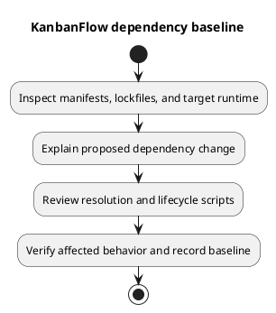

# KanbanFlow Dependency Baseline

## Authoritative records

The committed manifests describe permitted versions; lockfiles describe resolved installations. This baseline records repository configuration and makes no claim about the latest available releases or current vulnerability status.

| Area | Baseline evidence | Current declared configuration |
| --- | --- | --- |
| Backend | [Composer manifest](../../../backend/composer.json), [lockfile](../../../backend/composer.lock) | PHP `^8.3`, Laravel `^13.8`, Sanctum `^4.0`, Tinker `^3.0`. |
| Client | [npm manifest](../../../frontend/package.json), [lockfile](../../../frontend/package-lock.json) | React `^19.2.7`, TypeScript `~6.0.2`, Vite `^8.1.1`, Tailwind `^4.3.2`. |
| Client behavior | Frontend manifest | TanStack Query, Axios, React Router, React Hook Form, Zod, and dnd-kit. |
| Automation | [CI workflow](../../../.github/workflows/ci.yml) | PHP 8.4 with SQLite extensions; Node.js 24; Composer install, npm ci, backend tests, client lint/build. |

The declared PHP range is not a guarantee that every locked transitive dependency supports its lowest version. Check Composer platform requirements and the lockfile for the actual target. Align local/runtime versions with the candidate's requirements and CI instead of assuming XAMPP's bundled PHP is sufficient.

## Reproducible installation

Use `composer install` and `npm ci` in their respective directories for the committed baseline. An update command deliberately changes resolution and must be reviewed as a dependency change. Do not commit `vendor/`, `node_modules/`, credentials, or environment-specific generated files.

The backend also contains framework tooling; distinguish its package scripts from the separate application frontend. A successful backend tooling build alone does not establish that the `frontend/` application builds.

## Dependency change procedure

Record the reason, affected direct/transitive packages, runtime requirements, compatibility notes, and the manifest/lockfile diff. Verify installation, impacted behavior, backend tests or frontend lint/build as relevant, and environment compatibility. Security advisories require a dated assessment against the exact lockfile; no fresh advisory assessment is asserted here.

Review lifecycle scripts and plugins before trusting new packages. Keep upgrades scoped; explain any migration or API changes and retain a recoverable prior dependency baseline. Resolve vulnerabilities with explicit evidence rather than claiming all dependencies are safe from a successful build.

## Evidence and maintenance

Capture tool/runtime versions, candidate identity, check results, and remaining limitations in a [verification record](../../Releases/verification-template.md). Update this document when declared runtime or major tooling choices change; use the lockfiles for exact installed versions and [versioning strategy](../../Project-Management/versioning-strategy.md) for product release decisions.

## PlantUML diagram

[Editable PlantUML source](diagrams/dependency-baseline.puml)

