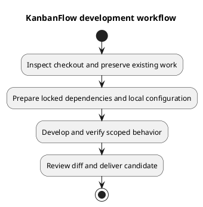

# KanbanFlow Development Workflow

## Prepare the local checkout

Inspect branch, remote, working-tree changes, and applicable repository instructions before editing. Preserve existing work and identify the exact requirement and affected paths. Use a focused branch for a new application change when appropriate; inspect its base before integrating. Do not reset or discard unrelated changes to obtain a clean tree.

Use the project [README](../../../README.md) for setup. Install backend dependencies from `backend/composer.lock` with `composer install` and frontend dependencies from `frontend/package-lock.json` with `npm ci`. Inspect scripts before running setup: the backend Composer setup script generates an application key and runs migrations, so it is not a harmless verification command for an existing environment.

## Configure and run

Keep `.env` and credentials local. The backend example uses MySQL, `http://localhost:8000`, a frontend at `http://localhost:5173`, and stateful SPA domains. Align the actual frontend API URL, backend URL, CORS, session, and Sanctum settings; use a consistent host rather than mixing `localhost` and `127.0.0.1` unintentionally. These are example settings, not a production prescription.

Start the backend and frontend using their documented commands. Confirm API reachability and an authenticated journey before diagnosing a UI failure as a credential problem. Never publish actual local account passwords in development notes.

## Develop in small steps

1. Define acceptance cases and reproduce the relevant behavior.
2. Inspect the actual caller, authority checks, data contract, and consuming views.
3. Implement the smallest coherent change with meaningful regression coverage.
4. Check normal, denied, invalid, stale, and failed paths as relevant.
5. Update affected documentation and inspect the complete diff.

## Verification commands and limits

| Working directory | Command | What it checks |
| --- | --- | --- |
| `backend/` | `php artisan test` | Existing backend unit/feature suites in the configured test environment. |
| `frontend/` | `npm run lint` | ESLint rules. |
| `frontend/` | `npm run build` | TypeScript project build and Vite production bundle. |
| Repository root | `git diff --check` | Whitespace and patch formatting. |

Backend PHPUnit configuration uses in-memory SQLite and test-specific services. Passing it does not prove MySQL locking or concurrency behavior. Frontend lint/build do not prove browser behavior or accessibility; the frontend manifest currently has no automated test script. For UI changes perform affected browser journeys, themes, keyboard/focus, and failure checks using [UI guidance](../04-design/ui-and-accessibility-design.md).

Record actual commands, candidate commit, environment, results, and remaining gaps. Do not turn historical README claims or configured CI jobs into fresh passing evidence. Deliver through [change delivery](change-delivery.md).

## PlantUML diagram

[Editable PlantUML source](diagrams/development-workflow.puml)

