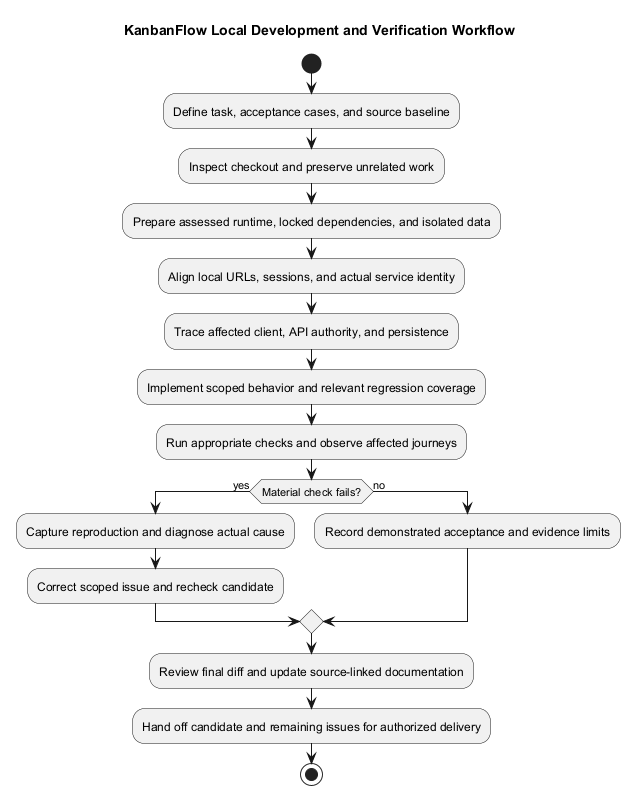
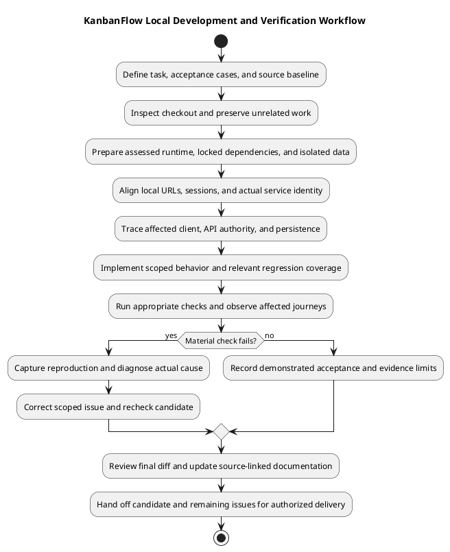

# KanbanFlow Development Workflow

## Prepare the local checkout

Inspect branch, remote, working-tree changes, and applicable repository instructions before editing. Preserve existing work and identify the exact requirement and affected paths. Use a focused branch for a new application change when appropriate; inspect its base before integrating. Do not reset or discard unrelated changes to obtain a clean tree.

Use the project [README](../../../README.md) for setup. Install backend dependencies from `backend/composer.lock` with `composer install` and frontend dependencies from `frontend/package-lock.json` with `npm ci`. Inspect scripts before running setup: the backend Composer setup script generates an application key and runs migrations, so it is not a harmless verification command for an existing environment.

## Configure and run

Keep `.env` and credentials local. The backend example uses MySQL, `http://localhost:8000`, a frontend at `http://localhost:5173`, and stateful SPA domains. Align the actual frontend API URL, backend URL, CORS, session, and Sanctum settings; use a consistent host rather than mixing `localhost` and `127.0.0.1` unintentionally. These are example settings, not a production prescription.

Start the backend and frontend using their documented commands. Confirm API reachability and an authenticated journey before diagnosing a UI failure as a credential problem. Never publish actual local account passwords in development notes.

## Develop in small steps

1. Define acceptance cases and reproduce the relevant behavior.
2. Inspect the actual caller, authority checks, data contract, and consuming views.
3. Implement the smallest coherent change with meaningful regression coverage.
4. Check normal, denied, invalid, stale, and failed paths as relevant.
5. Update affected documentation and inspect the complete diff.

## Establish the task and baseline

Record the requirement/backlog reference, intended actor, trigger, expected result, affected journeys, and exclusions. Inspect current source instead of assuming a design proposal is implemented. Consult [implementation status](implementation-status.md), [request contracts](../04-design/route-and-request-contracts.md), and [decision register](../../Project-Management/decision-register.md) for known boundaries.

Identify the starting commit, intended branch/remote, and existing staged, unstaged, or untracked work. A clean checkout is not required to begin a scoped task, but unrelated changes must stay identifiable and preserved. If remote integration or conflicts alter behavior, recheck the affected candidate before delivery.

## First setup versus existing installation

| Situation | Appropriate preparation |
| --- | --- |
| New isolated installation | Follow the project setup guide, create local environment files, provision an isolated database, and review key generation/migrations before execution. |
| Existing working installation | Preserve its key, credentials, data, and local settings; apply only required dependency/configuration/migration changes. |
| Test environment | Inspect PHPUnit settings and confirm isolation; do not point destructive fixture/reset operations at shared data. |
| Runtime mismatch | Inspect actual PHP/Node executables, extensions, and lockfile platform/engine requirements; correct the mismatch rather than bypassing checks. |

Use [dependency baseline](dependency-baseline.md) for declared and locked versions. Commands run from `backend/` and `frontend/` affect different package contexts; backend framework tooling is not the application frontend.

## Local application checks

Run `php artisan serve` from `backend/` and `npm run dev` from `frontend/` for the documented local development pattern, with the configured database available. Use actual URLs printed by the tools and align environment settings if a default port is unavailable. Do not assume an existing service uses the intended checkout merely because its port responds.

Confirm the frontend calls the expected API, complete a real authenticated journey, and verify one accepted data change after refresh using isolated fixtures. Local development servers and frontend preview are not a production deployment procedure. Keep service logs and browser diagnostics safe for sharing.

## Trace the change before editing

| Change | Sources and behavior to inspect |
| --- | --- |
| API behavior | Route, nested ancestry, invoked controller/policy, validation, response shape, and client consumers. |
| Ordering/WIP | Movement endpoint, transactions/locks, source/destination, stale state, active versus completed tasks, and failed optimistic recovery. |
| Shared UI | Component consumers, labels, pending/error states, keyboard/focus, supported themes, and layout. |
| Membership/visibility | Direct and indirect server paths plus downstream lists, analytics, activity, and comments. |
| Schema/dependencies | Existing records, runtime/lockfile compatibility, migration consequences, and recovery baseline. |

DEC-003 remains unresolved for manager removal/re-addition role changes. Do not silently choose a policy through a local fix or infer server enforcement from hidden UI actions.

## Failure diagnosis

| Symptom | Investigate before changing code |
| --- | --- |
| Login failure | API response, actual origin, CSRF/cookies, session settings, database reachability, and credential validation. |
| Client cannot reach API | Build-time API URL, process/port, host consistency, CORS, and transport errors. |
| Missing or forbidden resource | Current membership/role, private visibility, nested identity, and soft-delete state. |
| Failed move or stale UI | Conflict/validation response, persisted state, cache recovery, and current source/destination. |
| Install/build failure | Actual tool versions, lockfile consistency, platform requirements, and relevant error output. |

Record reproducible steps and distinguish observed causes from hypotheses. Preserve original failure evidence and verify the corrected candidate. Avoid password resets, broad permission changes, or destructive database resets as an unsupported diagnosis shortcut.

## Evidence and handoff

Use [verification records](../06-testing/verification-record-template.md) to capture the candidate, commands/scenarios, environment, expected/actual results, failures, and Not run boundaries. Start with targeted relevant checks, then complete the required suites/static/build checks. Broaden testing when changed behavior or unresolved risk warrants it.

Inspect the final staged diff and documentation links/diagrams before committing. Use [change delivery](change-delivery.md) for publication and local/remote identity checks. Record remaining work and how to reproduce any unresolved issue so another developer can continue without guessing. Runtime deployment and data recovery follow their separately assessed [deployment procedures](../07-deployment/README.md).

## Verification commands and limits

| Working directory | Command | What it checks |
| --- | --- | --- |
| `backend/` | `php artisan test` | Existing backend unit/feature suites in the configured test environment. |
| `frontend/` | `npm run lint` | ESLint rules. |
| `frontend/` | `npm run build` | TypeScript project build and Vite production bundle. |
| Repository root | `git diff --check` | Whitespace and patch formatting. |

Backend PHPUnit configuration uses in-memory SQLite and test-specific services. Passing it does not prove MySQL locking or concurrency behavior. Frontend lint/build do not prove browser behavior or accessibility; the frontend manifest currently has no automated test script. For UI changes perform affected browser journeys, themes, keyboard/focus, and failure checks using [UI guidance](../04-design/ui-and-accessibility-design.md).

Record actual commands, candidate commit, environment, results, and remaining gaps. Do not turn historical README claims or configured CI jobs into fresh passing evidence. Deliver through [change delivery](change-delivery.md).

## PlantUML diagram

[Editable PlantUML source](diagrams/development-workflow.puml)

