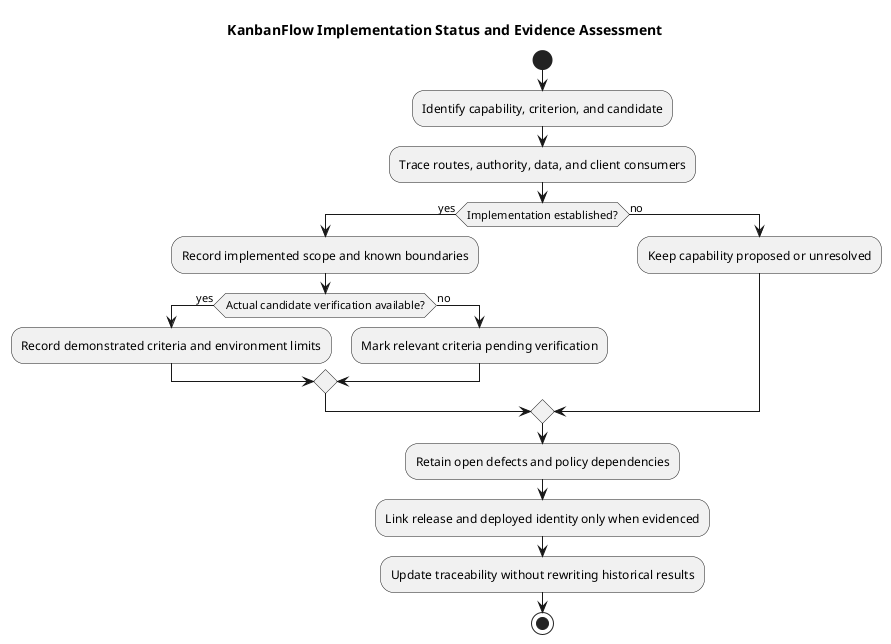

# KanbanFlow Implementation Status

## Reading this status

This is a source-backed capability inventory, not a fresh acceptance run or deployment report. The project and frontend metadata identify version 1.1.0. Historical release records remain historical; subsequent documentation commits do not certify application behavior or create a new tagged release.

## Capability inventory

| Area | Observed implementation | Evidence and limits |
| --- | --- | --- |
| Authentication | Registration, login/logout, authenticated-user retrieval, SPA session handling, protected client routes. | [Authentication design](../04-design/authentication-and-authorization.md); password-change/recovery functionality is not established by reset-token tables. |
| Collaboration hierarchy | Workspaces, members, projects, boards, columns, and tasks. | [Request contracts](../04-design/route-and-request-contracts.md) and [schema](../04-design/schema-reference.md); endpoint authority and ancestry matter. |
| Workflow | Ordering/movement, task assignment/completion, and active-task WIP enforcement. | [Editor interactions](../04-design/editor-interaction-flow.md); SQLite checks do not establish MySQL contention safety. |
| Collaboration signals | Task comments, activity, notifications, workspace analytics. | Route/controller evidence is needed for exact actor permissions and response contracts. |
| Client experience | Shared shell, dialogs, password visibility, Light/Dark/System themes, selected keyboard movement support. | [UI design](../04-design/ui-and-accessibility-design.md); no broad accessibility conformance claim. |
| Automation | CI jobs for backend tests and frontend lint/build on main pushes and pull requests. | [Workflow](../../../.github/workflows/ci.yml); job configuration is not a passing run. |

## Open issues and proposed capabilities

The manager remove/re-add path can bypass intended owner-only role changes. Track [DEC-003](../../Project-Management/decision-register.md) and [PB-001](../../Project-Management/product-backlog.md); documentation does not close this defect or decide the future policy.

Attachment storage, PDF/export delivery, anonymous public sharing, and password-change journeys have design material but no established implemented endpoints in the documented baseline. Workspace visibility metadata does not itself establish public access. Soft deletion does not imply restore UI, physical erasure, or automatic descendant soft deletion.

## Status vocabulary and evidence

| State | Required basis | What it does not mean |
| --- | --- | --- |
| Proposed | Requirement/design with scope and unresolved decisions visible. | An available endpoint or working user journey. |
| Implemented pending verification | Relevant source and contracts identified. | Acceptance criteria have passed. |
| Verified for a candidate/environment | Actual recorded checks against exact source and environment. | Universal correctness across engines, browsers, or later commits. |
| Released | Actual published tag/release identity and included changes recorded. | Running production source matches the release. |
| Deployed and observed | Actual target identity and post-rollout verification. | Backup restoration or all operational objectives have been demonstrated. |
| Open issue | Reproducible defect or unresolved decision with impact and next action. | An accepted fix merely because documentation mentions it. |

These states may coexist across different criteria for one capability. Record partial evidence instead of applying a blanket Complete label to the entire project.

## Source navigation for status assessment

| Evidence location | Assess |
| --- | --- |
| [Backend routes](../../../backend/routes/) | Exposed methods, paths, middleware, and invoked controllers. |
| [Backend application source](../../../backend/app/) | Actual authorization, visibility, validation, persistence, and side effects. |
| [Migrations](../../../backend/database/migrations/) | Defined schema, constraints, deletion behavior, and data compatibility. |
| [Frontend source](../../../frontend/src/) | Available pages, requests, shared controls, and loading/error interactions. |
| [Backend test inventory](../06-testing/automated-test-inventory.md) | Assertions present and environment limitations; execution needs separate results. |
| [Release records](../../Releases/README.md) | Historical tagged changes and documented verification at that time. |

Read a complete request path before concluding a capability is available or authorized. A policy method without a corresponding invoked endpoint, an unused schema field, or framework configuration alone is insufficient feature evidence.

## Detailed behavior boundaries

| Capability | Boundary to preserve in status reports |
| --- | --- |
| Workspace ownership and roles | Membership-scoped access and operation-specific authority; direct role restrictions do not resolve indirect manager changes. |
| Private boards | Visibility also affects downstream tasks, analytics, and activity. Creator read access does not establish mutation authority. |
| Board mutation | Current controllers invoke project update authority; BoardPolicy existence alone does not describe endpoint enforcement. |
| Movement and WIP | Dedicated move contracts, active-task rules, stale source conflicts, and persisted ordering need affected acceptance evidence. |
| Assignment and notifications | Current workspace eligibility, change-sensitive notification behavior, and own-user notification access matter. |
| Comments | Nested identity, current board access, author editing, and applicable moderation differ by operation. |
| Deletion | Endpoint soft deletion and observed position handling do not establish descendant restoration, physical erasure, or a general cascade. |
| Browser preferences | Themes and board preferences are browser-local behavior; account-wide synchronization is not established. |

Use [authorization flow](../04-design/authorization-decision-flow.md), [schema reference](../04-design/schema-reference.md), and [UI guidance](../04-design/ui-and-accessibility-design.md) for the detailed contracts rather than broad feature-list assumptions.

## Verification and operational gaps

| Question | Evidence still required when assessed |
| --- | --- |
| Does this candidate pass backend regression? | Actual suite/scenario result and candidate/environment identity. |
| Does the client behave correctly? | Browser acceptance, pending/failure recovery, persisted-state and relevant keyboard/theme observations. |
| Is ordering/WIP safe under relevant contention? | Isolated MySQL observations with competing requests and resulting data; SQLite alone is insufficient. |
| Are dependencies/platform compatible and secure? | Locked installation/platform checks and separately dated advisory assessment. |
| Is a candidate running on a target? | Runtime source/assets/configuration identity and post-rollout checks. |
| Is recovery reliable? | Actual backup integrity/restore rehearsal and measured outcomes against agreed objectives. |

No numeric coverage percentage, measured performance threshold, uptime achievement, accessibility certification, or completed production recovery is asserted by this status document. CI configuration is visible; candidate-specific job outcomes must be inspected before reporting them.

## Change record and closure

For a status change record capability/criterion, requirement or backlog reference, old/new state, source paths, full candidate SHA, actual checks, residual issues, and any release/runtime identity. Use [verification records](../06-testing/verification-record-template.md) and [traceability](../../Project-Management/traceability.md) to keep the assessment reviewable.

Close DEC-003/PB-001 only after the intended membership policy is agreed, direct and indirect operations are enforced, and relevant acceptance/regression evidence exists. Do not mark proposed downloads, PDF, sharing, or password-change features implemented without routes, authority, storage/data behavior, and functioning consumer evidence.

Update this inventory when application behavior changes, not merely when another document is expanded. Preserve historical releases and identify later source changes through commit history; version metadata alone does not indicate what is installed or deployed.

## How to update status

For each change record requirement/backlog identity, affected source, candidate commit, actual acceptance evidence, remaining limitations, and release linkage. Use statuses such as proposed, implemented pending verification, verified for a named candidate/environment, and released with a tag. Do not mark a feature verified solely because its source exists or a document was completed.

## Evidence gaps

Record browser regression and accessibility observations for affected journeys, production-like MySQL checks for concurrency-sensitive changes, and deployment/rollback evidence for an actual rollout. No fresh application test, vulnerability audit, production deployment, or performance measurement was executed to produce this inventory.

See [milestones](../../Project-Management/milestones.md), [unreleased work](../../Releases/unreleased.md), and [verification template](../../Releases/verification-template.md) for delivery context.

## PlantUML diagram

[Editable PlantUML source](diagrams/implementation-status.puml)

