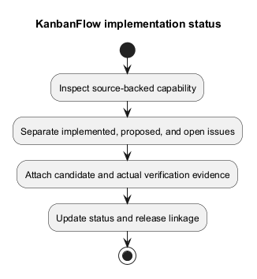
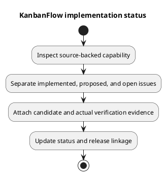

# KanbanFlow Implementation Status

## Reading this status

This is a source-backed capability inventory, not a fresh acceptance run or deployment report. The project and frontend metadata identify version 1.1.0. Historical release records remain historical; subsequent documentation commits do not certify application behavior or create a new tagged release.

## Capability inventory

| Area | Observed implementation | Evidence and limits |
| --- | --- | --- |
| Authentication | Registration, login/logout, authenticated-user retrieval, SPA session handling, protected client routes. | [Authentication design](../04-design/authentication-and-authorization.md); password-change/recovery functionality is not established by reset-token tables. |
| Collaboration hierarchy | Workspaces, members, projects, boards, columns, and tasks. | [Request contracts](../04-design/route-and-request-contracts.md) and [schema](../04-design/schema-reference.md); endpoint authority and ancestry matter. |
| Workflow | Ordering/movement, task assignment/completion, and active-task WIP enforcement. | [Editor interactions](../04-design/editor-interaction-flow.md); SQLite checks do not establish MySQL contention safety. |
| Collaboration signals | Task comments, activity, notifications, workspace analytics. | Route/controller evidence is needed for exact actor permissions and response contracts. |
| Client experience | Shared shell, dialogs, password visibility, Light/Dark/System themes, selected keyboard movement support. | [UI design](../04-design/ui-and-accessibility-design.md); no broad accessibility conformance claim. |
| Automation | CI jobs for backend tests and frontend lint/build on main pushes and pull requests. | [Workflow](../../../.github/workflows/ci.yml); job configuration is not a passing run. |

## Open issues and proposed capabilities

The manager remove/re-add path can bypass intended owner-only role changes. Track [DEC-003](../../Project-Management/decision-register.md) and [PB-001](../../Project-Management/product-backlog.md); documentation does not close this defect or decide the future policy.

Attachment storage, PDF/export delivery, anonymous public sharing, and password-change journeys have design material but no established implemented endpoints in the documented baseline. Workspace visibility metadata does not itself establish public access. Soft deletion does not imply restore UI, physical erasure, or automatic descendant soft deletion.

## How to update status

For each change record requirement/backlog identity, affected source, candidate commit, actual acceptance evidence, remaining limitations, and release linkage. Use statuses such as proposed, implemented pending verification, verified for a named candidate/environment, and released with a tag. Do not mark a feature verified solely because its source exists or a document was completed.

## Evidence gaps

Record browser regression and accessibility observations for affected journeys, production-like MySQL checks for concurrency-sensitive changes, and deployment/rollback evidence for an actual rollout. No fresh application test, vulnerability audit, production deployment, or performance measurement was executed to produce this inventory.

See [milestones](../../Project-Management/milestones.md), [unreleased work](../../Releases/unreleased.md), and [verification template](../../Releases/verification-template.md) for delivery context.

## PlantUML diagram

[Editable PlantUML source](diagrams/implementation-status.puml)

