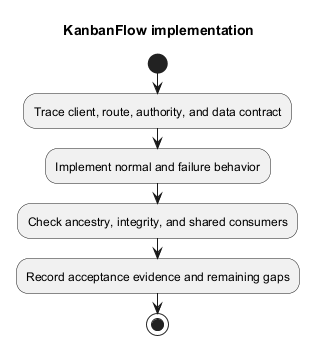
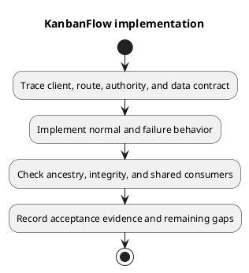

# KanbanFlow Implementation Guide

## Scope and boundaries

The application separates the React/TypeScript client in `frontend/` from the Laravel API in `backend/`. Trace a change through the consuming page or feature, API request, route, controller, policy, model, and migration as applicable. Consult [repository layout](../04-design/repository-layout.md) and [request contracts](../04-design/route-and-request-contracts.md) before adding parallel abstractions or changing response shapes.

## Implementation responsibilities

| Boundary | Required care |
| --- | --- |
| Client | Keep loading, empty, error, and pending states usable; validate inputs without treating client checks as authorization. |
| API | Resolve nested resource ancestry and invoke the applicable server authorization before mutation. Preserve documented status codes and payload contracts. |
| Persistence | Use appropriate transactions and locks for ordering/WIP changes. Explain migrations and compatibility with existing records. |
| Shared UI | Check representative consumers, supported themes, keyboard operation, and focus behavior. |
| Documentation | Describe actual behavior separately from intended targets and unimplemented proposals. |

Board mutation endpoints currently invoke project update authority; do not infer invoked authorization solely from the existence of a BoardPolicy method. The manager removal/re-addition issue remains open in [DEC-003](../../Project-Management/decision-register.md). A new membership change must address the agreed policy and its indirect paths explicitly.

## Data and interaction integrity

Use dedicated movement contracts for position changes rather than ordinary update fields that prohibit `position`. Verify destination membership/ancestry, active-task WIP rules, stale-resource conflicts, and failure recovery for relevant changes. Soft deletion is not proof of descendant soft deletion, erasure, or a restore feature. Describe the actual endpoint and persistence behavior instead of assuming a general cascade.

## Change specification

Record the trigger, actor, before/after behavior, affected sources, acceptance cases, and compatibility concerns. Include unauthorized actors and invalid nested identifiers for permission changes; include pending, retry, and failed requests for client mutations. Keep proposed attachment, PDF, public-sharing, and password-change designs separate from implemented endpoints.

## Review and completion

Review the final diff for scope, secrets, contracts, and regressions. Run the relevant checks from [development workflow](development-workflow.md); document environment-sensitive gaps. Connect requirement, decision, source, check, and release evidence through [traceability](../../Project-Management/traceability.md). Documentation completion is not fresh runtime verification.

## PlantUML diagram

[Editable PlantUML source](diagrams/implementation.puml)

