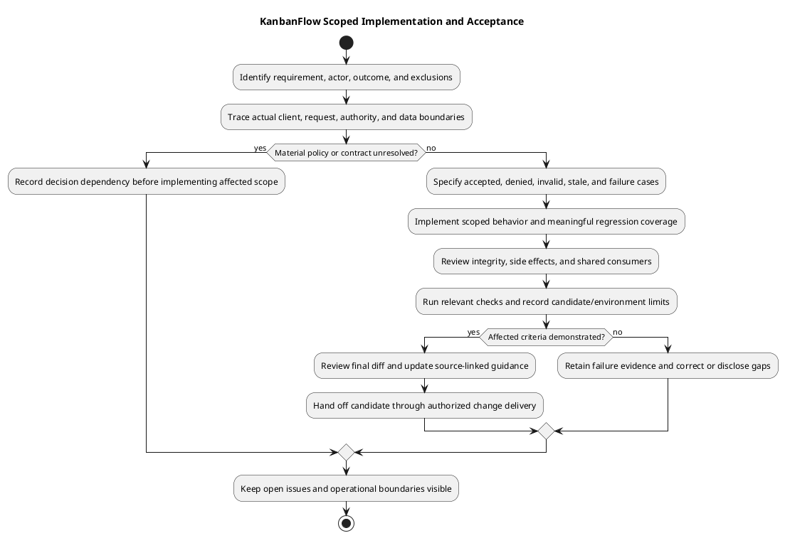

# KanbanFlow Implementation Guide

> **Policy amendment (2026-10-10):** Membership mutations are now owner-only; DEC-003/PB-001's bypass is fixed. Earlier open-policy text and diagrams below describe the preceding state. See [QA corrections](../06-testing/qa-corrections-2026-10-10.md) for the selected rule and regression evidence.

## Scope and boundaries

The application separates the React/TypeScript client in `frontend/` from the Laravel API in `backend/`. Trace a change through the consuming page or feature, API request, route, controller, policy, model, and migration as applicable. Consult [repository layout](../04-design/repository-layout.md) and [request contracts](../04-design/route-and-request-contracts.md) before adding parallel abstractions or changing response shapes.

## Implementation responsibilities

| Boundary | Required care |
| --- | --- |
| Client | Keep loading, empty, error, and pending states usable; validate inputs without treating client checks as authorization. |
| API | Resolve nested resource ancestry and invoke the applicable server authorization before mutation. Preserve documented status codes and payload contracts. |
| Persistence | Use appropriate transactions and locks for ordering/WIP changes. Explain migrations and compatibility with existing records. |
| Shared UI | Check representative consumers, supported themes, keyboard operation, and focus behavior. |
| Documentation | Describe actual behavior separately from intended targets and unimplemented proposals. |

Board mutation endpoints currently invoke project update authority; do not infer invoked authorization solely from the existence of a BoardPolicy method. The manager removal/re-addition issue remains open in [DEC-003](../../Project-Management/decision-register.md). A new membership change must address the agreed policy and its indirect paths explicitly.

## Data and interaction integrity

Use dedicated movement contracts for position changes rather than ordinary update fields that prohibit `position`. Verify destination membership/ancestry, active-task WIP rules, stale-resource conflicts, and failure recovery for relevant changes. Soft deletion is not proof of descendant soft deletion, erasure, or a restore feature. Describe the actual endpoint and persistence behavior instead of assuming a general cascade.

## Change specification

Record the trigger, actor, before/after behavior, affected sources, acceptance cases, and compatibility concerns. Include unauthorized actors and invalid nested identifiers for permission changes; include pending, retry, and failed requests for client mutations. Keep proposed attachment, PDF, public-sharing, and password-change designs separate from implemented endpoints.

## From requirement to change

1. Identify the requirement/backlog item, actor, trigger, expected result, and exclusions.
2. Inspect the actual callers and full request path; resolve material policy or contract questions before encoding a choice.
3. Define normal, invalid, denied, stale, and failure acceptance cases as relevant.
4. Implement a small coherent change and meaningful regression coverage while preserving unrelated work.
5. Review affected consumers, persistence, and side effects; update documentation where behavior changes.
6. Record actual checks for the candidate and hand off through [change delivery](change-delivery.md).

Use [implementation status](implementation-status.md) to distinguish source-backed capabilities from proposals and known issues. A design document, framework table, or unused model field does not establish an implemented user journey.

## Backend request implementation

| Concern | Implementation and review expectation |
| --- | --- |
| Authentication | Preserve the applicable session/Sanctum boundary and CSRF behavior; do not substitute client redirects for protection. |
| Nested resources | Resolve the requested workspace/project/board/column/task relationship before acting on IDs. |
| Authority | Invoke the operation's actual server policy/check; test current membership, roles, visibility, and indirect paths. |
| Validation | Validate submitted fields and domain rules; preserve dedicated movement contracts and prohibited ordinary position updates. |
| Persistence | Assess transaction/lock scope, stale state, integrity, and compatibility with existing records. |
| Response | Preserve operation-specific payload/status expectations and avoid private data exposure in errors or related listings. |
| Side effects | Assess activity, assignment notifications, and other effects so failed or repeated operations do not misrepresent accepted state. |

Consult [authentication](../04-design/authentication-and-authorization.md), [authorization flow](../04-design/authorization-decision-flow.md), and [error handling](../04-design/error-handling-design.md). Controller invocation and actual queries determine behavior; policy declarations alone are insufficient evidence.

## Frontend implementation

Trace a feature's page/component, form schema, API helper, query/mutation, and consumers before changing its contract. Keep required configuration explicit and align the real API origin with SPA session settings. Preserve distinct loading, empty, pending, validation, permission, and connection-failure behavior.

For optimistic operations, assess the actual rollback and authoritative refresh path. Do not imply every mutation is safely repeatable or that simultaneous edits merge automatically. Verify persisted state after refresh and error recovery, not just the visible immediate result.

Prefer existing shared controls when their behavior fits the requirement. Check representative forms/dialogs and supported themes when shared components change. Labels, focus restoration, keyboard interaction, and information versus editable-control semantics need observable acceptance cases. Follow [UI and accessibility design](../04-design/ui-and-accessibility-design.md).

## Data changes and concurrency

Review [schema reference](../04-design/schema-reference.md) and actual migrations for foreign keys, uniqueness, nullable fields, and deletion behavior. A database constraint cannot substitute for membership or domain validation where none exists. A soft-delete column does not establish a restore workflow or descendant cascade.

For movement/WIP work, inspect source/destination ancestry, active versus completed task counts, boundary positions, transaction/lock ordering, and stale source checks. Verify rejected actions leave the intended persisted state. In-memory SQLite regressions do not demonstrate MySQL contention; use isolated engine-specific cases when affected.

For a migration, explain existing-record compatibility, rollout sequencing, and recovery implications. Avoid destructive reset commands on existing/shared data and do not assume an older application can safely use the new schema. Use [upgrade guidance](../../Releases/upgrade-and-rollback.md).

## Dependencies, configuration, and maintainability

Keep dependency/runtime changes deliberate and review manifests plus lockfiles using [dependency baseline](dependency-baseline.md). Keep keys, credentials, private fixtures, and environment values outside committed source. Existing-installation key generation or migrations are assessed operations rather than routine checks.

Use repository conventions and focused names, keep error behavior understandable, and avoid new abstractions that duplicate existing request or shared-control responsibilities without a concrete need. Refactor only what the accepted change requires; preserve public contracts and unrelated work.

## Verification by affected boundary

| Boundary | Relevant evidence |
| --- | --- |
| API/authority | Backend assertions for accepted and denied actors, wrong ancestry, validation, and persisted effects. |
| Workflow integrity | Ordering/WIP and stale-state cases, failure recovery, and MySQL contention where relevant. |
| Client/shared UI | Lint/build plus affected browser journeys, themes, keyboard/focus, and errors. |
| Dependency/schema | Locked installation/platform checks and affected behavior/data compatibility. |
| Documentation | Local links, source accuracy, matching embedded/editable diagrams, readable previews, and patch formatting. |

Use [test strategy](../06-testing/test-strategy.md) and [verification records](../06-testing/verification-record-template.md). Retain failed/blocked/Not run cases and candidate identity. Configured CI, historical release results, and successful compilation do not establish unobserved runtime behavior.

## Completion checklist and handoff

- The final change implements the accepted trigger/result and preserves operation-specific authority and contracts.
- Relevant failure/denial/integrity cases have evidence or explicit remaining gaps.
- Dependency, schema, configuration, and operational consequences are documented when affected.
- Shared consumers and source-linked documentation/diagrams have been reviewed.
- The intended diff excludes unrelated work and secrets; actual delivery identity and outcome are recorded.

Open DEC-003 and proposed attachment/export/sharing/password-change capabilities remain visible until their own scope and evidence justify a status change. Implementation completion does not itself create a release tag, deploy a target, certify accessibility/security, or demonstrate recovery.

## Review and completion

Review the final diff for scope, secrets, contracts, and regressions. Run the relevant checks from [development workflow](development-workflow.md); document environment-sensitive gaps. Connect requirement, decision, source, check, and release evidence through [traceability](../../Project-Management/traceability.md). Documentation completion is not fresh runtime verification.

## PlantUML diagram

[Editable PlantUML source](diagrams/implementation.puml)

