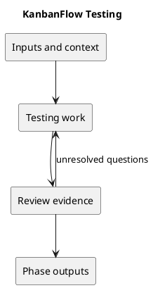

# Testing

## Purpose and activities

Run relevant backend tests, frontend lint, and production build. Current CI runs backend tests and frontend lint/build on main pushes and pull requests into main. Backend tests use in-memory SQLite; MySQL contention and browser usability require separate checks.

## Completion evidence

Evidence tied to the tested commit and environment, including failures and unverified boundaries. Do not infer usability or MySQL concurrency correctness from build or SQLite success.

## Related guidance

- [Supporting documentation](../../Project-Management/quality-and-risk-plan.md)
- [SDLC index](../README.md)

## PlantUML workflow

[Editable source](diagrams/workflow.puml)

