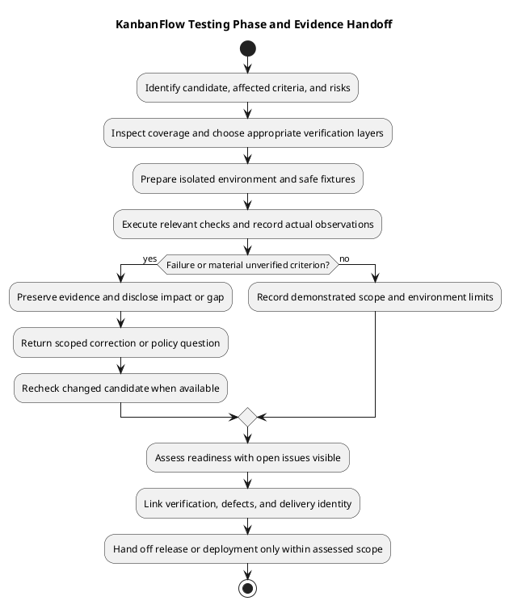

# KanbanFlow Testing

> **Policy amendment (2026-10-10):** Membership mutations are now owner-only; DEC-003/PB-001's bypass is fixed. Earlier open-policy text and diagrams below describe the preceding state. See [QA corrections](qa-corrections-2026-10-10.md) for the selected rule and regression evidence.

## Purpose and evidence rules

Testing assesses a named candidate against explicit acceptance criteria. Keep source inspection, static checks, automated execution, browser observations, and operational verification separate. A checklist or test file is not evidence of a passing run.

## Document catalog

| Document | Purpose |
| --- | --- |
| [Test strategy](test-strategy.md) | Scope, priorities, environments, and completion decisions. |
| [Testing](testing.md) | Repeatable execution and failure investigation. |
| [Automated test inventory](automated-test-inventory.md) | Existing suites, configured checks, and coverage limits. |
| [Manual acceptance checklist](manual-acceptance-checklist.md) | Browser journeys and failure-path observations. |
| [Security regression matrix](security-regression-matrix.md) | Actors, boundaries, and denial cases. |
| [Verification layers](verification-layers.md) | What each evidence layer can establish. |
| [Verification record template](verification-record-template.md) | Candidate-specific result capture. |
| [Documentation review — 2026-10-08](documentation-review-2026-10-08.md) | Scope and limits of this documentation review. |

The dated documentation review records its original scope and exclusions. It is historical documentation evidence, not fresh application verification for later commits.

## How to use this section

Start with [test strategy](test-strategy.md) to define affected acceptance criteria and risks. Consult [automated inventory](automated-test-inventory.md) for source coverage, then [verification layers](verification-layers.md) to identify checks that require another environment or method. Execute through [testing procedure](testing.md), [manual acceptance](manual-acceptance-checklist.md), and [security matrix](security-regression-matrix.md) as relevant. Record actual results in the [verification template](verification-record-template.md).

The documents organize verification; they do not assign an operator, approve a release, or certify the application by their existence.

## Entry checklist

- Identify the exact candidate SHA and any uncommitted changes affecting the checked state.
- Link requirements, changed paths, acceptance cases, and relevant design contracts.
- Record actual runtime/tool versions, database engine, browser context, and isolated fixtures as applicable.
- Identify known defects, unresolved policies, excluded environments, and side-effect controls.
- Select checks capable of assessing the property at risk before execution.

Do not run destructive fixture/reset operations against an unidentified or shared database. Keep credentials, tokens, cookies, and private data out of shared verification artifacts.

## Check selection by affected behavior

| Change | Evidence to select |
| --- | --- |
| API/permissions | Accepted and denied actors, current membership, nested ancestry, visibility, validation, and persisted effects. |
| Movement/WIP | Ordering and boundary cases, active/completed tasks, stale state, failure recovery, and isolated MySQL contention when relevant. |
| Authentication | Backend assertions plus real browser session/CSRF/origin behavior for affected configuration or journeys. |
| Shared UI | Lint/build plus representative consumers, themes, narrow/zoom layout, keyboard/focus, and pending/error paths. |
| Dependencies/schema | Locked installation/platform checks, existing-record compatibility, affected behavior, and migration/recovery assessment. |
| Documentation | Source accuracy, local links, embedded/editable diagram identity, readable previews, and patch formatting. |

DEC-003, the manager remove/re-add role bypass, remains open in the [decision register](../../Project-Management/decision-register.md). Direct-role test coverage does not demonstrate that indirect operations are safe.

## Configured baseline and limits

| Check | Location and command | Limit |
| --- | --- | --- |
| Backend suites | `backend/`: `php artisan test` | PHPUnit uses in-memory SQLite and test-specific services; not MySQL contention or real browser evidence. |
| Frontend lint | `frontend/`: `npm run lint` | Static rules, not user journey acceptance. |
| Frontend build | `frontend/`: `npm run build` | TypeScript/Vite compilation and bundling, not accessibility or deployment proof. |
| Patch formatting | Repository: `git diff --check` | Formatting only; staged changes also require staged-diff inspection. |
| CI | [Workflow](../../../.github/workflows/ci.yml) | Backend tests and frontend lint/build on main pushes/pull requests; actual candidate results must be inspected. |

CI configures PHP 8.4 and Node.js 24. The frontend manifest defines no automated test script. Neither configured jobs nor historical README/release claims provide a fresh passing result. No universal coverage percentage, performance threshold, or accessibility/security certification is established here.

## Execution, failures, and corrected candidates

Run targeted relevant cases first and complete required suites/checks for the change. Capture command/scenario, expected/actual outcome, candidate, environment, response and persisted state where relevant. If a failure occurs, preserve its evidence, distinguish environment issues from product defects, and verify the scoped correction on its new candidate.

Retain Pass, Fail, Blocked, Not run, and justified Not applicable states. A successful retry does not erase the original failure; repeated checks are useful when a change, failure, or unresolved risk justifies them. New conflict resolutions or substantive edits invalidate assumptions about unchanged checked behavior.

## Responsibilities and exit assessment

Scope/policy responsibility defines accepted behavior; implementation supplies the actual candidate; verification records observations; review assesses evidence and residual risks. These are responsibilities, not an invented staffing or approval roster.

Exit requires evidence for the affected criteria, reproducible open defects, disclosed unverified boundaries, and a recorded scope-specific outcome. A material confidentiality/integrity failure must remain visible rather than being obscured by unrelated passing tests. An implemented feature may still be pending verification or blocked by policy decisions.

## Handoff

Link requirement, source, check, defect, and delivery identity through [traceability](../../Project-Management/traceability.md). Send scoped corrections back to [implementation](../05-implementation/README.md), recurring issues to [maintenance](../08-maintenance/README.md), and release candidates through the [release checklist](../../Releases/release-checklist.md). Runtime rollout uses [deployment guidance](../07-deployment/README.md) and separate post-deployment evidence.

Document review, source publication, release tagging, runtime deployment, and recovery verification establish different outcomes. Report only the actions and checks actually observed.

## Entry and exit conditions

Start with an identifiable candidate, agreed acceptance cases, isolated data, and the relevant requirements/design. Finish with actual results, reproducible defects, unverified boundaries, and an explicit readiness outcome. Failed or blocked checks remain visible. Release or deployment readiness depends on the affected scope, not a universal count of passing tests.

See [implementation](../05-implementation/README.md), [requirements](../02-requirements/README.md), [quality and risk plan](../../Project-Management/quality-and-risk-plan.md), and [release verification](../../Releases/verification-template.md).

## PlantUML diagram

[Editable PlantUML source](diagrams/workflow.puml)

