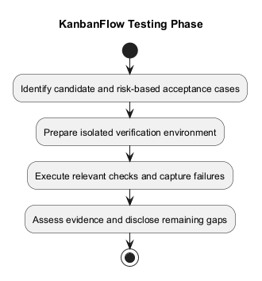
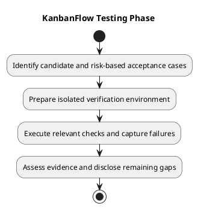

# KanbanFlow Testing

## Purpose and evidence rules

Testing assesses a named candidate against explicit acceptance criteria. Keep source inspection, static checks, automated execution, browser observations, and operational verification separate. A checklist or test file is not evidence of a passing run.

## Document catalog

| Document | Purpose |
| --- | --- |
| [Test strategy](test-strategy.md) | Scope, priorities, environments, and completion decisions. |
| [Testing](testing.md) | Repeatable execution and failure investigation. |
| [Automated test inventory](automated-test-inventory.md) | Existing suites, configured checks, and coverage limits. |
| [Manual acceptance checklist](manual-acceptance-checklist.md) | Browser journeys and failure-path observations. |
| [Security regression matrix](security-regression-matrix.md) | Actors, boundaries, and denial cases. |
| [Verification layers](verification-layers.md) | What each evidence layer can establish. |
| [Verification record template](verification-record-template.md) | Candidate-specific result capture. |
| [Documentation review — 2026-10-08](documentation-review-2026-10-08.md) | Scope and limits of this documentation review. |

The screenshot truncates the documentation-review filename; this catalog uses the current review date rather than inventing a historical record.

## Entry and exit conditions

Start with an identifiable candidate, agreed acceptance cases, isolated data, and the relevant requirements/design. Finish with actual results, reproducible defects, unverified boundaries, and an explicit readiness outcome. Failed or blocked checks remain visible. Release or deployment readiness depends on the affected scope, not a universal count of passing tests.

See [implementation](../05-implementation/README.md), [requirements](../02-requirements/README.md), [quality and risk plan](../../Project-Management/quality-and-risk-plan.md), and [release verification](../../Releases/verification-template.md).

## PlantUML diagram

[Editable PlantUML source](diagrams/workflow.puml)

