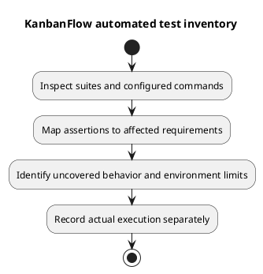

# KanbanFlow Automated Test Inventory

## Inventory basis

This inventory describes committed test files and configured commands inspected during documentation work. No application test execution or numeric coverage measurement is claimed here. Inspect the assertions and run the candidate before assigning a pass status.

## Backend suites

All feature files below are under [backend/tests/Feature](../../../backend/tests/Feature/).

| Files | Scenario families represented in source |
| --- | --- |
| `SpaAuthenticationTest.php` | Trusted origins, session login/logout, registration. |
| `WorkspaceApiTest.php`, `WorkspaceMemberApiTest.php` | Workspace membership/ownership, member addition/removal and direct role restrictions. |
| `ProjectApiTest.php`, `BoardApiTest.php` | Nested access, role restrictions, validation, slugs, board ordering/movement. |
| `ColumnApiTest.php`, `TaskApiTest.php` | Nested columns/tasks, movement, validation, assignment and WIP-related behavior. |
| `TaskCommentApiTest.php` | Comment validation, authorship, moderation, and nested identity. |
| `ActivityLogApiTest.php`, `WorkspaceAnalyticsApiTest.php` | Activity creation/filtering, workspace-scoped analytics and filters. |
| `NotificationApiTest.php` | Assignment notifications, own-user listing/read/delete, and cross-user denial. |
| `ReviewRegressionTest.php` | Private-board visibility including tasks/analytics/activity, removed-author denial, board/column deletion ordering, login throttling. |
| Feature `ExampleTest.php` | Health endpoint response; not database readiness. |

[Unit ExampleTest](../../../backend/tests/Unit/ExampleTest.php) is framework baseline material; its presence is not domain coverage. Existing direct-role tests do not close the manager removal/re-addition issue in [DEC-003](../../Project-Management/decision-register.md).

## Commands and automation

Run `php artisan test` from `backend/`. [PHPUnit configuration](../../../backend/phpunit.xml) defines Unit/Feature suites with in-memory SQLite, array sessions/cache/mail, and synchronous queues. This does not reproduce MySQL lock contention, browser cookie behavior, or production worker configuration.

From `frontend/`, `npm run lint` checks ESLint and `npm run build` performs the TypeScript/Vite build. The [manifest](../../../frontend/package.json) defines no automated test script; no frontend behavioral coverage is asserted.

[CI](../../../.github/workflows/ci.yml) configures backend tests on PHP 8.4 and frontend lint/build on Node.js 24 for main pushes and pull requests. Capture an actual run link and SHA before reporting CI success.

## Inventory maintenance

Map changed requirements to relevant files and assertions, identify missing meaningful regression cases, and record actual execution separately. Prioritize authorization bypasses, ancestry mismatches, ordering/WIP conflicts, and failed optimistic updates. Use [verification layers](verification-layers.md) for gaps requiring browser or database-specific checks.

## PlantUML diagram

[Editable PlantUML source](diagrams/automated-test-inventory.puml)

