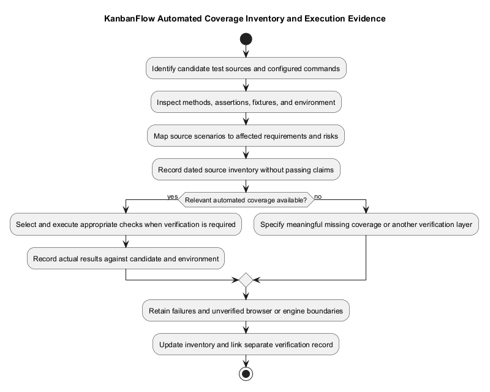
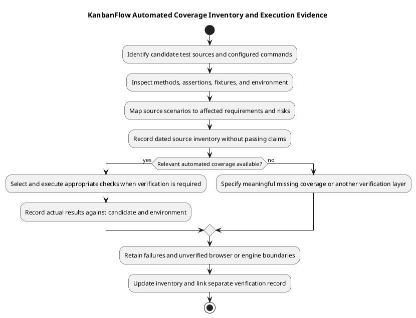

# KanbanFlow Automated Test Inventory

> **Policy amendment (2026-10-10):** Membership mutations are now owner-only; DEC-003/PB-001's bypass is fixed. Earlier open-policy text and diagrams below describe the preceding state. See [QA corrections](qa-corrections-2026-10-10.md) for the selected rule and regression evidence.

## Inventory basis

This inventory describes committed test files and configured commands inspected during documentation work. No application test execution or numeric coverage measurement is claimed here. Inspect the assertions and run the candidate before assigning a pass status.

## Backend suites

All feature files below are under [backend/tests/Feature](../../../backend/tests/Feature/).

| Files | Scenario families represented in source |
| --- | --- |
| `SpaAuthenticationTest.php` | Trusted origins, session login/logout, registration. |
| `WorkspaceApiTest.php`, `WorkspaceMemberApiTest.php` | Workspace membership/ownership, member addition/removal and direct role restrictions. |
| `ProjectApiTest.php`, `BoardApiTest.php` | Nested access, role restrictions, validation, slugs, board ordering/movement. |
| `ColumnApiTest.php`, `TaskApiTest.php` | Nested columns/tasks, movement, validation, assignment and WIP-related behavior. |
| `TaskCommentApiTest.php` | Comment validation, authorship, moderation, and nested identity. |
| `ActivityLogApiTest.php`, `WorkspaceAnalyticsApiTest.php` | Activity creation/filtering, workspace-scoped analytics and filters. |
| `NotificationApiTest.php` | Assignment notifications, own-user listing/read/delete, and cross-user denial. |
| `ReviewRegressionTest.php` | Private-board visibility including tasks/analytics/activity, removed-author denial, board/column deletion ordering, login throttling. |
| Feature `ExampleTest.php` | Health endpoint response; not database readiness. |

[Unit ExampleTest](../../../backend/tests/Unit/ExampleTest.php) is framework baseline material; its presence is not domain coverage. The 2026-10-10 membership regression amendment closes the manager removal/re-addition issue in [DEC-003](../../Project-Management/decision-register.md).

## Commands and automation

Run `php artisan test` from `backend/`. [PHPUnit configuration](../../../backend/phpunit.xml) defines Unit/Feature suites with in-memory SQLite, array sessions/cache/mail, and synchronous queues. This does not reproduce MySQL lock contention, browser cookie behavior, or production worker configuration.

From `frontend/`, `npm run lint` checks ESLint and `npm run build` performs the TypeScript/Vite build. The [manifest](../../../frontend/package.json) now defines `npm test` for ten protected-route session-boundary regression checks. These use controlled query outcomes and do not establish complete browser behavior.

[CI](../../../.github/workflows/ci.yml) configures backend tests on PHP 8.4 and frontend lint/build on Node.js 24 for main pushes and pull requests. Capture an actual run link and SHA before reporting CI success.

## Source definition snapshot — 2026-10-09

The following counts identify `public function test_` definitions in the feature files at the inspected baseline. They are source counts, not executed tests, assertions, discovered cases, passing results, or coverage percentages. Data providers and future naming styles can make execution/discovery counts differ.

| Feature file | Definitions |
| --- | ---: |
| [ActivityLogApiTest](../../../backend/tests/Feature/ActivityLogApiTest.php) | 7 |
| [BoardApiTest](../../../backend/tests/Feature/BoardApiTest.php) | 23 |
| [ColumnApiTest](../../../backend/tests/Feature/ColumnApiTest.php) | 22 |
| [ExampleTest](../../../backend/tests/Feature/ExampleTest.php) | 1 |
| [NotificationApiTest](../../../backend/tests/Feature/NotificationApiTest.php) | 20 |
| [ProjectApiTest](../../../backend/tests/Feature/ProjectApiTest.php) | 12 |
| [ReviewRegressionTest](../../../backend/tests/Feature/ReviewRegressionTest.php) | 7 |
| [SpaAuthenticationTest](../../../backend/tests/Feature/SpaAuthenticationTest.php) | 3 |
| [TaskApiTest](../../../backend/tests/Feature/TaskApiTest.php) | 26 |
| [TaskCommentApiTest](../../../backend/tests/Feature/TaskCommentApiTest.php) | 14 |
| [WorkspaceAnalyticsApiTest](../../../backend/tests/Feature/WorkspaceAnalyticsApiTest.php) | 7 |
| [WorkspaceApiTest](../../../backend/tests/Feature/WorkspaceApiTest.php) | 7 |
| [WorkspaceMemberApiTest](../../../backend/tests/Feature/WorkspaceMemberApiTest.php) | 13 |

Reinspect the candidate when source changes. Do not use the snapshot as a fixed acceptance threshold or combine it with historical passing counts to claim a new run.

## Selected regression mapping

| Behavior | Source cases to inspect | Remaining assessment |
| --- | --- | --- |
| Task movement/assignment | TaskApiTest includes cross-board destination denial, non-member assignee denial, same-column reordering, and owner/manager versus member movement cases. | Actual assertions, fixtures, and candidate execution; broader stale/concurrent schedules are not established by names. |
| Active-task WIP | TaskApiTest includes full-column creation, completed-task creation/movement, and reopening rejection cases. | Engine-specific competing operations and final persisted state when affected. |
| Private data | ReviewRegressionTest includes private-board tasks/analytics/activity and deleted-task activity visibility cases. | Other changed routes, filters, roles, and consumers require their own acceptance cases. |
| Removed access | ReviewRegressionTest includes removed comment-author edit/delete denial. | Current membership changes and related endpoints must be assessed separately. |
| Membership authority | WorkspaceMemberApiTest includes direct role-change restrictions and manager add/remove cases. | Owner-only membership enforcement and indirect-path rejection checks now resolve DEC-003 locally. |
| Own-user notifications | NotificationApiTest includes list/read/delete/read-all isolation and assignment-change behavior. | Actual runtime services and consumer behavior are separate checks. |

Method names help locate evidence; they are not a substitute for reading assertions or executing the candidate. Consult [security matrix](security-regression-matrix.md) and [manual acceptance](manual-acceptance-checklist.md) for complementary scenarios.

## Environment and test isolation

The test bootstrap is [TestCase](../../../backend/tests/TestCase.php), with suites and overrides in [phpunit.xml](../../../backend/phpunit.xml). Inspect actual effective settings before execution; do not assume an existing local environment is isolated solely from the filename.

Configured in-memory SQLite, array sessions/cache/mail, and synchronous queues differ from the local MySQL/database-service example. Feature tests using framework requests or authenticated fixtures do not alone reproduce actual browser origin/CSRF/cookie behavior. Database transactions/fixtures do not prove production lock scheduling, asynchronous delivery, or deployment compatibility.

## Execution record and selection

Run `php artisan test --filter=TaskApiTest` from `backend/` for a targeted task-suite assessment, and `php artisan test` for the configured complete backend suite when required by the change. Select filters from actual class/method names and retain command output, candidate identity, environment, and failures. A filter can omit related consumers and regressions; explain the selected scope.

Use [verification records](verification-record-template.md) to capture actual discovered/executed results separately from this inventory. A skipped, failed, blocked, or unexecuted check stays visible. Changed assertions or conflict resolutions require relevant re-verification on the corrected candidate.

## Gaps and inventory evolution

- Frontend session regression checks now supplement static/build checks; complete browser journeys remain unverified here.
- Browser acceptance, keyboard/focus, themes, real session behavior, and optimistic failure recovery need appropriate observations or newly implemented meaningful coverage.
- MySQL contention, production-like workers, performance measurements, recovery rehearsal, and infrastructure security require separate environments and evidence.
- Proposed attachment/PDF/sharing/password-change designs must not be listed as passing endpoint tests without implementation and actual checks.

When adding coverage, record the requirement/risk, source file and scenario, assertion purpose, environment, and execution evidence. Prioritize meaningful externally observable behavior rather than tests that merely mirror implementation. Update this inventory alongside changed suites while preserving the dated source snapshot as historical evidence or replacing it with a clearly identified new snapshot.

## Inventory maintenance

Map changed requirements to relevant files and assertions, identify missing meaningful regression cases, and record actual execution separately. Prioritize authorization bypasses, ancestry mismatches, ordering/WIP conflicts, and failed optimistic updates. Use [verification layers](verification-layers.md) for gaps requiring browser or database-specific checks.

## PlantUML diagram

[Editable PlantUML source](diagrams/automated-test-inventory.puml)

