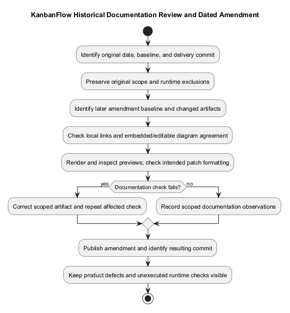
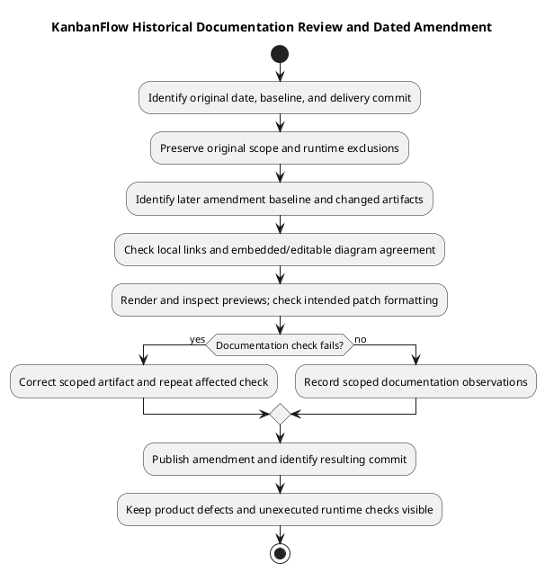

# KanbanFlow Testing Documentation Review — 2026-10-08

## Scope and baseline

This record concerns creation of the `docs/SDLC/06-testing` catalog and supporting documents. The starting repository baseline was `cab28f31817c69441a99f544439c97d465ca0990`. The original documentation delivery commit was `63adaf5ea3bbf0682f4c80584582a3ff3fe4b6ca`. It is not described as an application-tested candidate. Later amendments are identified in Git history and do not change the original review date.

## Reviewed references

The review inspected the existing testing index, backend feature-test names and selected regression source, PHPUnit configuration, frontend package scripts, CI configuration, and the release verification template. The new inventory describes source coverage families without claiming execution or a numeric coverage percentage.

## Documentation checks

Local document/diagram links, embedded PlantUML versus editable source, PNG generation/readability, and staged patch formatting are the checks for this documentation change. Their observed completion is reported in the delivery message after validation; this record defines their scope and does not replace failed-check logs.

## Explicit exclusions

No application suite, browser acceptance run, MySQL concurrency exercise, security/advisory audit, accessibility conformance assessment, CI result inspection, or production deployment was performed as part of writing these documents. Existing test files and configured jobs are not fresh passing evidence.

## Findings and follow-up

- Frontend lint/build are configured; no frontend automated test script is defined in the inspected manifest.
- Backend PHPUnit uses SQLite and test-specific services, leaving MySQL contention and actual browser session behavior to separate verification.
- The manager remove/re-add role issue remains open in [DEC-003](../../Project-Management/decision-register.md).
- Candidate-specific results should use [verification records](verification-record-template.md), with failures and Not run items retained.

See [catalog](README.md) and [verification layers](verification-layers.md) for the resulting documentation structure.

## Original deliverables and check scope

The October 8 change created the testing catalog and eight supporting documents, with matching PlantUML sources and PNG previews. The original delivery report recorded local-link, formatting, diagram-source consistency, and rendered-readability checks. Those observations concern the original documentation candidate; they do not automatically verify files changed afterward.

| Deliverable | Review responsibility |
| --- | --- |
| [Testing index](README.md) | Navigation, phase scope, evidence distinctions, and linked guides. |
| [Automated inventory](automated-test-inventory.md) | Source-backed suite families without fabricated passing results. |
| [Test strategy](test-strategy.md), [testing procedure](testing.md) | Risk-based selection, isolated environments, and failure recording. |
| [Manual checklist](manual-acceptance-checklist.md), [security matrix](security-regression-matrix.md) | Planned scenarios explicitly separate from executed acceptance. |
| [Verification layers](verification-layers.md) | Limits of static, SQLite, browser, database-specific, and operational evidence. |
| [Record template](verification-record-template.md) | Candidate-specific fields without invented testers, approvals, or results. |
| This review record | Historical scope, evidence sources, exclusions, and follow-up. |

## Review method and limitations

Review source references and internal document relationships, resolve local link targets, compare embedded PlantUML with editable `.puml`, regenerate PNG previews, inspect readability, and check the intended patch for formatting. Link existence is structural evidence; it does not prove every technical statement or detect every rendered heading/link issue.

This review did not execute all documented procedures, deeply audit every test assertion, measure automated coverage, or validate every application contract. Configured framework services and test names were used as scoped source evidence, not as runtime certification.

## Evidence classification

| Observation | Classification | Boundary |
| --- | --- | --- |
| Test files and scenario names exist | Source inspection | No execution or passing count implied. |
| PHPUnit/CI/package commands are configured | Configuration inspection | No current run, installed toolchain, or deployed service implied. |
| Local targets and diagram sources agree | Documentation consistency | Not application acceptance. |
| PNGs render and are readable | Artifact review | Not accessibility certification of the product. |
| Commit pushed and identities matched | Source delivery | Not runtime deployment or recovery evidence. |

Keep historical observations linked to the candidate at which they were made. A new document expansion requires fresh checks of its own changed artifacts rather than inheriting the original result.

## Follow-up amendment — 2026-10-09

This amendment expands the historical record from baseline `0ae1e3f5d4063ab31119c9b3aad1a29e5ce50048`, identifies the original delivery commit, and clarifies deliverables, review methods, evidence boundaries, and remaining actions. It changes this Markdown document and its matching PlantUML/PNG only; its resulting commit is recorded in Git history and the delivery report.

The amendment's checks cover local links in this record, embedded/editable diagram agreement, PNG generation and visual readability, and patch formatting. Actual completion is reported after those checks and publication. No broader re-review of every documentation file or new runtime acceptance is implied.

## Remaining actions and closure rules

| Item | State and required next evidence |
| --- | --- |
| Application regression | Not performed for this documentation review; execute relevant checks for an actual candidate. |
| Browser/accessibility observations | Not performed here; record affected journeys and actual browser/input/tool context. |
| MySQL concurrency | Not performed here; use isolated engine-specific contention and persisted-state observations. |
| Manager role bypass | Open DEC-003/PB-001; requires policy decision, enforcement, and relevant regression acceptance. |
| Advisory and operational assessment | Not performed here; needs dated dependency/target evidence and actual authorized operation checks. |

These are follow-up needs, not assigned commitments or completed work. No owner, deadline, approval, numerical coverage, or service target is invented. A documentation check cannot close a product defect. Record eventual execution in a [verification record](verification-record-template.md) and link the actual candidate and outcome.

Preserve this dated record as historical evidence. Add explicit amendments for later clarification rather than rewriting the original scope as if new checks occurred on October 8. Use [documentation traceability](../../Project-Management/documentation-traceability.md) to connect subsequent changes.

## PlantUML diagram

[Editable PlantUML source](diagrams/documentation-review-2026-10-08.puml)

