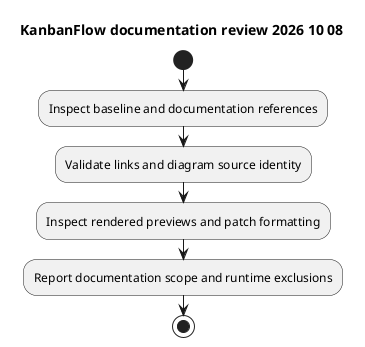

# KanbanFlow Testing Documentation Review — 2026-10-08

## Scope and baseline

This record concerns creation of the `docs/SDLC/06-testing` catalog and supporting documents. The starting repository baseline was `cab28f31817c69441a99f544439c97d465ca0990`. The resulting documentation commit is discoverable in this file's Git history; it is not described as an application-tested candidate.

## Reviewed references

The review inspected the existing testing index, backend feature-test names and selected regression source, PHPUnit configuration, frontend package scripts, CI configuration, and the release verification template. The new inventory describes source coverage families without claiming execution or a numeric coverage percentage.

## Documentation checks

Local document/diagram links, embedded PlantUML versus editable source, PNG generation/readability, and staged patch formatting are the checks for this documentation change. Their observed completion is reported in the delivery message after validation; this record defines their scope and does not replace failed-check logs.

## Explicit exclusions

No application suite, browser acceptance run, MySQL concurrency exercise, security/advisory audit, accessibility conformance assessment, CI result inspection, or production deployment was performed as part of writing these documents. Existing test files and configured jobs are not fresh passing evidence.

## Findings and follow-up

- Frontend lint/build are configured; no frontend automated test script is defined in the inspected manifest.
- Backend PHPUnit uses SQLite and test-specific services, leaving MySQL contention and actual browser session behavior to separate verification.
- The manager remove/re-add role issue remains open in [DEC-003](../../Project-Management/decision-register.md).
- Candidate-specific results should use [verification records](verification-record-template.md), with failures and Not run items retained.

See [catalog](README.md) and [verification layers](verification-layers.md) for the resulting documentation structure.

## PlantUML diagram

[Editable PlantUML source](diagrams/documentation-review-2026-10-08.puml)

