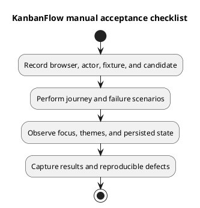

# KanbanFlow Manual Acceptance Checklist

## How to use

These scenarios are planned checks, not completed results. Record candidate, browser/version, viewport/zoom, theme, host configuration, actor, isolated fixture, expected outcome, actual observation, and evidence. Mark unexecuted scenarios Not run. Use the actual endpoint authority described in [design contracts](../04-design/route-and-request-contracts.md).

## User journeys

- [ ] Register valid/invalid input; verify login/logout and subsequent protected API access with real SPA cookies.
- [ ] Open a protected URL as guest; distinguish API/network failure from expired credentials during diagnosis.
- [ ] Create/select workspace, project, board, column, and task with the permitted actor; confirm persisted results after refresh.
- [ ] Check empty lists, loading states, validation messages, permission denial, and unavailable API recovery.
- [ ] Assign/reassign/unassign tasks; inspect completion, WIP acceptance/rejection, and relevant notifications/activity.
- [ ] Move items within/across allowed containers; test boundary positions and refresh-confirmed ordering.
- [ ] Fail a movement request and confirm optimistic client state recovers to authoritative data.
- [ ] Create/edit/delete comments as author and permitted moderator; verify denial for other/removed actors.
- [ ] Inspect analytics/activity/notifications with private-board and cross-user fixtures for data exposure.
- [ ] Cancel and confirm destructive actions; distinguish soft deletion from restoration or physical erasure.

## UI and accessibility

- [ ] Check Light, Dark, and System modes, system changes, tab synchronization, and storage failure handling.
- [ ] Navigate using keyboard, skip link, links/buttons, focus indicators, and supported movement handles.
- [ ] Inspect dialog initial focus, Tab/Shift+Tab containment, close/busy behavior, and focus restoration.
- [ ] Check form labels, password visibility, field errors, pending feedback, and changing status announcements.
- [ ] Inspect narrow screens, zoom, long names/content, overflow, and reduced-motion settings.
- [ ] Record applicable screen-reader observations and measured contrast checks; do not claim conformance without evidence.
- [ ] Confirm creator/date metadata is presented as information rather than editable input.

See [UI design](../04-design/ui-and-accessibility-design.md). Shared component changes require representative consumer checks; one successful dialog does not cover every form.

## Results and defects

For a defect record reproducible steps, expected/actual behavior, candidate/environment, impact, and next action. Avoid real-user secrets in screenshots. Link the result in a [verification record](verification-record-template.md); checkbox presence alone is not proof of acceptance.

## PlantUML diagram

[Editable PlantUML source](diagrams/manual-acceptance-checklist.puml)

