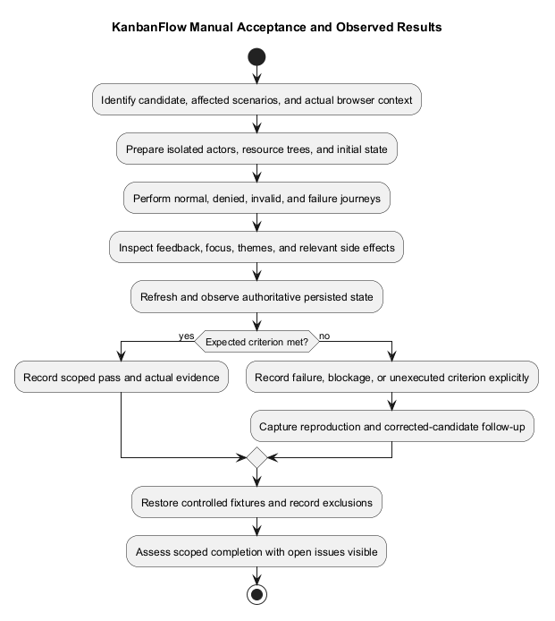
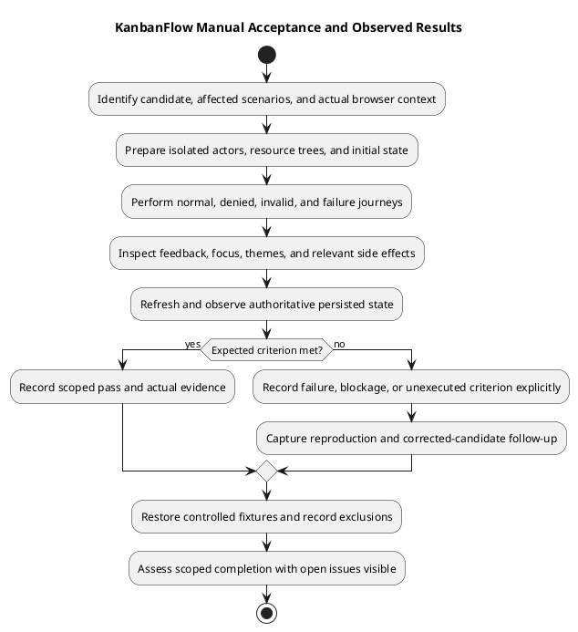

# KanbanFlow Manual Acceptance Checklist

> **Policy amendment (2026-10-10):** Membership mutations are now owner-only; DEC-003/PB-001's bypass is fixed. Earlier open-policy text and diagrams below describe the preceding state. See [QA corrections](qa-corrections-2026-10-10.md) for the selected rule and regression evidence.

## How to use

These scenarios are planned checks, not completed results. Record candidate, browser/version, viewport/zoom, theme, host configuration, actor, isolated fixture, expected outcome, actual observation, and evidence. Mark unexecuted scenarios Not run. Use the actual endpoint authority described in [design contracts](../04-design/route-and-request-contracts.md).

## User journeys

- [ ] Register valid/invalid input; verify login/logout and subsequent protected API access with real SPA cookies.
- [ ] Open a protected URL as guest; distinguish API/network failure from expired credentials during diagnosis.
- [ ] Create/select workspace, project, board, column, and task with the permitted actor; confirm persisted results after refresh.
- [ ] Check empty lists, loading states, validation messages, permission denial, and unavailable API recovery.
- [ ] Assign/reassign/unassign tasks; inspect completion, WIP acceptance/rejection, and relevant notifications/activity.
- [ ] Move items within/across allowed containers; test boundary positions and refresh-confirmed ordering.
- [ ] Fail a movement request and confirm optimistic client state recovers to authoritative data.
- [ ] Create/edit/delete comments as author and permitted moderator; verify denial for other/removed actors.
- [ ] Inspect analytics/activity/notifications with private-board and cross-user fixtures for data exposure.
- [ ] Cancel and confirm destructive actions; distinguish soft deletion from restoration or physical erasure.

## UI and accessibility

- [ ] Check Light, Dark, and System modes, system changes, tab synchronization, and storage failure handling.
- [ ] Navigate using keyboard, skip link, links/buttons, focus indicators, and supported movement handles.
- [ ] Inspect dialog initial focus, Tab/Shift+Tab containment, close/busy behavior, and focus restoration.
- [ ] Check form labels, password visibility, field errors, pending feedback, and changing status announcements.
- [ ] Inspect narrow screens, zoom, long names/content, overflow, and reduced-motion settings.
- [ ] Record applicable screen-reader observations and measured contrast checks; do not claim conformance without evidence.
- [ ] Confirm creator/date metadata is presented as information rather than editable input.

See [UI design](../04-design/ui-and-accessibility-design.md). Shared component changes require representative consumer checks; one successful dialog does not cover every form.

## Preparation and fixtures

Use a known candidate with matching client assets/API and isolated data. Prepare owner, manager, member, viewer, outsider, and removed-member accounts as required; avoid real-user passwords or content. Create two workspaces with distinguishable resource trees, a workspace-visible board, a private board, active/completed tasks, and a column with a small positive WIP limit. Record initial ordering, assignments, and counts before mutation scenarios.

Confirm actual hosts, browser cookies/CSRF behavior, and API reachability. Select affected scenarios from the diff and [test strategy](test-strategy.md); explain omissions rather than checking every box without execution. Destructive/failure scenarios belong in controlled fixtures, not shared production data.

## Repeatable acceptance scenarios

The IDs below identify planned cases for result records. Expected outcomes are acceptance properties to assess against current contracts; they are not statements that these cases have passed.

| ID | Procedure | Expected outcome / observation |
| --- | --- | --- |
| MA-001 | Register valid data, then submit invalid/duplicate data in isolated accounts. | Accepted session/user behavior and useful rejection feedback; invalid attempts do not create unintended records. |
| MA-002 | Sign in, open a protected route, sign out, then request protected data again. | Real session access works and logout revokes protected access; record actual API and client behavior. |
| MA-003 | Navigate from workspace to project to board and use breadcrumbs/back links. | Intended resource and context remain clear; refresh/deep links resolve with applicable authority. |
| MA-004 | Create/edit a resource with a permitted actor; submit invalid fields and repeat as a denied actor. | Accepted values persist after refresh; invalid/denied operations leave state unchanged with understandable feedback. |
| MA-005 | Assign, reassign, and unassign a task; try a non-member assignee through an authorized direct-request test if needed. | Valid assignment persists, invalid assignment is rejected, and relevant assignment notifications/activity match accepted changes. |
| MA-006 | Fill the WIP column with active tasks; try creation, movement, and reopening beyond its limit. | Relevant active-task operations reject overflow without unintended persistence; assess completed-task behavior separately. |
| MA-007 | Reorder items and move a task to another allowed column; refresh. | Authoritative source/destination and ordering match accepted operations; boundary positions follow the contract. |
| MA-008 | Interrupt/reject a movement request in a controlled environment. | User sees failure and optimistic state recovers to authoritative data; refresh does not reveal a hidden unintended move. |
| MA-009 | Create/edit/delete comments as author, another member, moderator, and removed author. | Current-access and operation-specific authorship/moderation rules hold; rejected attempts leave state unchanged. |
| MA-010 | Inspect private-board content and related analytics/activity using allowed and denied actors. | Visibility applies to affected detail/list/related views; no hidden content leaks through summaries or activity. |
| MA-011 | List/read/delete notifications with two different users. | Own-user state changes correctly and another user's data cannot be accessed or modified. |
| MA-012 | Cancel a destructive action, then confirm one with a permitted actor; refresh affected views. | Cancel preserves state; confirmed operation follows actual soft-delete/ordering behavior without claiming restoration or erasure. |
| MA-013 | Observe empty, slow/loading, denied, validation, and unavailable-API states. | Feedback and recovery are understandable; pending actions do not imply success before acceptance. |
| MA-014 | Remove membership or change relevant visibility in another session, then revisit affected views/actions. | Current authority is respected; stale client UI does not authorize rejected server actions. |

Use [security regression matrix](security-regression-matrix.md) for direct requests, wrong ancestry, and indirect membership operations. DEC-003 remains open; do not treat owner-only direct role-change behavior as proof that manager remove/re-add paths are safe.

## UI acceptance details

| ID | Procedure | Evidence to record |
| --- | --- | --- |
| UI-001 | Exercise Light/Dark/System across affected pages; change system preference and another tab's selection. | Actual mode transitions, readability, persisted preference, tab behavior, and storage-failure limitations. |
| UI-002 | Use Tab/Shift+Tab, Enter/Space, skip link, and available keyboard movement paths. | Focus order/visibility, operable controls, resulting movement, and unsupported paths. |
| UI-003 | Open/close representative dialogs, including invalid/pending states and removed opener conditions. | Initial focus, containment, Escape/close behavior while busy, scroll restoration, and focus return. |
| UI-004 | Submit invalid forms and toggle password visibility. | Labels, field/error relationships, clear pending/error feedback, and visibility button state/name. |
| UI-005 | Use narrow layout, browser zoom, long content, and reduced motion. | Readable content, reachable actions, controlled overflow, and observed motion behavior. |
| UI-006 | Inspect metadata/status and use applicable assistive tools. | Information is distinguishable from inputs; status is understandable beyond color; record actual announcements/contrast measurements when checked. |

Record actual browser/version, dimensions/zoom, theme, input method, and assistive tool/version where used. Do not claim screen-reader or contrast compliance from visual inspection alone. Selected keyboard sensors do not guarantee every drag interaction works without a pointer.

## Failure and persistence observations

After accepted or rejected mutations inspect the response, visible feedback, and authoritative state after refresh. Where side effects matter, check assignment, comments, notifications, activity, and relevant analytics. Reconcile stale UI with current source data before concluding an operation succeeded or corrupted state.

For network interruption, stale resource, session expiry, or service failure, record the controlled trigger and restore the fixture/service afterward. Manual browser cases do not establish all concurrency schedules; MySQL contention needs separate isolated verification.

## Result recording and completion

| Scenario ID | Candidate/environment | Expected | Actual | State | Evidence / defect / next step |
| --- | --- | --- | --- | --- | --- |
| MA-001 | To be recorded | To be assessed | Not observed | Not run | Execute only when in scope. |

Replace the example row with actual results using [verification records](verification-record-template.md). Use Pass, Fail, Blocked, Not run, or justified Not applicable. Capture reproduction steps and impact for failures; preserve evidence for the failing candidate and identify corrected-candidate rechecks separately.

Completion is scope-specific: demonstrate affected criteria, disclose exclusions/open issues, and record the outcome. No browser acceptance run, accessibility audit, or product test result is asserted by expanding this document. Source publication is separate from release/deployment acceptance.

## Results and defects

For a defect record reproducible steps, expected/actual behavior, candidate/environment, impact, and next action. Avoid real-user secrets in screenshots. Link the result in a [verification record](verification-record-template.md); checkbox presence alone is not proof of acceptance.

## PlantUML diagram

[Editable PlantUML source](diagrams/manual-acceptance-checklist.puml)

