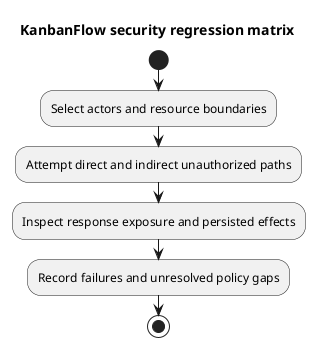

# KanbanFlow Security Regression Matrix

## Scope

Use isolated users and fixtures to assess application authority and confidentiality. This matrix is a verification plan with source references, not an executed penetration test. Resolve exact expectations against current controllers/policies and agreed requirements before recording outcomes.

| Boundary | Actors and attack case | Expected property / evidence |
| --- | --- | --- |
| Authentication | Guest, valid session, logged-out session; unrelated origin and missing/invalid CSRF on applicable SPA mutations. | Protected data/mutations require authentication; record actual middleware response and absence of unauthorized state changes. See `SpaAuthenticationTest.php`; real browser checks remain separate. |
| Workspace | Member versus outsider; owner versus manager for workspace mutation. | Membership-scoped reads and owner-only workspace update/delete. See `WorkspaceApiTest.php`. |
| Membership | Owner, manager, member; direct role change and remove/re-add with changed role. | Owner/current-membership protections; direct restriction tests do not close indirect escalation. DEC-003 remains open pending policy and implementation. |
| Nested resources | Valid object under a wrong workspace/project/board/column/task path. | Ancestry rejection and unchanged state; inspect project/board/column/task/comment suites. |
| Private boards | Owner/manager/creator/member/viewer/outsider; list/detail/tasks/activity/analytics. | Prevent hidden content exposure across downstream routes; `ReviewRegressionTest.php` contains selected cases. Creator visibility does not imply mutation authority. |
| Mutations | Member/viewer versus owner/manager; direct HTTP calls despite hidden UI. | Server enforcement independent of buttons. Board mutation controllers currently invoke project update authority. |
| Assignment and WIP | Non-member assignee, foreign destination, stale column, competing active-task moves. | Validation, integrity, appropriate conflict/rejection, no corrupt persistence. SQLite tests do not establish MySQL contention behavior. |
| Comments | Author, other member, moderator, removed author; wrong task path. | Current board access plus applicable authorship/moderation and ancestry checks. Removed-author regression is present. |
| Notifications | Own-user versus another user's IDs; list/read/delete/read-all. | No cross-user data or mutation; inspect `NotificationApiTest.php`. |
| Throttling | Repeated failed logins with isolated identities/IP context. | Observe configured rate limits without disrupting shared users; selected regression exists. |

Referenced test files are in [backend feature tests](../../../backend/tests/Feature/). See [authorization flow](../04-design/authorization-decision-flow.md), [threat analysis](../03-analysis/security-threat-model-and-risk-analysis.md), and [decision register](../../Project-Management/decision-register.md).

## Observation requirements

Record actor role/current membership, fixture ancestry, request/status, response exposure, and persisted side effects. A denial code alone is insufficient if state or related listings leaked. Repeat relevant cases after removal, visibility changes, and deletion where the changed behavior demands it.

## Coverage limits and handoff

Public sharing, attachment downloads, PDF delivery, and password-change designs are not established routes in this baseline; do not invent successful security tests for them. Dependency advisories, infrastructure configuration, and browser security need their own dated evidence. Link reproducible failures and unverified cases in the [verification record](verification-record-template.md).

## PlantUML diagram

[Editable PlantUML source](diagrams/security-regression-matrix.puml)

