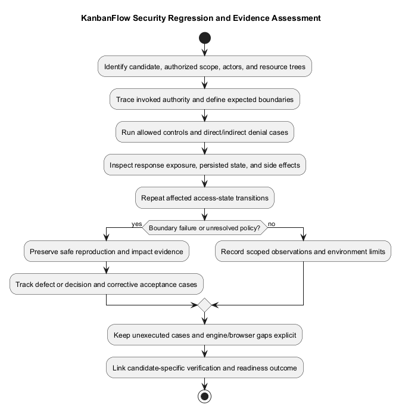
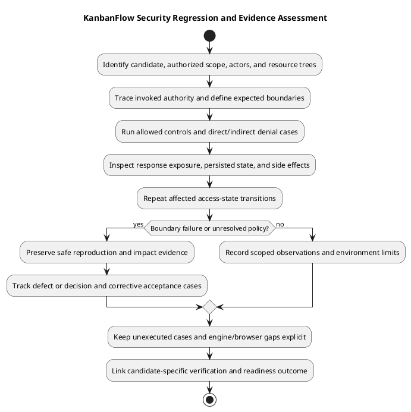

# KanbanFlow Security Regression Matrix

> **Policy amendment (2026-10-10):** Membership mutations are now owner-only; DEC-003/PB-001's bypass is fixed. Earlier open-policy text and diagrams below describe the preceding state. See [QA corrections](qa-corrections-2026-10-10.md) for the selected rule and regression evidence.

## Scope

Use isolated users and fixtures to assess application authority and confidentiality. This matrix is a verification plan with source references, not an executed penetration test. Resolve exact expectations against current controllers/policies and agreed requirements before recording outcomes.

| Boundary | Actors and attack case | Expected property / evidence |
| --- | --- | --- |
| Authentication | Guest, valid session, logged-out session; unrelated origin and missing/invalid CSRF on applicable SPA mutations. | Protected data/mutations require authentication; record actual middleware response and absence of unauthorized state changes. See `SpaAuthenticationTest.php`; real browser checks remain separate. |
| Workspace | Member versus outsider; owner versus manager for workspace mutation. | Membership-scoped reads and owner-only workspace update/delete. See `WorkspaceApiTest.php`. |
| Membership | Owner, manager, member; direct role change and remove/re-add with changed role. | Owner/current-membership protections; direct restriction tests do not close indirect escalation. DEC-003 remains open pending policy and implementation. |
| Nested resources | Valid object under a wrong workspace/project/board/column/task path. | Ancestry rejection and unchanged state; inspect project/board/column/task/comment suites. |
| Private boards | Owner/manager/creator/member/viewer/outsider; list/detail/tasks/activity/analytics. | Prevent hidden content exposure across downstream routes; `ReviewRegressionTest.php` contains selected cases. Creator visibility does not imply mutation authority. |
| Mutations | Member/viewer versus owner/manager; direct HTTP calls despite hidden UI. | Server enforcement independent of buttons. Board mutation controllers currently invoke project update authority. |
| Assignment and WIP | Non-member assignee, foreign destination, stale column, competing active-task moves. | Validation, integrity, appropriate conflict/rejection, no corrupt persistence. SQLite tests do not establish MySQL contention behavior. |
| Comments | Author, other member, moderator, removed author; wrong task path. | Current board access plus applicable authorship/moderation and ancestry checks. Removed-author regression is present. |
| Notifications | Own-user versus another user's IDs; list/read/delete/read-all. | No cross-user data or mutation; inspect `NotificationApiTest.php`. |
| Throttling | Repeated failed logins with isolated identities/IP context. | Observe configured rate limits without disrupting shared users; selected regression exists. |

Referenced test files are in [backend feature tests](../../../backend/tests/Feature/). See [authorization flow](../04-design/authorization-decision-flow.md), [threat analysis](../03-analysis/security-threat-model-and-risk-analysis.md), and [decision register](../../Project-Management/decision-register.md).

## Observation requirements

Record actor role/current membership, fixture ancestry, request/status, response exposure, and persisted side effects. A denial code alone is insufficient if state or related listings leaked. Repeat relevant cases after removal, visibility changes, and deletion where the changed behavior demands it.

## Candidate and fixture preparation

Record exact source/assets identity, effective configuration, database/browser context, and the affected request contracts. Prepare isolated owner, manager, member, viewer, outsider, and removed-member accounts. Use two workspaces with distinct resource trees, a private board, a workspace-visible board, comments by different authors, and notifications belonging to different users.

Capture initial records, roles, positions, and WIP counts before mutation cases. Use controlled direct API requests as well as client journeys; hidden buttons do not establish authorization. Restrict testing to authorized environments and avoid exposing real credentials, cookies, tokens, or private content in shared artifacts.

## Repeatable regression cases

These IDs identify planned checks. Read the actual invoked controllers/middleware/policies before setting exact expected status codes; rejection type depends on the boundary. No row is marked passed by this document.

| ID | Action | Evidence and acceptance property |
| --- | --- | --- |
| SEC-001 | Request protected endpoints as guest and after logout using the real SPA session path. | Authentication boundary holds; record actual response and absence of protected data or mutation. |
| SEC-002 | Exercise relevant SPA mutations with missing/invalid CSRF and unrelated-origin context. | Record actual middleware/browser behavior; framework authenticated fixtures alone do not prove real cookie/origin behavior. |
| SEC-003 | Read another workspace's data and update/delete workspace as a non-owner. | Membership/ownership boundaries hold and rejected requests leave records unchanged. |
| SEC-004 | Change roles as manager/member and attempt owner-role removal/change. | Direct owner/current-role protections hold; verify state as well as response. |
| SEC-005 | Remove and re-add a member with a different role as manager. | Document the indirect escalation path and DEC-003 impact; future acceptance depends on an agreed policy and implemented fix. Do not claim the current issue resolved. |
| SEC-006 | Substitute a valid project/board/column/task/comment ID into another parent path. | Nested ancestry is enforced, no cross-resource mutation occurs, and response content does not expose hidden data. |
| SEC-007 | Inspect private-board detail, list, tasks, analytics, and activity as regular member/viewer/outsider. | Affected visibility paths do not leak private titles, descriptions, counts, or activity content outside applicable access. |
| SEC-008 | Read a private board as creator and separately attempt mutation as an otherwise non-privileged actor. | Read visibility is assessed separately from mutation authority; current board mutation endpoints invoke project update authority. |
| SEC-009 | Call board/column/task mutations directly as denied actors. | Server authority holds independently of client controls; no accepted-looking side effects occur on rejection. |
| SEC-010 | Assign a task to a non-member or move it to a column on another board. | Domain validation and destination ancestry reject invalid changes; inspect persisted assignment/source/destination. |
| SEC-011 | Exceed active-task WIP by create/move/reopen; assess stale source and competing operations. | Relevant integrity/rejection rules hold; engine-specific concurrency needs separate MySQL evidence. |
| SEC-012 | Edit/delete comments as other author, moderator, and removed author; substitute wrong task ancestry. | Current access, operation-specific authorship/moderation, and ancestry are enforced. |
| SEC-013 | List/read/delete another user's notification or run read-all as a different user. | Response and stored notification state remain isolated to the authorized user. |
| SEC-014 | Inspect private task activity after relevant deletion or visibility/membership changes. | Changed data/access state does not unintentionally reveal previously hidden content. |
| SEC-015 | Repeat controlled failed login attempts with isolated account/IP context. | Observe configured throttling and recovery without disrupting shared users; record actual limit responses. |

Use [automated inventory](automated-test-inventory.md) to locate existing assertions, and [manual acceptance](manual-acceptance-checklist.md) for user-visible recovery. A test name or configured limit is not fresh execution evidence.

## Positive controls and state transitions

Pair denials with an allowed request using the intended actor so an unrelated service failure is not mistaken for correct enforcement. Record actual authority rather than granting extra permissions to make a control pass. Repeat affected checks after membership removal, role changes, private/workspace visibility changes, soft deletion, or session revocation when relevant.

For comments, editing and deletion have different author/moderator rules; inspect the actual endpoint rather than applying one policy universally. For private boards, review downstream listings and summaries as well as detail endpoints. Workspace visibility metadata does not establish anonymous public access.

## Persistence and side-effect checks

Record pre/post domain records, assignments, ordering, relevant WIP counts, notifications, and activity for attempted mutations. Rejection alone is insufficient if writes or private response data occurred. Refresh/read through the authoritative API after a client failure; optimistic state is not proof of accepted persistence.

SQLite API tests can assess their executed assertions, but do not establish MySQL transaction scheduling, production queues, or real browser session configuration. Avoid assuming rollback of source also restores data or removes already delivered side effects.

## Results and defect handling

| Case ID | Candidate/actor/fixture | Expected | Actual response and state | State | Evidence / next action |
| --- | --- | --- | --- | --- | --- |
| SEC-001 | To be recorded | Protected boundary assessed | Not observed | Not run | Execute when in scope. |

Use Pass, Fail, Blocked, Not run, or justified Not applicable in a [verification record](verification-record-template.md). Capture reproducible unauthorized read/write behavior, affected scope, safe evidence, and corrective acceptance cases. Preserve the failing candidate and identify corrected-candidate verification separately.

Material confidentiality or integrity failures remain visible in readiness decisions. A known defect is not closed by documentation, a hidden button, or unrelated passing tests. DEC-003 closure requires an explicit policy outcome plus direct and indirect enforcement evidence.

## Assessment limits

This matrix does not constitute a penetration test, advisory audit, infrastructure/TLS review, security certification, or complete attack-surface assessment. Planned routes for files/PDF/public sharing/password changes require their own implementation-specific threat and regression cases if introduced. Assess actual target configuration and dependencies separately with dated evidence.

## Coverage limits and handoff

Public sharing, attachment downloads, PDF delivery, and password-change designs are not established routes in this baseline; do not invent successful security tests for them. Dependency advisories, infrastructure configuration, and browser security need their own dated evidence. Link reproducible failures and unverified cases in the [verification record](verification-record-template.md).

## PlantUML diagram

[Editable PlantUML source](diagrams/security-regression-matrix.puml)

