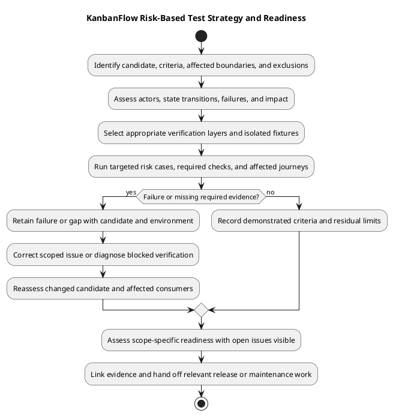

# KanbanFlow Test Strategy

> **Policy amendment (2026-10-10):** Membership mutations are now owner-only; DEC-003/PB-001's bypass is fixed. Current guidance below reflects this rule; historical records retain their original scope. See [QA corrections](qa-corrections-2026-10-10.md) for the selected rule and regression evidence.

## Objectives and scope

Demonstrate accepted user behavior while preventing unauthorized access, cross-workspace changes, corrupt ordering, and misleading client state. Tie the scope to the candidate diff and [requirements](../02-requirements/README.md). Prioritize integrity and confidentiality failures before cosmetic defects; document the impact rather than relying on an invented severity score.

## Risk-driven selection

| Change | Verification focus |
| --- | --- |
| Permissions/membership | Owner, manager, member, viewer, outsider, removed member; direct requests and indirect role paths. |
| Movement/WIP | Nested source/destination, boundary positions, active versus completed tasks, stale state, concurrency, failed UI recovery. |
| Authentication | Real SPA cookies/CSRF, origin configuration, login/logout, expired or failed requests. |
| Shared UI | Representative consumers, loading/empty/errors, themes, narrow/zoom layout, keyboard/focus. |
| Dependencies/schema | Locked install/runtime compatibility, affected behavior, existing records and migration/rollback implications. |
| Documentation | Local links, consistency with source, diagram/source identity, rendered readability. |

## Environments

Use isolated fixtures and non-production accounts. Backend PHPUnit's SQLite environment supports API regression execution but is not MySQL concurrency evidence. Use a production-like isolated MySQL environment for lock-sensitive scenarios, recording engine/version and observed persisted state. Browser checks must record browser/version, viewport/zoom, theme, input method, and relevant host/origin settings without secrets.

## Candidate-specific planning

Record the baseline and exact candidate, changed paths, requirement/backlog IDs, observable acceptance outcomes, affected consumers, and exclusions. Follow the change through the client, route, invoked authority, persistence, and side effects. A small diff can affect a shared control or permission boundary widely; select checks by behavioral reach and impact, not file count alone.

Use [automated inventory](automated-test-inventory.md) to locate existing assertions and [verification layers](verification-layers.md) to identify properties those assertions cannot establish. Resolve unclear expected authority through the [decision register](../../Project-Management/decision-register.md) rather than inventing a passing expectation.

## Coverage dimensions

| Dimension | Cases to consider when affected |
| --- | --- |
| Actors/access | Guest, owner, manager, member, viewer, outsider, removed member, private-board creator, and different notification owners. |
| Data/ancestry | Valid tree, wrong parent path, foreign destination/assignee, empty list, long/invalid input, existing and soft-deleted records. |
| State transitions | Login/logout, membership/visibility changes, assignment/reassignment, completion/reopening, movement, deletion. |
| Failures | Validation/denial, stale source, rejected move, unavailable service, session/origin issues, optimistic recovery. |
| UI context | Supported themes, narrow/zoom layout, keyboard/focus, reduced motion, and applicable assistive-tool observations. |
| Operational compatibility | Runtime/lockfiles, database engine, migrations, configuration, assets, and assessed recovery combination. |

Select a justified subset for the change, including positive controls and rejection cases. Scenario presence in a checklist is not execution evidence, and one successful actor/browser does not establish every dimension.

## Verification approach

| Layer | Role in this strategy |
| --- | --- |
| Source/contract review | Confirm actual behavior, invoked authority, test assertions, and planned expectations. |
| Backend regression | Exercise relevant API/domain assertions against the configured isolated test environment. |
| Frontend static/build | Detect lint/type/bundle problems; supplement with actual browser behavior. |
| Manual acceptance/security | Observe affected journeys, direct requests, failure recovery, data exposure, and persisted effects. |
| Engine-specific checks | Assess relevant MySQL contention and state under controlled competing operations. |
| Operational assessment | Verify an actual authorized target rollout or recovery separately from source publication. |

The backend suite uses SQLite and test-specific services. The frontend manifest defines lint/build but no automated behavioral test script. CI runs backend tests and frontend lint/build; inspect actual candidate runs before claiming success. See [security matrix](security-regression-matrix.md) and [manual scenarios](manual-acceptance-checklist.md).

## Fixtures and safety of evidence

Use isolated accounts and distinguishable workspaces/resource trees, private and workspace-visible boards, tasks with active/completed states, limited columns, comments by different authors, and own/other-user notifications where needed. Record preconditions and expected state so acceptance and side effects can be checked after refresh.

Identify effective database configuration before fixture/reset operations. Keep shared data intact and restore controlled failure conditions afterward. Sanitize shared diagnostics without publishing passwords, tokens, cookies, private content, or database dumps. Preserve restricted evidence separately when required for investigation.

## Execution order and adaptive scope

1. Review contracts and reproduce the changed behavior or defect.
2. Run targeted checks capable of finding the highest-impact regression.
3. Correct failures with retained reproduction evidence and recheck the corrected candidate.
4. Complete the relevant existing suite and required static/build checks.
5. Perform affected browser, security, or engine-specific observations that automated checks cannot supply.
6. Review final source/documentation changes and assemble the scope-specific result.

Broaden or repeat checks when substantive edits, conflict resolutions, failures, shared-consumer changes, or remaining uncertainty justify it. Repeated unchanged passing runs do not fill a missing verification layer. Do not weaken authority, delete meaningful assertions, or label a failure environmental without evidence merely to obtain green results.

## Entry, exit, and readiness

Entry requires an identifiable candidate, explicit acceptance cases, appropriate environment/fixtures, and known policy dependencies. Exit requires actual evidence for affected criteria, traceable failures/gaps, and a recorded assessment. Readiness is separate from executing a command or finishing a checklist.

| Observation | Readiness handling |
| --- | --- |
| Material confidentiality/integrity failure | Keep impact visible and require scoped correction or an explicit recorded disposition; unrelated passing checks do not resolve it. |
| Environment/tool failure | Record Blocked and diagnose the setup; the intended behavior remains unverified. |
| Missing required layer | Record Not run or a gap with next action; do not infer correctness from another layer. |
| Affected cases demonstrated | Record candidate/environment-specific scope and residual limits; release/deployment uses its own assessment. |

Membership additions, removals, and role changes are owner-only under DEC-003/PB-001; the 2026-10-10 correction closes the manager remove/re-add bypass. Proposed files/PDF/sharing/password-change designs are not passing endpoint capabilities. No numerical coverage target, uptime achievement, performance benchmark, or conformance certification is created by this strategy.

## Reporting and maintenance

Use [verification records](verification-record-template.md) for expected/actual results, candidate/environment, evidence links, CI status when inspected, defects, and exclusions. Link requirement, source, check, and delivery through [traceability](../../Project-Management/traceability.md). Capture recorded reviewer/operator identities only when known; do not invent approvals or assigned owners.

Update the strategy when actual risks, implementation, tooling, or environments change. Retain historical results for their original candidates. Send defects back to implementation and recurring gaps to [maintenance](../08-maintenance/README.md); use [release checklist](../../Releases/release-checklist.md) and [deployment guidance](../07-deployment/README.md) for subsequent operations.

## Execution and decision

Run targeted cases first, then the relevant existing suite and configured static/build checks. Investigate failures without deleting assertions or weakening authority to obtain green results. Recheck the corrected candidate and affected consumers. Capture pass, fail, blocked, not run, or justified not applicable for each criterion.

Exit requires evidence for the affected acceptance cases and disclosure of material gaps. Membership additions, removals, and role changes are owner-only under DEC-003/PB-001; the 2026-10-10 correction closes the manager remove/re-add bypass. No accessibility certification, performance threshold, or security audit is inferred from lint/build or source inspection.

Use [testing procedure](testing.md), [manual checklist](manual-acceptance-checklist.md), and [verification record](verification-record-template.md) to execute and record the strategy.

## PlantUML diagram

[Editable PlantUML source](diagrams/test-strategy.puml)

