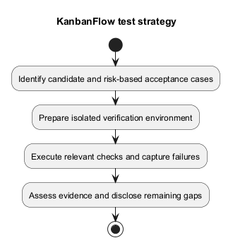
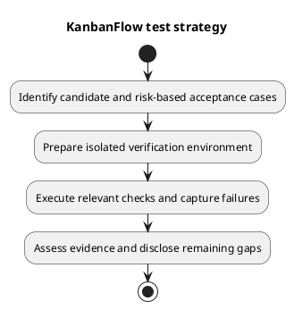

# KanbanFlow Test Strategy

## Objectives and scope

Demonstrate accepted user behavior while preventing unauthorized access, cross-workspace changes, corrupt ordering, and misleading client state. Tie the scope to the candidate diff and [requirements](../02-requirements/README.md). Prioritize integrity and confidentiality failures before cosmetic defects; document the impact rather than relying on an invented severity score.

## Risk-driven selection

| Change | Verification focus |
| --- | --- |
| Permissions/membership | Owner, manager, member, viewer, outsider, removed member; direct requests and indirect role paths. |
| Movement/WIP | Nested source/destination, boundary positions, active versus completed tasks, stale state, concurrency, failed UI recovery. |
| Authentication | Real SPA cookies/CSRF, origin configuration, login/logout, expired or failed requests. |
| Shared UI | Representative consumers, loading/empty/errors, themes, narrow/zoom layout, keyboard/focus. |
| Dependencies/schema | Locked install/runtime compatibility, affected behavior, existing records and migration/rollback implications. |
| Documentation | Local links, consistency with source, diagram/source identity, rendered readability. |

## Environments

Use isolated fixtures and non-production accounts. Backend PHPUnit's SQLite environment supports API regression execution but is not MySQL concurrency evidence. Use a production-like isolated MySQL environment for lock-sensitive scenarios, recording engine/version and observed persisted state. Browser checks must record browser/version, viewport/zoom, theme, input method, and relevant host/origin settings without secrets.

## Execution and decision

Run targeted cases first, then the relevant existing suite and configured static/build checks. Investigate failures without deleting assertions or weakening authority to obtain green results. Recheck the corrected candidate and affected consumers. Capture pass, fail, blocked, not run, or justified not applicable for each criterion.

Exit requires evidence for the affected acceptance cases and disclosure of material gaps. Unresolved [DEC-003](../../Project-Management/decision-register.md) remains an open issue, not an accepted fix. No accessibility certification, performance threshold, or security audit is inferred from lint/build or source inspection.

Use [testing procedure](testing.md), [manual checklist](manual-acceptance-checklist.md), and [verification record](verification-record-template.md) to execute and record the strategy.

## PlantUML diagram

[Editable PlantUML source](diagrams/test-strategy.puml)

