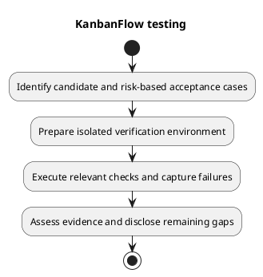

# KanbanFlow Testing Procedure

## Prepare

Record full candidate SHA, affected requirements, actual tool versions, environment, and data isolation. Inspect local changes and test configuration before running commands. Preserve unrelated work and never use destructive database reset commands against an unidentified or shared database.

Install committed dependency baselines as described in [development workflow](../05-implementation/development-workflow.md). Keep local credentials outside logs and commits. Do not treat migration/setup commands as ordinary verification of an existing environment.

## Execute

1. Select acceptance and regression cases from the diff and risk strategy.
2. Run relevant backend cases, then `php artisan test` from `backend/` when warranted.
3. Run `npm run lint` and `npm run build` from `frontend/` for affected frontend changes.
4. Perform the affected [manual journeys](manual-acceptance-checklist.md) and [security cases](security-regression-matrix.md).
5. Use isolated MySQL checks for concurrency-sensitive changes; observe persisted ordering and WIP after competing requests.
6. Inspect final documentation/diagram links and patch formatting where changed.

The current frontend manifest has no test script. Do not invent a command or report browser behavior verified from a successful build. PHPUnit uses SQLite and test-specific service settings; record that boundary explicitly.

## Failure investigation

Capture the failing command/scenario, actor, input, response, expected/actual behavior, and persisted result. Distinguish an environment failure from a product defect using reproduction evidence. Keep the original failure record, apply a scoped correction, and re-run the affected checks on the new candidate. Avoid exposing tokens, cookies, passwords, or private fixture content in shared artifacts.

## Reporting

Use [verification record template](verification-record-template.md). Link actual CI results when inspected; configured jobs are not results. State exclusions and open defects. A documentation review establishes documentation checks only, and a source push establishes publication only.

## PlantUML diagram

[Editable PlantUML source](diagrams/testing.puml)

