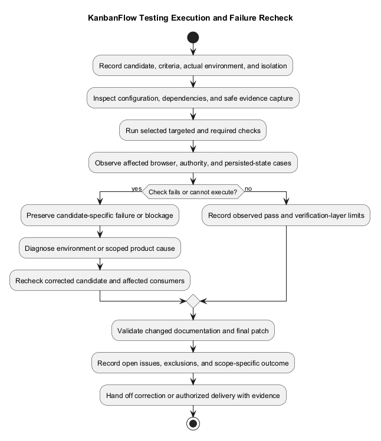
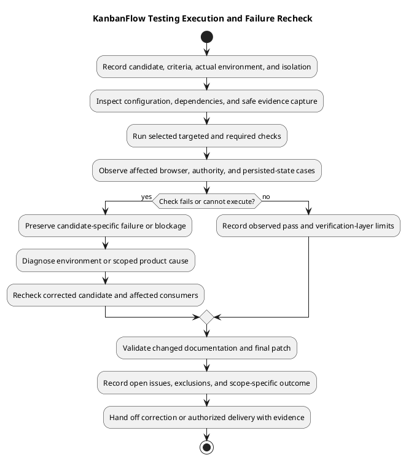

# KanbanFlow Testing Procedure

## Prepare

Record full candidate SHA, affected requirements, actual tool versions, environment, and data isolation. Inspect local changes and test configuration before running commands. Preserve unrelated work and never use destructive database reset commands against an unidentified or shared database.

Install committed dependency baselines as described in [development workflow](../05-implementation/development-workflow.md). Keep local credentials outside logs and commits. Do not treat migration/setup commands as ordinary verification of an existing environment.

## Execute

1. Select acceptance and regression cases from the diff and risk strategy.
2. Run relevant backend cases, then `php artisan test` from `backend/` when warranted.
3. Run `npm run lint` and `npm run build` from `frontend/` for affected frontend changes.
4. Perform the affected [manual journeys](manual-acceptance-checklist.md) and [security cases](security-regression-matrix.md).
5. Use isolated MySQL checks for concurrency-sensitive changes; observe persisted ordering and WIP after competing requests.
6. Inspect final documentation/diagram links and patch formatting where changed.

The current frontend manifest has no test script. Do not invent a command or report browser behavior verified from a successful build. PHPUnit uses SQLite and test-specific service settings; record that boundary explicitly.

## Failure investigation

Capture the failing command/scenario, actor, input, response, expected/actual behavior, and persisted result. Distinguish an environment failure from a product defect using reproduction evidence. Keep the original failure record, apply a scoped correction, and re-run the affected checks on the new candidate. Avoid exposing tokens, cookies, passwords, or private fixture content in shared artifacts.

## Preflight checklist

- Identify the checked source/assets and any uncommitted changes; record the baseline and candidate precisely.
- Link affected acceptance cases and source paths using [test strategy](test-strategy.md).
- Inspect effective test database/configuration and isolate fixtures before execution.
- Confirm actual PHP/Node/tool versions and locked dependencies using [dependency baseline](../05-implementation/dependency-baseline.md).
- Identify browser/origin/session context, controlled failure triggers, and relevant side effects.
- Define evidence capture and safe artifact handling without credentials or private data.

Stop and diagnose a material setup mismatch before interpreting failed requests as product failures. Do not generate a new application key, reset shared data, or weaken authority to prepare a passing run.

## Command reference

Run commands from the indicated package context, inspect their output, and record results. The examples below are procedures to execute when appropriate, not checks performed by this document.

| Directory | Command | Purpose and limit |
| --- | --- | --- |
| `backend/` | `php artisan test --filter=TaskApiTest` | Example targeted suite; choose actual class/method names from the affected tests. |
| `backend/` | `php artisan test` | Configured Unit/Feature suites; SQLite/test-service limits remain. |
| `frontend/` | `npm run lint` | Static rules only. |
| `frontend/` | `npm run build` | TypeScript/Vite build; no browser acceptance implied. |
| Repository root | `git diff --check` | Unstaged patch formatting. |
| Repository root | `git diff --cached --check` | Staged patch formatting before committing. |

Targeted filters may omit related regressions; complete required broader checks according to the affected scope. Backend framework tooling and the application frontend have separate manifests. CI runs configured backend tests and client lint/build; inspect the actual candidate run before reporting its result.

## Browser and direct-request execution

Use the [manual acceptance checklist](manual-acceptance-checklist.md) scenario IDs to record actor, resource tree, browser/version, viewport/zoom, theme, input method, and expected outcome. Exercise accepted behavior and denial/failure paths. Observe visible feedback and authoritative state after refresh rather than treating optimistic UI as proof of persistence.

Use [security regression cases](security-regression-matrix.md) for direct API requests, wrong ancestry, private data visibility, notification ownership, and indirect membership paths. Include allowed controls so an unavailable service is not mistaken for correct authorization. DEC-003 remains open; document its scope without inventing a resolved policy.

For shared controls inspect representative consumers, labels, keyboard/focus, pending/error states, and themes. Selected keyboard movement support does not prove every drag path works without a pointer. Assistive-tool or contrast claims need their actual observations/measurements.

## Database-specific and persisted-state checks

For relevant MySQL contention cases use an isolated engine/version and record initial data, competing requests, order/timing evidence where available, responses, final positions, and active-task counts. Keep fixtures controlled and restore the environment afterward. No universal parallel-request command or safe production reset is assumed here.

Inspect records and relevant activity/notification effects after accepted or rejected changes. Assess stale source, destination ancestry, completion/reopening, and rejection integrity where affected. SQLite success alone does not demonstrate production locking or asynchronous service behavior.

## Failure classification and recheck

| Observation | Next action |
| --- | --- |
| Missing dependency/runtime/configuration | Retain setup error, confirm actual tools/settings, and correct environment; intended criterion remains unverified. |
| Reproducible application mismatch | Record trigger, actor, expected/actual response and state; implement a scoped correction with relevant regression coverage. |
| Browser-only symptom | Inspect actual API response, session/origin behavior, client cache/assets, and UI state before changing server authority. |
| Intermittent contention or side effect | Retain competing-operation/data evidence and investigate the relevant transaction/service boundary. |
| Check not executable | Record Blocked or Not run with reason and required next evidence. |

Preserve the original failing candidate/result. Identify the corrected source and repeat affected checks, expanding to shared consumers when warranted. New substantive changes or conflict resolutions require relevant re-verification. Do not erase meaningful assertions or relabel defects as environmental without evidence.

## Documentation verification path

For documentation-only changes inspect source accuracy and local targets, compare embedded PlantUML with editable `.puml`, regenerate previews when source changes, inspect rendered readability, and check the intended patch. Link existence does not validate every statement. Record document checks without claiming new application suite, browser, security, or operational results.

## Result states and completion

Use Pass, Fail, Blocked, Not run, or justified Not applicable against specific criteria. Record candidate, environment, command/scenario, expected/actual outcome, evidence, defect reference, and next action. A passing build cannot substitute for a missing browser or MySQL layer.

Completion means the affected scope has evidence and disclosed residual limits, not that every possible case has been certified. Keep material confidentiality/integrity failures and unresolved policies visible. Link the actual CI run/SHA when inspected; source synchronization alone says nothing about deployed runtime.

Hand corrections to [implementation](../05-implementation/implementation.md), publish through [change delivery](../05-implementation/change-delivery.md), and assess release/runtime operations using [release checklist](../../Releases/release-checklist.md) and [deployment](../07-deployment/README.md). This procedure records no executed application checks by its existence.

## Reporting

Use [verification record template](verification-record-template.md). Link actual CI results when inspected; configured jobs are not results. State exclusions and open defects. A documentation review establishes documentation checks only, and a source push establishes publication only.

## PlantUML diagram

[Editable PlantUML source](diagrams/testing.puml)

