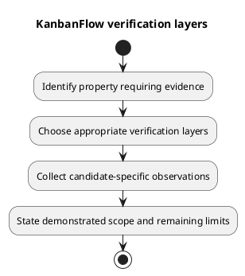

# KanbanFlow Verification Layers

## Evidence boundaries

Choose the layer capable of answering the actual question. More passing checks at a weaker layer do not establish an untested property at another layer.

| Layer | Can establish within its scope | Does not establish alone |
| --- | --- | --- |
| Source/document review | Contracts, configuration, test inventory, local links, diagram consistency. | Executed behavior, deployed state, security certification. |
| Static/build | ESLint results, TypeScript compilation and Vite bundling. | Browser interaction, accessibility, actual SPA sessions. |
| Backend automated | Assertions exercised by a named PHPUnit run in its configured environment. | MySQL concurrency, real cookies/origins, production queues. |
| Browser acceptance | Observed journeys, failure recovery, themes, keyboard/focus in recorded browsers. | All devices or universal accessibility conformance. |
| Database-specific | Observed integrity/locking outcomes under recorded MySQL scenarios. | Every contention schedule or production capacity. |
| CI | Actual jobs and results for a particular SHA. | Deployed release or checks absent from the workflow. |
| Operational | Observed rollout, migrations, smoke checks, and rollback rehearsal for a target. | Restored data from code rollback alone. |

## Combining evidence

For a task movement change combine source/contracts, backend assertions, persisted-state observations, browser failure recovery, and MySQL concurrency checks where relevant. For a documentation-only change, validate links, embedded/source identity, diagram rendering, and the intended diff; do not claim unrelated runtime tests were executed.

## Recording limits

Attach candidate identity, command/scenario, environment, result, evidence link, and exclusions to each observation. Keep failed, blocked, and Not run items visible. Historical release results do not transfer automatically to a new candidate.

Use [test strategy](test-strategy.md), [automated inventory](automated-test-inventory.md), and [verification template](verification-record-template.md) to connect layers without overstating coverage.

## PlantUML diagram

[Editable PlantUML source](diagrams/verification-layers.puml)

