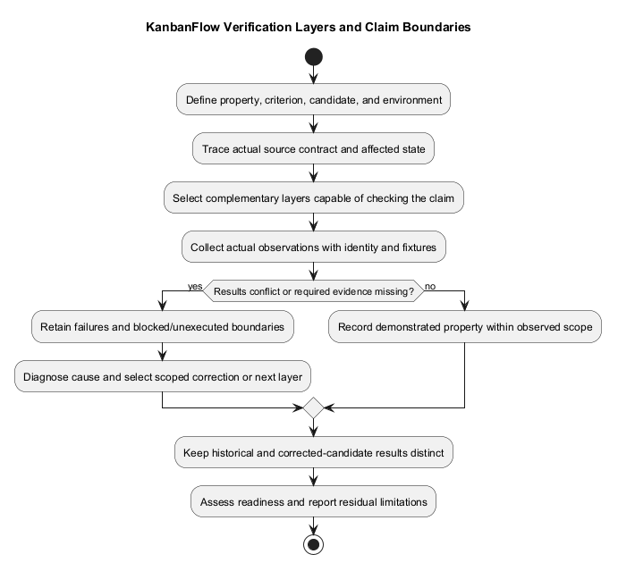
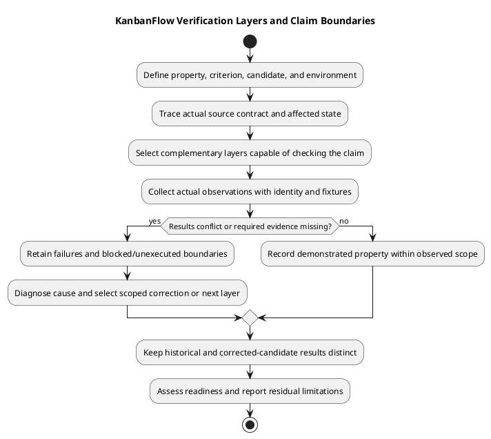

# KanbanFlow Verification Layers

> **Policy amendment (2026-10-10):** Membership mutations are now owner-only; DEC-003/PB-001's bypass is fixed. Current guidance below reflects this rule; historical records retain their original scope. See [QA corrections](qa-corrections-2026-10-10.md) for the selected rule and regression evidence.

## Evidence boundaries

Choose the layer capable of answering the actual question. More passing checks at a weaker layer do not establish an untested property at another layer.

| Layer | Can establish within its scope | Does not establish alone |
| --- | --- | --- |
| Source/document review | Contracts, configuration, test inventory, local links, diagram consistency. | Executed behavior, deployed state, security certification. |
| Static/build | ESLint results, TypeScript compilation and Vite bundling. | Browser interaction, accessibility, actual SPA sessions. |
| Backend automated | Assertions exercised by a named PHPUnit run in its configured environment. | MySQL concurrency, real cookies/origins, production queues. |
| Browser acceptance | Observed journeys, failure recovery, themes, keyboard/focus in recorded browsers. | All devices or universal accessibility conformance. |
| Database-specific | Observed integrity/locking outcomes under recorded MySQL scenarios. | Every contention schedule or production capacity. |
| CI | Actual jobs and results for a particular SHA. | Deployed release or checks absent from the workflow. |
| Operational | Observed rollout, migrations, smoke checks, and rollback rehearsal for a target. | Restored data from code rollback alone. |

## Combining evidence

For a task movement change combine source/contracts, backend assertions, persisted-state observations, browser failure recovery, and MySQL concurrency checks where relevant. For a documentation-only change, validate links, embedded/source identity, diagram rendering, and the intended diff; do not claim unrelated runtime tests were executed.

## Selecting evidence for a claim

Start with the precise property and candidate rather than a preferred tool. Identify the actor, request or journey, relevant state transition, environment, and observable outcome. Trace the actual contract in source, then choose the execution or observation capable of checking it. Multiple layers are complementary; they are not a universal ladder where completing one certifies the next.

| Claim to assess | Appropriate combination |
| --- | --- |
| A denied actor cannot mutate a nested task | Source/invoked-authority review, backend/direct-request cases, and persisted-state/side-effect checks. |
| Login works with deployed SPA origins | Source/configuration plus real browser cookie/CSRF behavior on the identified target. |
| A failed move recovers correctly | Backend rejection/state evidence plus browser optimistic recovery and refresh observations. |
| WIP holds under competing requests | Domain assertions plus isolated MySQL contention and final active-task counts. |
| A shared dialog is usable | Source/markup review plus representative browser keyboard/focus and relevant assistive-tool observations. |
| Documentation is consistent | Source-reference review, local links, matching embedded/editable diagrams, rendered previews, and diff checks. |
| A published version is running | Tag/source identity plus actual deployed assets/API identity and post-rollout checks. |
| Data can be recovered | Backup integrity and actual restore rehearsal with database/files/key compatibility and application checks. |

Use [manual acceptance](manual-acceptance-checklist.md), [security matrix](security-regression-matrix.md), and [deployment guides](../07-deployment/README.md) for the corresponding scenarios.

## Configured baseline versus executed evidence

Backend PHPUnit uses in-memory SQLite with test-specific sessions/cache/mail and synchronous queues. Its assertions can assess the executed cases in that environment; they do not reproduce MySQL lock scheduling, real browser origin behavior, or deployed worker configuration.

Frontend ESLint and TypeScript/Vite build checks detect static and bundle problems. The inspected frontend manifest defines no automated behavioral test script. Browser state, theme persistence, keyboard focus, server side effects, and accessibility measurements require their own evidence.

[CI configuration](../../../.github/workflows/ci.yml) runs backend tests and frontend lint/build. An actual CI run is execution evidence for its jobs and SHA; the workflow file alone is configuration evidence. Neither establishes runtime deployment, backup integrity, or universal acceptance.

## Evidence chain and identity

Connect requirement/criterion, source contract, scenario/assertion, candidate/environment, observation, and resulting assessment. Record full SHA and relevant working-tree changes where the checked state was not committed. Browser evidence should identify matching assets/API and actual configuration; a screenshot without identity or fixture context can be ambiguous.

For corrected candidates keep the original failure and new result separate. Substantive edits, updated dependencies, conflict resolutions, schema changes, or changed runtime settings require reassessment of the affected evidence. Historical release checks stay tied to their original candidate and environment.

## Example: task movement

Review the dedicated move payload and nested source/destination authority. Inspect existing movement/WIP assertions and execute relevant cases. Observe accepted or rejected persisted column/position state, activity or notification effects where relevant, and client rollback/refresh after a controlled failure.

If transaction scheduling is affected, add isolated MySQL competing operations and record responses/final ordering/active counts. A passing SQLite suite plus a smooth pointer animation does not establish that contention case. State which actors, destinations, schedules, and browsers were actually assessed.

## Example: documentation amendment

Inspect source accuracy and the final intended diff, resolve local link targets, compare embedded PlantUML with editable source, regenerate PNGs, and inspect readability. Record those checks as document verification. Do not attach a fresh application-test, security, accessibility, CI, or deployment result that was not observed.

Link existence is structural evidence, not proof that every linked claim is correct. A readable diagram is artifact evidence, not product accessibility certification.

## Gaps and conflicting results

| Observation | Interpretation and next action |
| --- | --- |
| Static/build passes but browser fails | Preserve both results; diagnose the behavioral failure rather than reporting blanket success. |
| SQLite passes but MySQL case fails | Investigate actual engine/transaction assumptions and keep integrity risk visible. |
| Local checks pass but CI fails | Identify runtime/configuration/candidate differences and inspect actual logs before classifying cause. |
| Health responds but sign-in/data fails | Health reachability is narrower than session/database readiness. |
| Source pushed but target identity differs | Publication succeeded; rollout is separate and unverified for that target. |
| Required environment unavailable | Record Blocked or Not run; another layer cannot silently substitute. |

Choose scoped corrections and meaningful rechecks. More unchanged passing runs do not resolve missing evidence. Membership additions, removals, and role changes are owner-only under DEC-003/PB-001; the 2026-10-10 correction closes the manager remove/re-add bypass.

## Scope-specific completion

Use [verification records](verification-record-template.md) to record Pass, Fail, Blocked, Not run, or justified Not applicable for each criterion. Summarize demonstrated properties and residual risks without claiming every layer was performed. Release/deployment readiness requires the relevant assessment, not an accumulated test count.

No numerical coverage, performance achievement, security certification, accessibility conformance, or completed restore is established by this guide. Update layer selection as the application and actual operating environment evolve.

## Recording limits

Attach candidate identity, command/scenario, environment, result, evidence link, and exclusions to each observation. Keep failed, blocked, and Not run items visible. Historical release results do not transfer automatically to a new candidate.

Use [test strategy](test-strategy.md), [automated inventory](automated-test-inventory.md), and [verification template](verification-record-template.md) to connect layers without overstating coverage.

## PlantUML diagram

[Editable PlantUML source](diagrams/verification-layers.puml)

