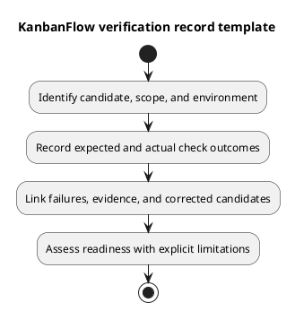

# KanbanFlow Testing Verification Record Template

## Use

Copy the record below and replace placeholders with actual observations. A blank template is not a completed review. Link the [release verification template](../../Releases/verification-template.md) when the candidate is being assessed for release; avoid conflicting duplicate result records.

## Copyable record

````markdown
# Verification — <candidate / scope>

## Identity and scope
- Full tested SHA: <actual commit>
- Date/time and timezone: <actual observation>
- Tester: <actual identity>
- Requirement/acceptance IDs: <references>
- Changed paths and affected journeys: <scope>
- Exclusions and policy dependencies: <explicit limits>

## Environment
- OS; PHP/Node/tool versions: <observed>
- Database engine/version and isolated fixture: <observed>
- Browser/version, viewport/zoom, theme, input/assistive tools: <when applicable>
- Relevant non-secret host/origin settings: <when applicable>

## Results
| ID | Layer and command/scenario | Expected | Actual | State | Evidence / next action |
| --- | --- | --- | --- | --- | --- |
| CHECK-001 | <specific check> | <acceptance> | <observation> | <Pass/Fail/Blocked/Not run/Not applicable> | <log/link/reason> |

## Failures and persistence
<Reproduction, response, state after refresh, relevant side effects, and corrected-candidate recheck.>

## CI when inspected
- Run URL and exact SHA: <actual>
- Observed job results: <actual or not inspected>

## Outcome
- Demonstrated criteria: <evidence-backed>
- Open defects and unverified boundaries: <explicit>
- Readiness outcome: <actual assessment or pending>
- Follow-up: <action and recorded owner, if known>
````

## Quality rules

Capture errors as well as passes, preserve evidence for the original failing candidate, and identify the corrected candidate separately. Do not include passwords, session cookies, tokens, or private data in shared logs. A justified Not applicable needs a scope explanation; elapsed time or absence of a report does not count as success.

## PlantUML diagram


[Editable PlantUML source](diagrams/verification-record-template.puml)


