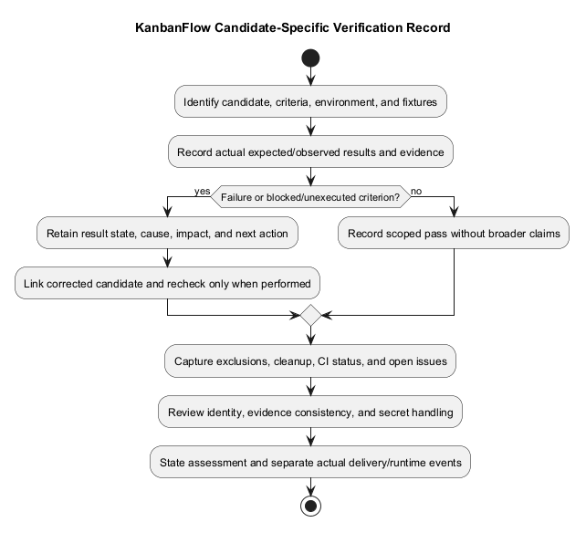
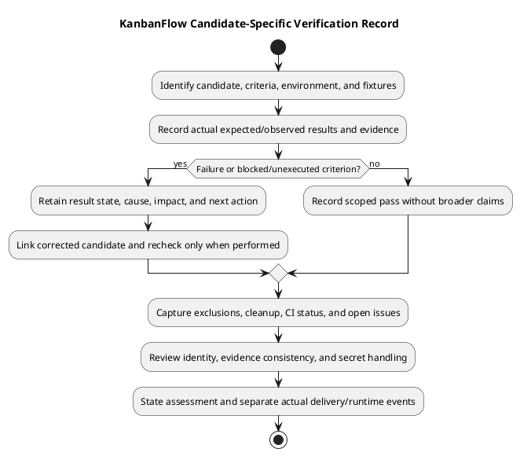

# KanbanFlow Testing Verification Record Template

## Use

Copy the record below and replace placeholders with actual observations. A blank template is not a completed review. Link the [release verification template](../../Releases/verification-template.md) when the candidate is being assessed for release; avoid conflicting duplicate result records.

## Copyable record

````markdown
# Verification — <candidate / scope>

## Identity and scope

- Record status: <Draft / In progress / Complete with stated scope>
- Baseline and full tested SHA: <actual identities>
- Working-tree changes affecting checked state: <paths/diff identity or none>
- Date/time and timezone: <actual observation>
- Tester/reviewer: <actual recorded identity or not recorded>
- Requirement/backlog/acceptance IDs: <references>
- Changed paths and affected consumers/journeys: <scope>
- Exclusions and unresolved policy dependencies: <explicit limits>

## Environment and fixtures

| Field | Actual value |
| --- | --- |
| OS, PHP/Node and relevant tools | <observed versions> |
| Dependencies/source/assets | <lockfile/candidate identity and matching client/API> |
| Database and isolation | <engine/version, safe dataset, effective test configuration> |
| Actor and resource tree | <role/current membership/visibility/ancestry without secrets> |
| Browser and UI context | <version, viewport/zoom, theme, input/assistive tools when applicable> |
| Non-secret configuration | <relevant host/origin/session/service assumptions> |
| Preconditions | <initial state, controlled failures, side effects and cleanup> |

## Check results

| ID | Criterion/layer | Command or repeatable scenario | Expected | Actual | State | Evidence / next action |
| --- | --- | --- | --- | --- | --- | --- |
| CHECK-001 | <criterion and layer> | <directory/command or scenario ID/steps> | <observable acceptance> | <response/output/state> | <Pass/Fail/Blocked/Not run/Not applicable> | <log/link/reason> |

## Failure and persisted-state record

| Defect/check | Failing candidate | Reproduction and impact | Response / persisted effects | Correction candidate | Recheck result/evidence |
| --- | --- | --- | --- | --- | --- |
| <reference> | <full SHA/state> | <actor/input/steps/expected versus actual> | <records after refresh and relevant side effects> | <actual identity or pending> | <actual state/evidence or Not run> |

## CI when inspected

- Run URL, exact SHA, and observed job conclusions: <actual or not inspected>
- Differences from local environment and checks absent from workflow: <limits>

## Documentation checks when applicable

- Source-reference accuracy and local link targets: <actual result or Not run>
- Embedded/editable PlantUML agreement: <actual result or Not applicable>
- Preview generation/readability and intended patch formatting: <actual result>

## Outcome and follow-up

- Demonstrated criteria and observed scope: <evidence-backed>
- Failed, blocked, and unexecuted criteria: <explicit>
- Open defects/policy questions and residual risks: <references and impact>
- Readiness assessment: <actual scope-specific decision or pending>
- Follow-up: <required action and recorded owner/date only if known>
- Fixture/service cleanup: <actual outcome or remaining work>

## Delivery or runtime evidence only when performed

- Commit/branch/remote and fetched identity comparison: <actual publication result or not performed>
- Release/tag identity: <actual or not performed>
- Runtime target/source/assets and post-rollout checks: <actual or not performed>
- Recovery/restore observations: <actual or not performed>
````

## Result state definitions

| State | Meaning |
| --- | --- |
| Pass | Observed result meets the specified criterion in the recorded candidate/environment. |
| Fail | Executed check contradicts the criterion; preserve reproduction and impact evidence. |
| Blocked | A prerequisite or environment issue prevents valid execution/assessment. |
| Not run | The check was not executed; record the reason and next evidence if required. |
| Not applicable | The criterion is outside the assessed scope, with an explicit justification. |

Do not turn a configured job, existing test file, empty placeholder, or lack of reported errors into Pass. A successful check at one layer does not resolve a gap at another. Use [verification layers](verification-layers.md) and [test strategy](test-strategy.md) when selecting scope.

## Filling and maintaining a record

Identify the candidate before execution and record actual context as checks proceed. Include the command's directory or repeatable scenario ID, actor/fixture, expected outcome, output/response, and persisted effects when relevant. Scope-specific records may omit irrelevant fields only with a clear explanation.

When substantive edits, dependencies, configuration, or conflict resolutions change the checked behavior, identify the new candidate and recheck affected criteria. Keep the original failing observation and its evidence; do not overwrite it with a later Pass as if the failure never occurred. Historical results remain tied to their original state.

A complete record can contain failures and gaps. Complete means the assessment and limitations are recorded, not that the product is universally correct or deployment is authorized. Keep DEC-003 and other unresolved issues linked rather than claiming closure from unrelated checks.

## Evidence handling and consistency

Link useful logs, screenshots, request/state observations, and actual CI run identities. Store sensitive evidence through restricted procedures and share sanitized excerpts; exclude passwords, tokens, cookies, environment secrets, private content, and dumps. Do not invent tool output, reviewer identity, approval, coverage percentage, or measured recovery outcome.

Avoid duplicating results in competing records. Use this template for testing evidence and link the [release verification record](../../Releases/verification-template.md) for release assessment. Source publication, tag creation, runtime rollout, and data recovery need their own actual identities and results.

## Review before handoff

- Every claimed result has candidate/environment context and supporting observation.
- Expected outcomes are concrete and distinguish response, visible feedback, and persisted state where relevant.
- Failures, blocked/Not run items, exclusions, and corrective rechecks remain identifiable.
- CI, accessibility, MySQL, security, deployment, and recovery claims are limited to actual evidence.
- No placeholders are presented as completed observations, and shared artifacts exclude secrets.
- The assessment states demonstrated scope, residual risk, and the required next action.

Use [testing procedure](testing.md), [manual checklist](manual-acceptance-checklist.md), and [security matrix](security-regression-matrix.md) for execution details. This template itself records no performed product checks.

## Quality rules

Capture errors as well as passes, preserve evidence for the original failing candidate, and identify the corrected candidate separately. Do not include passwords, session cookies, tokens, or private data in shared logs. A justified Not applicable needs a scope explanation; elapsed time or absence of a report does not count as success.

## PlantUML diagram



[Editable PlantUML source](diagrams/verification-record-template.puml)


