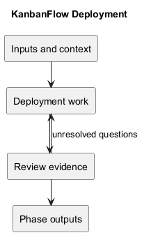
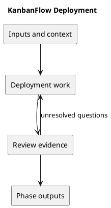

# Deployment

## Purpose and activities

Separate source publication from runtime deployment. Review environment URLs, session configuration, assets, data compatibility, backups, and recovery before an authorized deployment. GitHub Actions does not automatically deploy this application.

## Completion evidence

A verified target environment, approved deployment scope, smoke-check evidence, and a recovery plan tested as appropriate. No production deployment is asserted by this guide.

## Related guidance

- [Supporting documentation](../../Releases/upgrade-and-rollback.md)
- [SDLC index](../README.md)

## PlantUML workflow

[Editable source](diagrams/workflow.puml)

