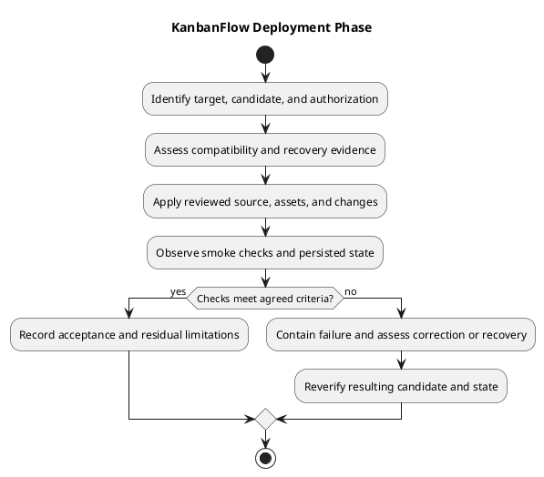

# KanbanFlow Deployment

## Purpose and status

This phase prepares a named application candidate for an identified runtime environment and records the outcome of an authorized rollout. These documents are operational guidance, not evidence that production hosting, backups, restoration, or deployment have occurred. GitHub source publication and CI checks are separate from deployment.

## Document catalog

| Document | Purpose |
| --- | --- |
| [Deployment](deployment.md) | Entry conditions, rollout controls, and completion evidence. |
| [Deployment architecture](deployment-architecture.md) | Runtime components and operational boundaries. |
| [Environment and configuration](environment-and-configuration.md) | Hosts, credentials, services, and environment review. |
| [Release and upgrade runbook](release-and-upgrade-runbook.md) | Candidate preparation, rollout, verification, and recovery decisions. |
| [Upgrade activity](upgrade-activity.md) | Upgrade decision flow and evidence checkpoints. |
| [Backup and recovery runbook](backup-and-recovery-runbook.md) | Recovery objectives, backup scope, restore verification, and access control. |
| [Backup recovery activity](backup-recovery-activity.md) | Recovery workflow and failure handling. |

The screenshot abbreviates two filenames; the catalog uses their full descriptive names. Each document includes an editable PlantUML source and rendered preview.

## Phase inputs and outputs

Inputs include exact candidate identity, actual verification evidence, target ownership/configuration, compatibility assessment, recoverable data/configuration, and operation authorization. Outputs include observed runtime identity, smoke results, data integrity observations, residual issues, and the selected recovery or acceptance outcome.

Do not advance a failed or unverified operation solely because the source push succeeded. See [testing](../06-testing/README.md), [release checklist](../../Releases/release-checklist.md), [upgrade and rollback](../../Releases/upgrade-and-rollback.md), and [maintenance](../08-maintenance/README.md).

## PlantUML diagram

[Editable PlantUML source](diagrams/workflow.puml)

