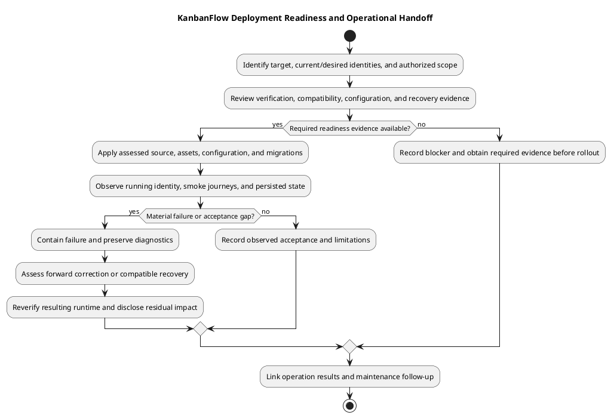

# KanbanFlow Deployment

## Purpose and status

This phase prepares a named application candidate for an identified runtime environment and records the outcome of an authorized rollout. These documents are operational guidance, not evidence that production hosting, backups, restoration, or deployment have occurred. GitHub source publication and CI checks are separate from deployment.

## Document catalog

| Document | Purpose |
| --- | --- |
| [Deployment](deployment.md) | Entry conditions, rollout controls, and completion evidence. |
| [Deployment architecture](deployment-architecture.md) | Runtime components and operational boundaries. |
| [Environment and configuration](environment-and-configuration.md) | Hosts, credentials, services, and environment review. |
| [Release and upgrade runbook](release-and-upgrade-runbook.md) | Candidate preparation, rollout, verification, and recovery decisions. |
| [Upgrade activity](upgrade-activity.md) | Upgrade decision flow and evidence checkpoints. |
| [Backup and recovery runbook](backup-and-recovery-runbook.md) | Recovery objectives, backup scope, restore verification, and access control. |
| [Backup recovery activity](backup-recovery-activity.md) | Recovery workflow and failure handling. |

Each document includes an editable PlantUML source and rendered preview. Use the runbooks with actual target-specific procedures and evidence before an operation.

## How to use this section

Start with [deployment architecture](deployment-architecture.md) to identify the actual components and environment decisions. Assess [configuration](environment-and-configuration.md), candidate compatibility, and data recovery through the [backup runbook](backup-and-recovery-runbook.md). Use [deployment guidance](deployment.md) and the [release/upgrade runbook](release-and-upgrade-runbook.md) for preparation and execution. The activity documents summarize decision checkpoints; they are not evidence of performed operations.

The repository does not establish a production provider, domain, service manager, redundant topology, backup schedule, or on-call roster. Fill in those operational details for the authorized target rather than assuming the local XAMPP setup supplies them.

## Distinct delivery events

| Event | Evidence required |
| --- | --- |
| Source publication | Actual pushed commit and fetched remote identity. |
| Release/tag publication | Actual tag/release identity, included changes, and release assessment. |
| Runtime deployment | Target source/assets/configuration identity and observed rollout results. |
| Post-deployment acceptance | Actual smoke/affected journey and persisted-state checks. |
| Recovery | Selected recovery point, compatible runtime/data, actual restore/rollback observations, and residual loss/issues. |

CI runs backend tests and frontend lint/build; it does not automatically deploy or restore this application. Package version metadata, a tag, or a successful health response alone does not establish running target identity or complete readiness.

## Entry checklist

- Record current and intended full SHA/tag, matching assets, actual target, and authorized operation scope.
- Review acceptance evidence, exact diff/release notes, known issues, and unverified boundaries.
- Assess PHP/Node/extensions, locked dependencies, database version, storage, and relevant services.
- Review URL/origin/session configuration and protect existing secrets/application key.
- Identify migrations, existing-record compatibility, traffic/maintenance controls, and failure criteria.
- Verify appropriate backup availability and restore evidence, including configuration/key recovery.
- Define actual service/cache actions, smoke cases, and compatible recovery options for the target.

Do not use destructive database resets or routine key regeneration as upgrade shortcuts. Migrations, dependency/setup scripts, and restore actions require assessment against the actual existing installation.

## Responsibilities and evidence

| Responsibility | Required contribution |
| --- | --- |
| Target/operation ownership | Identify environment, scope, access, traffic decisions, and authorized actions. |
| Engineering compatibility | Explain source/assets/runtime/schema changes and viable recovery combinations. |
| Verification | Record actual candidate/environment results and required post-rollout observations. |
| Recovery | Identify protected data/configuration, recovery point, restore procedure, and observed rehearsal limits. |
| Closeout/maintenance | Record outcome, residual impact, known issues, and follow-up. |

These are responsibilities, not assigned people or invented approvals. Capture actual operators/reviewers only when known. Exclude passwords, tokens, cookies, dumps, and private data from shared operational records.

## Execution and stop conditions

Apply the assessed candidate using the target's established procedure, keeping backend source/dependencies and frontend build coherent. Record each material step and manage relevant services/configuration caches as required. Provider-specific commands and service controls must be selected for the actual environment.

Stop and assess state when a material step fails, a required backup cannot be verified, compatibility is uncertain, or smoke checks expose confidentiality/integrity problems. Preserve diagnostics and avoid repeated destructive mutations. Choose a scoped forward correction or compatible recovery from evidence; older source can reintroduce security defects.

## Post-rollout acceptance

| Area | Observe |
| --- | --- |
| Identity/reachability | Intended source/assets/services and database-backed application behavior. |
| SPA session | Real login/logout, protected requests, cookies/CSRF/origins, and relevant existing sessions. |
| Authority/privacy | Allowed and denied resource paths, current membership, private content, and affected downstream views. |
| Data/workflow | Existing records, accepted/rejected mutations, refreshed persistence, ordering/WIP where affected. |
| Client/collaboration | Changed UI journeys, themes/focus, comments, notifications, activity, and relevant analytics. |
| Operations | Relevant service/log behavior and assessed rollback/recovery outcomes when performed. |

Use [manual acceptance](../06-testing/manual-acceptance-checklist.md) and [verification layers](../06-testing/verification-layers.md) to select checks. SQLite tests do not establish MySQL contention, and builds do not establish browser behavior. DEC-003 remains open; deployment of documentation does not fix the manager role bypass.

## Recovery and phase exit

Code rollback, migration reversal, and database restore are different actions. Assess source/assets/schema/key/security compatibility and possible lost writes before intervention. A backup file's existence is not proof of restorability, and rollback of source does not recover deleted data. Follow [upgrade and rollback](../../Releases/upgrade-and-rollback.md).

Exit records actual target/candidate identity, step outcomes, smoke evidence, residual issues/data loss, and acceptance or further corrective work. Use [release verification records](../../Releases/verification-template.md), then hand recurring incidents and follow-up to [maintenance](../08-maintenance/README.md). This index asserts no performed runtime operation, measured recovery objective, or service availability achievement.

## Phase inputs and outputs

Inputs include exact candidate identity, actual verification evidence, target ownership/configuration, compatibility assessment, recoverable data/configuration, and operation authorization. Outputs include observed runtime identity, smoke results, data integrity observations, residual issues, and the selected recovery or acceptance outcome.

Do not advance a failed or unverified operation solely because the source push succeeded. See [testing](../06-testing/README.md), [release checklist](../../Releases/release-checklist.md), [upgrade and rollback](../../Releases/upgrade-and-rollback.md), and [maintenance](../08-maintenance/README.md).

## PlantUML diagram

[Editable PlantUML source](diagrams/workflow.puml)

