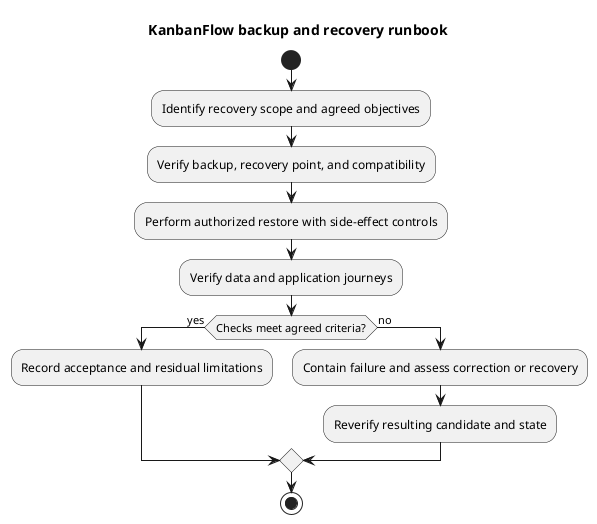

# KanbanFlow Backup and Recovery Runbook

## Status and objectives

No backup system, retention schedule, recovery-point objective (acceptable data loss), or recovery-time objective (acceptable outage) is established by the repository. Agree these values, responsible operators, protected locations, and verification frequency for the actual environment before relying on this runbook.

## Backup scope inventory

| Asset | Required assessment |
| --- | --- |
| Database | Domain data and any session/cache/queue tables in use; consistency and engine/version compatibility. |
| Stored files | Actual private/public or external data written by this installation; disk configuration alone does not prove attachments exist. |
| Configuration/secrets | Secure recovery of environment values and established application key with restricted access. |
| Source/dependencies/assets | Known-good commit/tag, lockfiles, runtime requirements, and matching build artifacts. |
| Operational metadata | Backup time/identity, procedure/tool version, integrity checks, access and retention records. |

Do not commit database dumps or secrets to GitHub. Encrypt/protect sensitive backups according to the actual environment's controls, separate them from the failure domain being protected, and verify access without exposing contents in logs.

## Backup procedure prerequisites

Select a database/storage procedure compatible with the engine and write pattern. Coordinate database/file consistency, capture necessary recovery metadata, and verify successful output/integrity. Define retention and deletion procedures explicitly; neither a file's existence nor a successful command establishes restorability.

No universal backup command is supplied because credentials, database engine, service layout, and consistency requirements vary. Record tested environment-specific commands securely in the operational record.

## Restore rehearsal

Restore to an isolated target first. Verify backup integrity, intended recovery point, runtime/schema compatibility, key/configuration recovery, record relationships and expected files. Test database-backed application journeys and permissions; avoid unintended outbound messages or jobs from the rehearsal environment. Measure observed recovery time/data gap against agreed objectives without inventing successful values.

## Incident recovery

Identify incident scope, contain harmful writes, preserve diagnostics where appropriate, and select an authorized recovery point. Assess writes that will be lost and source/schema/security compatibility before restoring. Reconcile affected users/data and prevent duplicate background side effects as applicable. Verify the restored runtime and document remaining loss or issues before reopening traffic.

## Evidence and limitations

Record actual backup/restore identity, timestamps, operator, integrity outcomes, observed data gap, smoke results, and exclusions. Soft deletion is not a backup or verified restore feature. Code rollback does not recover missing data. See [backup recovery activity](backup-recovery-activity.md) and [upgrade and rollback](../../Releases/upgrade-and-rollback.md).

## PlantUML diagram

[Editable PlantUML source](diagrams/backup-and-recovery-runbook.puml)

