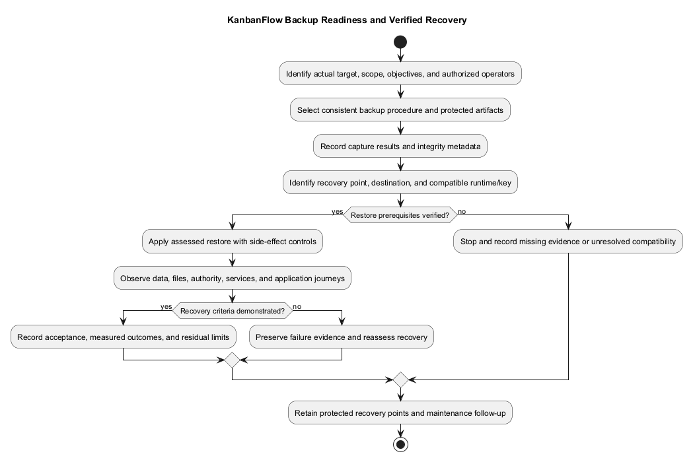
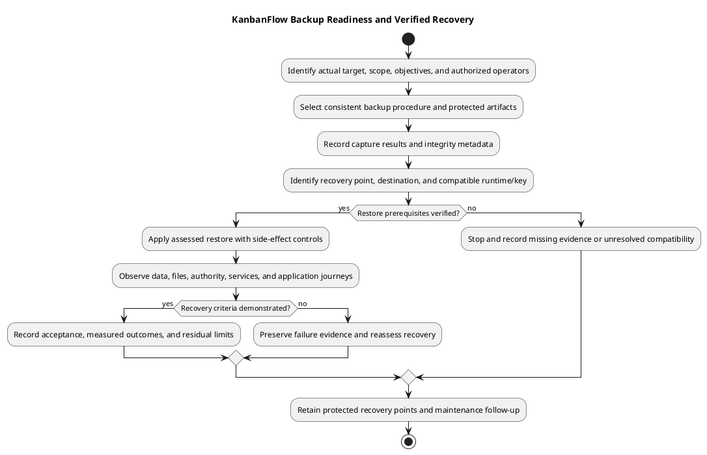

# KanbanFlow Backup and Recovery Runbook

## Status and objectives

No backup system, retention schedule, recovery-point objective (acceptable data loss), or recovery-time objective (acceptable outage) is established by the repository. Agree these values, responsible operators, protected locations, and verification frequency for the actual environment before relying on this runbook.

## Backup scope inventory

| Asset | Required assessment |
| --- | --- |
| Database | Domain data and any session/cache/queue tables in use; consistency and engine/version compatibility. |
| Stored files | Actual private/public or external data written by this installation; disk configuration alone does not prove attachments exist. |
| Configuration/secrets | Secure recovery of environment values and established application key with restricted access. |
| Source/dependencies/assets | Known-good commit/tag, lockfiles, runtime requirements, and matching build artifacts. |
| Operational metadata | Backup time/identity, procedure/tool version, integrity checks, access and retention records. |

Do not commit database dumps or secrets to GitHub. Encrypt/protect sensitive backups according to the actual environment's controls, separate them from the failure domain being protected, and verify access without exposing contents in logs.

## Backup procedure prerequisites

Select a database/storage procedure compatible with the engine and write pattern. Coordinate database/file consistency, capture necessary recovery metadata, and verify successful output/integrity. Define retention and deletion procedures explicitly; neither a file's existence nor a successful command establishes restorability.

No universal backup command is supplied because credentials, database engine, service layout, and consistency requirements vary. Record tested environment-specific commands securely in the operational record.

## Restore rehearsal

Restore to an isolated target first. Verify backup integrity, intended recovery point, runtime/schema compatibility, key/configuration recovery, record relationships and expected files. Test database-backed application journeys and permissions; avoid unintended outbound messages or jobs from the rehearsal environment. Measure observed recovery time/data gap against agreed objectives without inventing successful values.

## Incident recovery

Identify incident scope, contain harmful writes, preserve diagnostics where appropriate, and select an authorized recovery point. Assess writes that will be lost and source/schema/security compatibility before restoring. Reconcile affected users/data and prevent duplicate background side effects as applicable. Verify the restored runtime and document remaining loss or issues before reopening traffic.

## Environment-specific readiness record

| Field | Required actual value before use |
| --- | --- |
| Protected installation | Target, database engine/version, storage locations, source/assets identity. |
| Objectives | Agreed acceptable data loss/outage and how each is measured. |
| Responsibility/access | Actual authorized operators, backup access, and recovery decision responsibility. |
| Procedure | Tested tool/command/service sequence appropriate to the target; credential handling outside shared records. |
| Consistency | Coordinated recovery point for database, files, configuration/key, and relevant queued work. |
| Protection/retention | Restricted location, encryption/key recovery, separate failure domain, retention and deletion rules. |
| Rehearsal | Actual isolated restore results, limitations, and last observed date. |

Do not infer these values from example configuration or invent an owner, schedule, recovery target, or successful rehearsal. A runbook can remain incomplete for an unidentified operational target even when its guidance is fully documented.

## Backup execution checkpoints

1. Identify the exact dataset/services and confirm the selected procedure's privileges and compatibility.
2. Establish a consistent capture approach appropriate to the engine and active writes; coordinate stored files and other required state.
3. Capture database/data, required files, protected configuration/key recovery, and runtime/source metadata through the approved procedure.
4. Record operation results, artifact identities, sizes/timestamps, and appropriate integrity checks without secrets.
5. Verify protected storage/access and recoverability through an actual isolated restore rehearsal.
6. Apply the agreed retention process only after required protected recovery points are confirmed.

Checksums can detect certain artifact changes; they do not establish semantic consistency or restorability. A backup command returning success does not prove the required dataset was selected or the application can read it. Do not delete the last known usable recovery point merely because a new file exists.

## Restoration entry and stop criteria

Before restore identify the selected backup/recovery point, intended destination, authorized overwrite scope, source/schema/runtime/key compatibility, write containment, and expected data loss. Confirm the destination is isolated for rehearsal or explicitly authorized for incident recovery. Preserve relevant incident state/diagnostics where appropriate before overwriting data.

Stop and reassess if the backup identity/integrity is uncertain, required key/configuration is unavailable, engine/schema compatibility is unresolved, the target is ambiguous, or restore scope/data loss has not been agreed. Do not repeatedly import into shared data or bypass a failed check to obtain a working health response.

## Restore sequence and side effects

Prepare a compatible runtime and restricted destination, suppress unintended outbound effects in rehearsal, and restore the assessed dataset/files/configuration through the tested target-specific procedure. Observe each material result. Keep the established application key recoverable; generating a replacement can break compatibility with protected data.

Assess sessions, cache, and queued work according to actual drivers and behavior. Replaying stored jobs or sending external notifications can duplicate effects; do not blindly resume services before reconciling the selected recovery point. Cache invalidation and session handling are assessed decisions, not automatic prescriptions for every recovery.

Do not assume restoration can be reversed by checking out the former source. Retain the compatible source/assets/dependency combination and assess schema/security behavior before accepting older code.

## Validation matrix

| Check | Observe after restoration |
| --- | --- |
| Identity | Expected backup point, runtime/source/assets, configuration, database and storage destination. |
| Data relationships | Required workspaces/projects/boards/columns/tasks and relevant memberships/comments, without missing or foreign relationships. |
| Files | Required actual stored data is present and access remains private/public as intended; no attachment feature is inferred from disk settings. |
| Authentication/authority | Real session behavior, permitted/denied paths, private-resource visibility, and current membership at the restored point. |
| Mutations/integrity | Accepted changes persist, rejections leave state unchanged, and relevant ordering/WIP behavior is assessed. |
| Side effects/services | Relevant activity/notifications/queues match the recovered state without unintended replay or disclosure. |
| Recovery objectives | Observed elapsed recovery and actual data gap, compared with previously agreed objectives. |

Use isolated test accounts/data where possible. Record known defects such as DEC-003 separately; restoration is not a membership-policy fix. A health response or completed database import alone is insufficient acceptance.

## Copyable operation evidence

````markdown
# Backup / recovery observation — <actual target and scope>

- Status and operation type: <backup / rehearsal / incident recovery; actual state>
- Operator and authorization scope: <recorded identities or pending>
- Source/assets/runtime and database identity: <actual>
- Selected backup/recovery point and protected location reference: <non-secret identifiers>
- Start/end timestamps and timezone: <observed>
- Consistency and side-effect controls: <actual procedure>
- Step results and integrity evidence: <logs/references without secrets>
- Restore destination and overwrite scope: <actual or not performed>
- Data gap/lost writes and elapsed recovery: <observed or not measured>
- Application/data validation results: <Pass/Fail/Blocked/Not run by criterion>
- Residual issues, acceptance decision, and follow-up: <actual or pending>
````

Use [verification records](../../Releases/verification-template.md) for linked candidate/application observations rather than conflicting duplicate results. Keep failed attempts and subsequent corrected recovery evidence identifiable.

## Maintenance and limits

Reassess the procedure when database/runtime versions, migrations, filesystem use, encryption/key handling, service layout, or recovery objectives change. Rehearse on the actual agreed schedule when established and record results; this document creates no scheduler or backup service.

Soft deletion, source tags, GitHub synchronization, and CI are separate from data recovery. This document performs no backup, restore, data deletion, encryption setup, or measured recovery test. Use [incident triage](../08-maintenance/incident-triage.md) and [release/upgrade guidance](release-and-upgrade-runbook.md) for operational decisions.

## Evidence and limitations

Record actual backup/restore identity, timestamps, operator, integrity outcomes, observed data gap, smoke results, and exclusions. Soft deletion is not a backup or verified restore feature. Code rollback does not recover missing data. See [backup recovery activity](backup-recovery-activity.md) and [upgrade and rollback](../../Releases/upgrade-and-rollback.md).

## PlantUML diagram



[Editable PlantUML source](diagrams/backup-and-recovery-runbook.puml)


