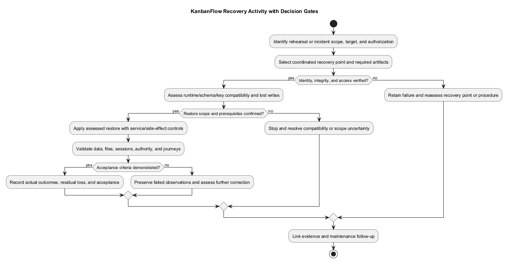
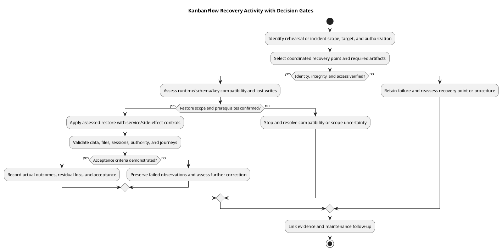

# KanbanFlow Backup Recovery Activity

> **Policy amendment (2026-10-10):** Membership mutations are now owner-only; DEC-003/PB-001's bypass is fixed. Earlier open-policy text and diagrams below describe the preceding state. See [QA corrections](../06-testing/qa-corrections-2026-10-10.md) for the selected rule and regression evidence.

## Purpose and inputs

This activity supports backup verification and recovery decisions. Inputs include an actual incident/rehearsal scope, authorized target, selected recovery point, protected backup/configuration, compatible runtime, and agreed recovery objectives. It asserts no completed restore.

## Workflow checkpoints

1. Identify affected data/services and contain further harmful changes where required.
2. Verify backup identity, integrity, access, and the acceptable recovery point.
3. Assess source/schema/key compatibility and data loss before the authorized restore.
4. Restore into an isolated target for rehearsal, or the explicitly authorized incident target.
5. Verify records/files, relationships, permissions, sessions, and relevant application journeys.
6. Record measured outcomes, residual loss/issues, and acceptance or further recovery action.

## Failure and acceptance

If the backup is unusable or the restored application fails checks, preserve evidence and reassess the procedure/recovery point. Do not claim success from a completed import alone. Avoid accidental notification/job side effects during rehearsal, and reconcile relevant queued work before resuming normal operation.

Acceptance requires the agreed recovery criteria and actual verification evidence, including known data loss. Retain non-secret backup identifiers, timestamps, selected runtime, observations, and follow-up. Use [backup and recovery runbook](backup-and-recovery-runbook.md) and [verification record](../../Releases/verification-template.md).

## Choose the activity mode

| Mode | Target and purpose | Required controls |
| --- | --- | --- |
| Backup verification/rehearsal | Isolated destination used to demonstrate recoverability. | Prevent unintended outbound messages/jobs, protect copied data, and keep the live installation intact. |
| Incident recovery | Explicitly authorized affected target and selected recovery point. | Contain harmful writes, assess lost writes/overwrite scope, preserve appropriate diagnostics, and control reopening. |

Neither mode is implied by editing this document. Identify actual operators, target, authorization, agreed recovery objectives, and procedures through the [backup runbook](backup-and-recovery-runbook.md).

## Decision gates

| Gate | Required evidence | If missing or failed |
| --- | --- | --- |
| Scope | Affected dataset/services, target identity, intended activity mode, and authorized operation. | Stop before changing data; resolve target/scope uncertainty. |
| Recovery point | Actual backup identity/time, required artifacts, access and integrity observations. | Retain diagnostics and assess another usable recovery point or procedure. |
| Compatibility | Database/schema, source/assets/runtime, configuration/key, required files, and side-effect controls. | Resolve compatibility before restore; do not improvise key regeneration or schema reversal. |
| Data-loss decision | Expected lost writes and agreed recovery objectives for the selected point. | Record uncertainty and obtain the required operational decision before overwrite. |
| Restore execution | Material step results through the target-specific tested procedure. | Contain failed state and reassess before repeating operations. |
| Acceptance | Actual data/application checks, residual issues, and measured recovery outcomes where assessed. | Keep recovery unaccepted and choose further corrective action. |

Backup existence or a successful import is insufficient evidence at the acceptance gate. Checksums address artifact integrity, not every semantic or application relationship.

## Step evidence

1. Record incident/rehearsal context, current runtime/data state, timestamps/timezone, and protected evidence references.
2. Identify the selected recovery artifacts and coordinated point across database, files, and key/configuration as applicable.
3. Confirm target isolation or authorized overwrite, compatibility, containment, and relevant service controls.
4. Execute only the assessed restore procedure and capture each material result without secrets.
5. Inspect recovered records/relationships, actual stored files, real sessions, allowed/denied paths, and relevant persisted mutations.
6. Reconcile relevant queued or external side effects before resuming services; do not replay work blindly.
7. Record actual elapsed recovery/data gap, acceptance or failure, remaining loss/issues, and follow-up.

For engine-specific or browser checks use [verification layers](../06-testing/verification-layers.md). A healthy endpoint does not establish database readiness; soft deletion does not establish recovery capability.

## Recheck and failure paths

If an artifact is unreadable, required key/configuration is absent, or runtime compatibility is unresolved, stop the restore path and retain the reason. If execution fails, inspect the resulting state before retrying or selecting another point. Preserve relevant diagnostics and avoid destructive resets that obscure the incident.

If application validation fails after import, record expected/actual response and persisted state; assess whether the cause is data, source/assets, configuration, services, or a known product defect. DEC-003 remains open and is not repaired by restoration. A forward correction or compatible recovery needs its own identified candidate and recheck.

Code rollback, database restoration, and migration reversal are distinct choices with different consequences. See [upgrade and rollback](../../Releases/upgrade-and-rollback.md); older source can reintroduce security defects, and restore can discard newer writes.

## Acceptance and closeout record

| Field | Actual observation to capture |
| --- | --- |
| Operation identity | Mode, target, operator, authorization, and source/assets/runtime. |
| Backup point | Non-secret artifact identifiers, timestamps, integrity/access results, and restored scope. |
| Execution | Steps/results, controlled services and side effects, failures and rechecks. |
| Validation | Criterion-specific Pass/Fail/Blocked/Not run, data relationships, sessions/authority, and application journeys. |
| Recovery outcomes | Measured elapsed recovery/data gap or explicitly not measured; comparison to previously agreed objectives. |
| Decision | Actual acceptance or pending/failed state, residual loss, next action, and recorded owner when known. |

Use [release verification records](../../Releases/verification-template.md) and [incident triage](../08-maintenance/incident-triage.md) for linked evidence. Do not invent approval, successful restore, zero loss, or a recovery-time achievement. Retain failed attempts separately from corrected results.

## Maintenance boundary

Review this activity when database/schema versions, storage use, key handling, service layout, or actual recovery procedures change. Update the editable diagram and preview together. This guide creates no backup scheduler, monitoring service, or runtime recovery action; it defines a process requiring environment-specific evidence.

## PlantUML diagram

[Editable PlantUML source](diagrams/backup-recovery-activity.puml)

