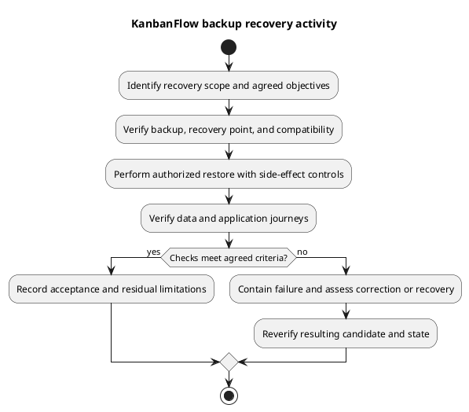

# KanbanFlow Backup Recovery Activity

## Purpose and inputs

This activity supports backup verification and recovery decisions. Inputs include an actual incident/rehearsal scope, authorized target, selected recovery point, protected backup/configuration, compatible runtime, and agreed recovery objectives. It asserts no completed restore.

## Workflow checkpoints

1. Identify affected data/services and contain further harmful changes where required.
2. Verify backup identity, integrity, access, and the acceptable recovery point.
3. Assess source/schema/key compatibility and data loss before the authorized restore.
4. Restore into an isolated target for rehearsal, or the explicitly authorized incident target.
5. Verify records/files, relationships, permissions, sessions, and relevant application journeys.
6. Record measured outcomes, residual loss/issues, and acceptance or further recovery action.

## Failure and acceptance

If the backup is unusable or the restored application fails checks, preserve evidence and reassess the procedure/recovery point. Do not claim success from a completed import alone. Avoid accidental notification/job side effects during rehearsal, and reconcile relevant queued work before resuming normal operation.

Acceptance requires the agreed recovery criteria and actual verification evidence, including known data loss. Retain non-secret backup identifiers, timestamps, selected runtime, observations, and follow-up. Use [backup and recovery runbook](backup-and-recovery-runbook.md) and [verification record](../../Releases/verification-template.md).

## PlantUML diagram

[Editable PlantUML source](diagrams/backup-recovery-activity.puml)

