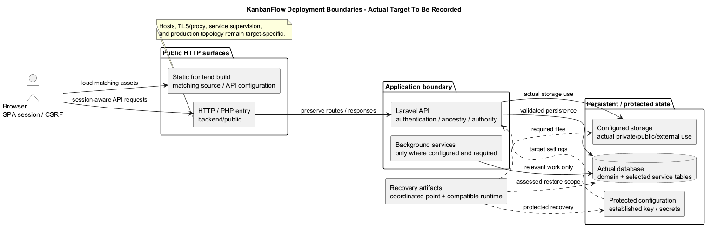
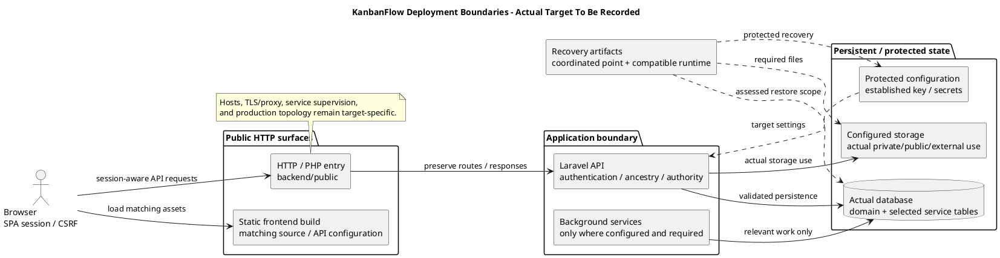

# KanbanFlow Deployment Architecture

## Repository-backed components

The runtime design contains a browser application built from `frontend/`, a Laravel backend from `backend/`, and persistent application data. The local example uses MySQL. Hosting layout, domains, redundancy, TLS termination, and service supervision remain environment-specific decisions; this document does not claim a deployed topology.

| Component | Operational responsibility |
| --- | --- |
| Browser/client assets | Serve the matching React/Vite build and support SPA navigation. `VITE_API_URL` must match the intended API when building. |
| HTTP server/PHP runtime | Route backend requests through its public entry point; configure transport, proxy handling, and runtime extensions for the target. |
| Laravel API | Authentication, resource ancestry, server authorization, validation, and database mutations. |
| Database | Domain records and configured session/cache/queue tables where those drivers are used. |
| Storage | Configured local/private/public disks or an explicitly configured external disk; protect private data. |
| Background services | Supervise workers/scheduled tasks only where actual application behavior and configuration require them. |

## Current configuration boundaries

The backend environment example uses database sessions, cache, and queues, and a local filesystem disk. [Filesystem configuration](../../../backend/config/filesystems.php) includes private/public local and S3 settings; S3 configuration is not proof of an active cloud deployment or implemented attachment feature. Determine the actual data written before defining backup scope.

The [queue configuration](../../../backend/config/queue.php) supports multiple drivers. Inventory actual queued work before prescribing worker scale or notification latency; PHPUnit's synchronous test setting does not demonstrate deployed asynchronous delivery.

## Trust and failure boundaries

Browser UI restrictions are not server authority. Public frontend assets may be cached, but credentials and private API data require the appropriate transport/session controls. Cross-origin SPA sessions depend on coordinated API URL, trusted stateful domains, CORS, and cookie settings. Shared service failures can affect sessions, cache, or queue work as well as domain data.

## Request and asset paths

1. The browser loads the matching frontend build from its actual static hosting location.
2. Client requests use the build's API configuration and the browser's session/CSRF context.
3. The target HTTP/PHP entry path reaches Laravel through `backend/public`, with the actual middleware and route contracts.
4. Laravel performs ancestry, authorization, validation, persistence, and relevant side effects.
5. The client consumes the operation-specific response and refreshes authoritative state where applicable.

Configure SPA deep-link fallback for client navigation while preserving API status/JSON responses. Do not route failed API requests into a frontend HTML fallback. Vite development/preview servers do not establish a production hosting architecture.

## Deployment units and identity

| Unit | Identity and compatibility to record |
| --- | --- |
| Backend source | Exact commit, public entry point, runtime/extensions, and installed Composer lock baseline. |
| Frontend assets | Source commit, npm lock baseline, build-time API settings, and matching artifact identity. |
| Database/schema | Engine/version, applied migrations, data compatibility, and actual selected connection. |
| Configuration/key | Protected environment values, established application key, actual cache state and secret recovery reference. |
| Services/storage | Actual drivers, writable roots, service controls, and protected data locations. |

A shared package version string does not establish that source, assets, database, and configuration belong to the same compatible deployment. Record actual units through [release verification](../../Releases/verification-template.md).

## Exposure and trust boundaries

| Boundary | Required target assessment |
| --- | --- |
| Public client/static path | Only intended build artifacts exposed; no environment files, repository internals, dumps, or private storage. |
| Backend HTTP entry | Public entry point and transport/proxy behavior appropriate to target; preserve request/status handling. |
| SPA session/origin | Actual API/frontend hosts, CORS credentials, stateful domains, cookies and CSRF behavior agree. |
| Application authority | Server checks apply independently of client visibility; nested resource and private-data boundaries remain enforced. |
| Data/service network | Database/storage/service access and credentials limited to the actual operational need. |
| Operator/backup access | Restricted procedures for configuration, key, artifacts, logs, and recovered private data. |

These are assessment requirements, not claims that infrastructure controls are configured or audited. Workspace visibility metadata does not establish anonymous public sharing. Filesystem/S3 settings do not establish implemented file delivery or a deployed cloud store.

## Persistence and service dependencies

The local example selects database-backed sessions/cache/queues. Inventory what the actual installation uses and how service/database outages affect authentication, domain writes, or queued work. Operational logs, domain activity records, and backup metadata have different purposes and protection needs.

Use actual application behavior to decide whether worker/scheduler services are required and how they are supervised. Do not assume every notification is asynchronous or that framework driver options are active services. Reconcile relevant queued work and external side effects when restoring data.

## Availability, scaling, and recovery decisions

| Scenario | Decision and evidence required |
| --- | --- |
| Single instance | Target service controls, failure detection, restart/recovery procedure, and protected persistent state. |
| Multiple API instances | Compatible source/configuration, session/cache coordination, storage access, and concurrency assumptions. |
| Cached/static assets | Build identity, invalidation/versioning approach, and compatibility with the running API during rollout. |
| Database changes | Migration sequencing and old/new source/schema compatibility; safe data recovery options. |
| Backup restoration | Coordinated database/files/key/runtime recovery point and actual restore validation. |

No redundant hosting, automatic failover, deployment slots, autoscaling, or recovery-time objective is established by the repository. Assess such capabilities explicitly if introduced rather than inferring them from a diagram.

## Failure observations and verification

Distinguish static availability, API reachability, database-backed readiness, real SPA sessions, and accepted persisted mutations. The health response is narrower than an end-to-end journey. Inspect actual source/assets identity, relevant service diagnostics, current authority, and data state after a rollout or recovery.

Backend SQLite results do not establish deployed MySQL contention; frontend builds do not establish browser behavior. Use [verification layers](../06-testing/verification-layers.md), [deployment guide](deployment.md), and [backup runbook](backup-and-recovery-runbook.md) for scoped evidence. DEC-003 remains an open application issue even in a functioning infrastructure layout.

## Target architecture record

Before an actual operation record non-secret host/origin paths, runtime and artifact identities, database/schema, storage/drivers, service controls, transport/proxy assumptions, monitoring, backup/recovery evidence, operators, and remaining decisions. Keep credentials and actual keys outside the diagram and shared record.

Update this architecture when those boundaries change. The diagram below describes logical deployment responsibilities with target-specific choices unresolved; it is not an inventory of running production hosts or a completed infrastructure/security audit.

## Operational decisions still required

Record target hosts, TLS/proxy behavior, database version/isolation, storage locations, credential management, service controls, monitoring, backup retention, recovery objectives, and ownership. Assess scaling/session consistency if multiple API instances are introduced. Do not infer high availability from the component diagram.

See [environment review](environment-and-configuration.md), [system architecture](../04-design/system-architecture-diagram.md), and [backup runbook](backup-and-recovery-runbook.md).

## PlantUML diagram

[Editable PlantUML source](diagrams/deployment-architecture.puml)

