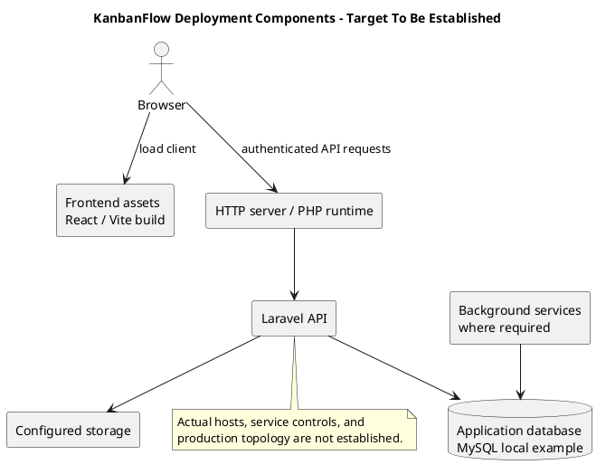

# KanbanFlow Deployment Architecture

## Repository-backed components

The runtime design contains a browser application built from `frontend/`, a Laravel backend from `backend/`, and persistent application data. The local example uses MySQL. Hosting layout, domains, redundancy, TLS termination, and service supervision remain environment-specific decisions; this document does not claim a deployed topology.

| Component | Operational responsibility |
| --- | --- |
| Browser/client assets | Serve the matching React/Vite build and support SPA navigation. `VITE_API_URL` must match the intended API when building. |
| HTTP server/PHP runtime | Route backend requests through its public entry point; configure transport, proxy handling, and runtime extensions for the target. |
| Laravel API | Authentication, resource ancestry, server authorization, validation, and database mutations. |
| Database | Domain records and configured session/cache/queue tables where those drivers are used. |
| Storage | Configured local/private/public disks or an explicitly configured external disk; protect private data. |
| Background services | Supervise workers/scheduled tasks only where actual application behavior and configuration require them. |

## Current configuration boundaries

The backend environment example uses database sessions, cache, and queues, and a local filesystem disk. [Filesystem configuration](../../../backend/config/filesystems.php) includes private/public local and S3 settings; S3 configuration is not proof of an active cloud deployment or implemented attachment feature. Determine the actual data written before defining backup scope.

The [queue configuration](../../../backend/config/queue.php) supports multiple drivers. Inventory actual queued work before prescribing worker scale or notification latency; PHPUnit's synchronous test setting does not demonstrate deployed asynchronous delivery.

## Trust and failure boundaries

Browser UI restrictions are not server authority. Public frontend assets may be cached, but credentials and private API data require the appropriate transport/session controls. Cross-origin SPA sessions depend on coordinated API URL, trusted stateful domains, CORS, and cookie settings. Shared service failures can affect sessions, cache, or queue work as well as domain data.

## Operational decisions still required

Record target hosts, TLS/proxy behavior, database version/isolation, storage locations, credential management, service controls, monitoring, backup retention, recovery objectives, and ownership. Assess scaling/session consistency if multiple API instances are introduced. Do not infer high availability from the component diagram.

See [environment review](environment-and-configuration.md), [system architecture](../04-design/system-architecture-diagram.md), and [backup runbook](backup-and-recovery-runbook.md).

## PlantUML diagram

[Editable PlantUML source](diagrams/deployment-architecture.puml)

